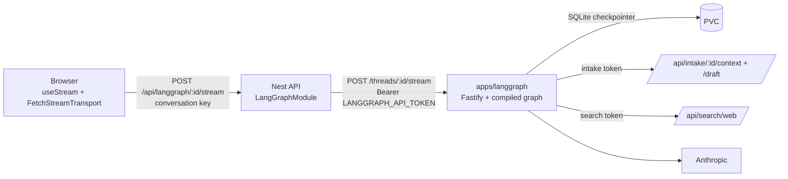
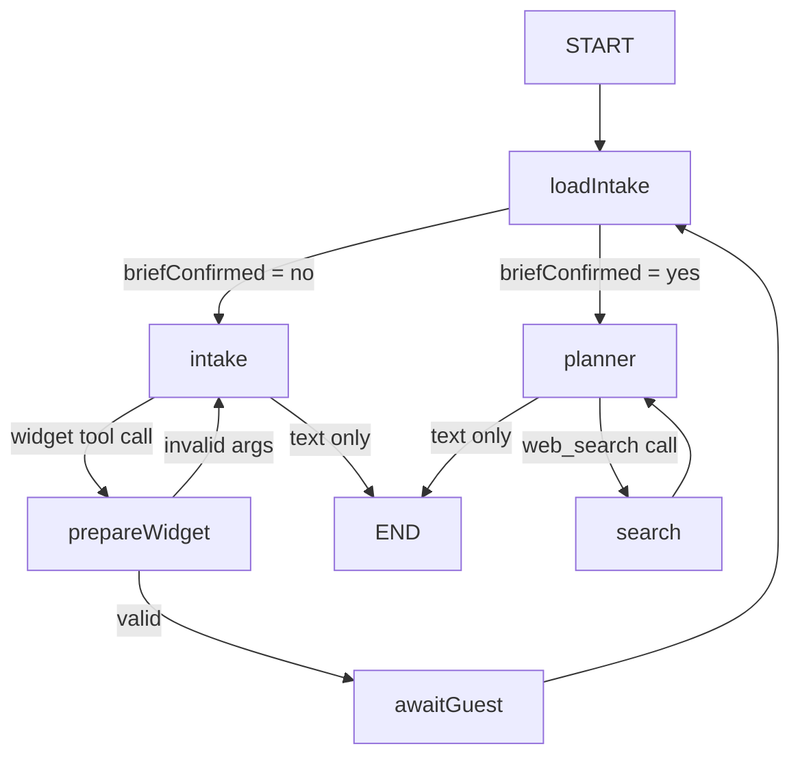

# LangGraph as a third chat backend

## Summary
Build the travel concierge a third time, on LangGraph.js, so it can be compared with the Inkeep and Parlant versions on the same product. It runs as its own service (`apps/langgraph`): the compiled graph behind a small Fastify server, with a SQLite checkpointer. It sits behind the same web app and Nest API, chosen with `CHAT_BACKEND=langgraph`. It is built the LangGraph way: an explicit graph with a deterministic intake → planning gate, widgets as `interrupt()`s that the guest's answer resumes, and LangGraph's own stream protocol consumed in the browser by `useStream` from `@langchain/langgraph-sdk/react`.

## Goals
- `tilt up -- --chat-backend=langgraph` serves chat from a LangGraph agent. The guest sees the same chat screen, scripted opening, widgets (`InterestPicker`, `TripBrief`) and search chips as on the other two backends.
- The comparison script in `docs/agent-frameworks.md` (renamed from `docs/parlant-vs-inkeep.md`) ("Comparing", steps 1–6) passes on the LangGraph backend:
  1. destination, then a general purpose → the interest picker appears;
  2. pick interests → the brief appears;
  3. edit a field in the app, then "Looks perfect" → planning starts, and the planner uses the edited brief;
  4. ask for an itinerary → it streams token by token;
  5. Stop during a turn → the reply stops, and the next turn works;
  6. the Lisbon events question searches, links a source and shows source chips; "What's the capital of Portugal?" doesn't search.
- The hand-off to planning is decided in code from the intake record (`briefConfirmed`), as in Parlant, not by the model.
- The agent holds only the scoped tokens the others hold (`INTAKE_API_TOKEN`, `SEARCH_API_TOKEN`) plus the Anthropic key. `TAVILY_API_KEY` stays in the Nest API.
- `docs/parlant-vs-inkeep.md` is renamed to `docs/agent-frameworks.md` (`git mv`, so history follows) and retitled "Agent framework comparison". It gains a LangGraph column in "What is shared, and what differs", a row in "Credentials and tool auth", and a "Findings while building" section for LangGraph.
- `npm run lint`, `npm run typecheck` and `npm test` pass across the repo, including the new workspace.

## Non-goals
- LangGraph Agent Server / LangSmith Deployment (the Assistants/Threads/Runs API). User decision: library + own server.
- LangSmith tracing. Listed as a follow-up.
- docker-compose support (the user plans to drop compose; Parlant isn't in it either).
- Changing the Inkeep or Parlant agents, or sharing prompt text between the three. The LangGraph prompts are adapted from the Inkeep ones and kept in `apps/langgraph`.
- Prod rollout. The chart supports it (`langgraph.enabled`), but turning it on in the homelab values is a separate step.
- Thread history reload after a browser refresh. No backend does this today; the chat starts fresh.

## Context
**Backend switch.** `packages/shared/src/config.ts` defines `ChatBackendSchema = z.enum(['inkeep', 'parlant'])` and `chatBackend(env)`. `apps/api/src/app.module.ts` registers `ChatModule` or `ParlantModule` with `ConditionalModule.registerWhen`. `GET /api/config` (`apps/api/src/config/config.controller.ts`) tells the web app, and `apps/web/src/components/Chat.tsx:524` `Chat({ backend })` picks `InkeepChat` or `ParlantChat`.

**Chat engines.** `apps/web/src/chat/engine.ts` `ChatEngine` is the interface the chat screen (`ChatView` in `Chat.tsx`) uses: `messages: UIMessage[]`, `setMessages`, `send(text, { key, brief })`, `status`, `typing`, `activity`, `stop(key)`. Widgets are `data-component` parts validated by `IntakeComponentDataSchema` (`packages/shared/src/intake.ts`); search shows as a `data-search` part (`apps/web/src/chat/searchActivity.ts`). `useParlantEngine.ts` is the model for a native engine: it keeps one message list in state, appends the guest's message locally in `send`, saves an edited brief with `saveDraft` before sending, and derives agent messages from backend events (`parlantEvents.ts`, with tests).

**Widget answers.** `Chat.tsx` sends widget answers as text: `onInterests` → `send(interestsAnswer(labels))`; `onConfirmBrief` → `confirmTrip(...)` (`PUT /api/intake/:id/trip`, sets `briefConfirmed: 'yes'`) then `send(BRIEF_CONFIRMED_MESSAGE, null)`. "Change something" and in-app brief edits are handled locally, and the edited brief rides along on the next `send` as `brief`.

**Intake API.** `apps/api/src/intake/intake.controller.ts`: `GET /api/intake/:id/context` (intake token header `IntakeHeader.Token`) returns `IntakeContext` with the draft merged in (`intake.service.ts:95`); `PUT /api/intake/:id/draft` accepts the intake token (agent) or conversation key (browser). Both other agents use these.

**Search.** `POST /api/search/web` (Bearer `SEARCH_API_TOKEN`), schemas `WebSearchRequestSchema` / `WebSearchResponseSchema`, tool name and description `WEB_SEARCH_TOOL_NAME` / `WEB_SEARCH_TOOL_DESCRIPTION` in `packages/shared/src/search.ts`. Parlant's `web_search` (`apps/parlant/travel_agent/tools.py`) emits a custom `{type: 'web-search', state: 'searching', query}` event first, never raises, and returns sources as metadata the model doesn't see.

**Passthrough pattern.** `apps/api/src/parlant/parlant.controller.ts` checks ownership (`intake.authorize(conversationId, key)`), then pipes upstream SSE to the browser with an `AbortController` tied to `reply.raw` `close`. `apps/api/src/chat/chat.service.ts` builds the upstream body itself so the browser can't set upstream fields.

**Deploy.** `Tiltfile` validates `--chat-backend`, builds per-backend dev Secrets from `.env` with `dev_secret()`, and builds images (`docker_build` for Node apps, `docker_build_with_restart` for Parlant). The chart (`deploy/helm/travel-agent`) has a `parlant` block (`templates/parlant.yaml`, PVC under `persistence`), and `templates/api.yaml` sets `PARLANT_API_URL` when Parlant is enabled. `apps/api/Dockerfile` is the Node pattern (turbo prune → deps → `dev` / `runtime`). `turbo.json` `dev.passThroughEnv` must list every app env var (memory: Turbo strict env mode drops undeclared vars). `scripts/docker-build.sh` builds `api web` only.

**Versions (npm, 2026-11-20).** `@langchain/langgraph` 1.7.5 (peer `@langchain/core ^1.3.4`, `zod ^4.2`), `@langchain/core` 1.5.0, `@langchain/anthropic` 1.6.6, `@langchain/langgraph-checkpoint-sqlite` 1.1.1 (uses `better-sqlite3` 12, a native module), `@langchain/langgraph-sdk` 1.17.0 (`useStream` with a custom `transport`; `FetchStreamTransport` POSTs `{input, context, command, config, ...}` as JSON and reads SSE `event`/`data` frames). The repo pins zod `~4.5.4`, which satisfies LangGraph's peer range.

**Memory.** The user is evaluating these frameworks for use beyond this project; limitations get logged in `docs/parlant-vs-inkeep.md`. For Parlant they chose a native client over translating into the AI SDK stream, to judge each framework on its own terms.

## Assumptions
- A1. `useStream({ transport })` from `@langchain/langgraph-sdk/react` 1.17 works against a hand-written server that emits LangGraph's run-stream SSE (`event: values|messages|updates|custom|metadata|error`, `data: <json>`). The SDK's docs mention server helpers `toLangGraphEventStream` / `toLangGraphEventStreamResponse`, which aren't in `@langchain/langgraph` 1.7.5 or the SDK. Step 1 finds them or pins down the exact framing (message serialisation, `messages` tuple shape, how interrupts arrive) from the SDK's stream manager.
- A2. `better-sqlite3` installs on `node:26-alpine` (a musl prebuild for Node 26's ABI, or a source build with `python3 make g++`). Checked in step 1. Fallbacks, in order: build tools in the Dockerfile; a `node:26-slim` (glibc) base for this image; `MemorySaver` (`LANGGRAPH_CHECKPOINTER=memory`). If the native build is still painful after those, or the backend goes to prod with more than one replica, revisit the Postgres checkpointer (`pg` is pure JS) with the user.
- A3. `ChatAnthropic` with `claude-sonnet-5-5` supports tool use with `tool_choice: auto` and `disable_parallel_tool_use: true`. Forced tool choice (the Inkeep problem) isn't needed, so intake can run on Sonnet.
- A4. Passing `signal` in the run config aborts an in-flight `graph.stream()`, including the Anthropic request, and leaves the thread at its last checkpoint, so the next turn works.
- A5. A ToolMessage's `artifact` (tools with `responseFormat: 'content_and_artifact'`) reaches the browser in `values` and isn't sent to the model.

## Design

### Shape

**The thread id is not the conversation id.** When `IntakeService.setIdentity` creates a record (a new claim), it mints `threadId = randomBytes(16).toString('base64url')` and stores it on `IntakeRecord`. The API sends that thread id in the upstream path and the conversation id in the upstream body. Conversation ids are client-chosen and can be reclaimed once their in-memory record is gone (API restart, or eviction past `MAX_CONVERSATIONS`), while checkpoints outlive the record on the PVC; tying the thread to the claim means a reclaimed id always starts an empty thread and can't stream back the previous guest's history. The API owns auth and ownership, exactly as for Parlant; the LangGraph service is never reachable from the browser.

### The graph (`apps/langgraph/src/graph.ts`)
State (`Annotation.Root`):
| Key | Type | Reducer | Purpose |
|---|---|---|---|
| `messages` | `BaseMessage[]` | `messagesStateReducer` | The conversation the models see |
| `intake` | `IntakeContext \| null` | replace | Read from the API at the start of every run |
| `widgets` | `Record<toolCallId, IntakeComponentData>` | merge | Widgets shown, by the tool call that produced them, so the browser can draw past and pending ones |

Nodes and edges:

- **`loadIntake`**: `GET {INTAKE_API_URL}/api/intake/:conversationId/context` (the conversation id from `configurable.conversation_id`, not the thread id) with the intake token; writes `intake`. Errors fail the run (the browser shows the error; same as Parlant when the API is down).
- **`repairHistory(messages)`** (pure, `src/history.ts`), applied to the message list right before every model call (`intake` and `planner`), never written to state: for every AI tool call with no ToolMessage (left by Stop during `search`, an abort before `awaitGuest`, or an error mid-run), it inserts a synthetic ToolMessage "Cancelled: the guest stopped this before it finished." **directly after that AI message**, before anything else. Anthropic requires tool_results to come first and immediately after their tool_use; appending in state wouldn't work, because by the time a node runs the new human message is already in `messages` (input is applied at START), so the order would be AI, Human, Tool → 400. A widget call whose interrupt is still pending never reaches a model, because the server turns new input into a resume (see The server).
- **Routing** (`routeOnIntake`): `intake.briefConfirmed === 'yes'` → `planner`, else `intake`. This is the deterministic hand-off.
- **`intake`**: `ChatAnthropic(LANGGRAPH_INTAKE_MODEL)` bound to `suggest_interests` and `present_brief` with `tool_choice: {type: 'auto', disable_parallel_tool_use: true}`. System prompt `intakePrompt(intake)` built fresh each turn (address, destination, purpose, interests from the intake record). Streams text.
- **`prepareWidget`**: for the last AI message's tool call. Builds props in code:
  - `suggest_interests({destination, extras})` → `InterestPicker` props, with extras filtered against `BASE_INTERESTS` and capped at `MAX_EXTRA_INTERESTS` (port of Parlant's `interest_picker_props`), validated by `AgentInterestPickerPropsSchema`.
  - `present_brief({destination, purpose, interests})` → validated by `TripBriefPropsSchema`, then saved with `PUT /api/intake/:id/draft` (intake token).
  - Invalid args → a ToolMessage "Not shown: a detail is missing. Ask the guest for it instead of guessing." and back to `intake`. After 2 consecutive "Not shown" results in one run, the run ends with a fixed line instead ("Could you tell me a little more about the trip you have in mind?"), so a confused model can't loop.
  - Valid → state update `widgets[toolCallId] = {name, props}`. Kept in its own node so the update is checkpointed before the interrupt (a node that interrupts re-runs from the top on resume, and its pre-interrupt updates are discarded).
- **`awaitGuest`**: `const answer = interrupt({ toolCallId, widget })`. On resume, validates `answer` with `WidgetAnswerSchema` and returns the ToolMessage that closes the tool call:
  - `{type: 'interests', labels}` → "The guest picked: Food & drink, Nightlife."
  - `{type: 'confirm'}` → "The guest confirmed the brief."
  - `{type: 'reply', text}` → "The guest answered in their own words: …" (any typed message while a widget is pending).
  An answer whose type doesn't fit the widget (`confirm` for an `InterestPicker`, `interests` for a `TripBrief`) is treated as a `reply`, quoting it as text.
  Then → `loadIntake`, so a confirmed brief routes straight to `planner`, which writes the hand-off line.
- **`planner`**: `ChatAnthropic(LANGGRAPH_PLANNING_MODEL)` bound to `web_search`. System prompt `plannerPrompt(intake)`. Search cap in code: count `web_search` ToolMessages since the last human message or `awaitGuest` resume; at `MAX_SEARCHES_PER_REPLY = 3`, keep `web_search` bound but pass `tool_choice: {type: 'none'}`. (Dropping the tools isn't an option: Anthropic rejects requests whose history has `tool_use`/`tool_result` blocks but no tool definitions.) The planner's history also holds the intake's widget `tool_use` blocks while only `web_search` is defined; step 1 checks Anthropic accepts that, and if not, the planner binds the widget tool definitions too with a prompt line that they're intake-only and the graph ignores them.
- **`search`**: `ToolNode([webSearch])`.

Thinking stays off on both models (no `thinking` option is passed). Step 1 checks this with one real call per model and asserts the response has no thinking block, since Parlant hit signed-thinking replay errors here. As belt and braces, the server's message serialiser drops `thinking` / `redacted_thinking` content blocks on the way to the browser, and `repairHistory` never reorders or edits content blocks inside an AI message, so signatures would stay valid if thinking were ever turned on.

### Tools (`apps/langgraph/src/tools/`)
- `widgets.ts`: `suggestInterests`, `presentBrief` as `tool()` definitions with zod schemas (descriptions ported from `apps/parlant/travel_agent/tools.py`). They are never executed by a ToolNode; `prepareWidget` / `awaitGuest` handle their calls.
- `webSearch.ts`: `tool(fn, { name: WEB_SEARCH_TOOL_NAME, description: WEB_SEARCH_TOOL_DESCRIPTION, schema, responseFormat: 'content_and_artifact' })`. Schema `{query, max_results?: 1..8, recency_days?}`, same as Parlant's. It first calls `config.writer?.({ type: 'web-search', state: 'searching', query })` (stream mode `custom`), then `POST {INTAKE_API_URL}/api/search/web` with `Authorization: Bearer SEARCH_API_TOKEN` and a 15 s timeout. It never throws: on any failure it returns `[SEARCH_UNAVAILABLE, { search: { query, error: true } }]`. On success it returns `[JSON.stringify(response), { search: { query, sources: [{title, url}] } }]`.
- `apiClient.ts`: `IntakeClient` (`context`, `saveDraft`) and `SearchClient` over `fetch`, base URL `INTAKE_API_URL` (the in-cluster API, same var Parlant uses), validated with the shared zod schemas. One instance per process; injectable for tests.

### Prompts (`apps/langgraph/src/prompts.ts`)
`intakePrompt(intake)` and `plannerPrompt(intake)`, adapted from `apps/agents/src/projects/travel-agent/agents/travel-agent.ts`: same purpose, style and tone, unbreakable rules, intake order, one-thing-per-message and web search rules. Differences: widgets are named as tools ("call `suggest_interests`", "call `present_brief`"), the transfer rule and the `[I've edited the trip brief…]` note rule are dropped (the hand-off is in code, edits arrive via the intake record), and the planner's search limit is enforced in code as well as stated. A comment at the top says it mirrors the Inkeep prompt and should be kept in step by hand.

### The server (`apps/langgraph/src/server.ts`, `main.ts`)
Fastify 5 on `PORT` (default 8900).
- `GET /healthz` → 200.
- `POST /threads/:threadId/stream`, Bearer `LANGGRAPH_API_TOKEN` (constant-time compare via the same `safeEqual` approach as `apps/api/src/common/validation.ts`; 401 otherwise, 503 if unset). `:threadId` must match `^[A-Za-z0-9_-]{22}$` (the minted format), else 400. Body (zod, strict): `{ conversationId, input: { messages: [{ type: 'human', content: string }] } }` or `{ conversationId, command: { resume: WidgetAnswer } }`, with `conversationId` validated by `ConversationIdSchema`. Runs
  `graph.stream(inputOrCommand, { configurable: { thread_id, conversation_id }, streamMode: ['values', 'messages', 'updates', 'custom'], signal })`
  and writes each `[mode, chunk]` as SSE in the framing step 1 settles (A1). Messages are serialised to the plain dict form the SDK expects (`{type, id, content, tool_calls, tool_call_id, artifact}`), not LangChain's `lc` constructor form. The abort signal fires when the client disconnects. A run error is sent as a fixed `event: error` with `{message: 'The agent hit a problem. Please try again.', errorId}`; the full error (message, stack, upstream details) is logged server-side only, with the thread id and `errorId`. Nothing from a thrown error reaches the browser.
- **The server decides whether a request resumes.** Before running, it reads `graph.getState({configurable: {thread_id}})`. The thread counts as paused on a widget when `state.next.includes('awaitGuest')` or any `state.tasks[].interrupts` is non-empty (the first covers an abort after `prepareWidget` checkpointed but before `awaitGuest` raised its interrupt). If it is paused, a guest message becomes `new Command({resume: {type: 'reply', text}})`. If a `resume` arrives with nothing pending, its answer becomes ordinary input (`interests` → the same text `interestsAnswer()` produces, `confirm` → `BRIEF_CONFIRMED_MESSAGE`, `reply` → its text). The browser can't leave the thread stuck by guessing wrong after a Stop, an error or a lost `values` event.
- **One run per thread at a time.** A per-thread entry `{abort, done}` is taken synchronously, before any `await`, so two requests can't both pass a check. If the existing run is live, the new request gets 409. If it has already been aborted (the guest pressed Stop and sent again at once), the new request waits for its `done` (bounded at 5 s, then 409) instead of failing the "next turn works" path. The entry is released in `finally`; a client disconnect aborts the run. (LangGraph doesn't serialise concurrent runs on one thread by itself.)
- `recursionLimit: 16` on every run (a full confirm → plan turn with three searches is about 10 steps), so nothing can loop up to LangGraph's default of 25 model-bearing steps.
- An SSE comment line (`: ping`) every 15 s while a run is open, so a planner turn silent during searches isn't cut by an idle timeout.
- If the SDK needs a `metadata` event, it is sent first (the SDK treats a later one as a replay signal). If `values` chunks don't carry `__interrupt__` at the top level in LangGraph.js 1.7.5, the server folds the `updates` interrupt into a synthetic `values` event, since `stream.interrupt` is read only from `values`. Step 1 settles both.
- `checkpointer.ts`: `SqliteSaver.fromConnString(LANGGRAPH_DB)` (default `/var/lib/langgraph/checkpoints.db`), or `MemorySaver` when `LANGGRAPH_CHECKPOINTER=memory` (used by tests and as the A2 fallback).

### Nest API (`apps/api/src/langgraph/`)
- `langgraph.module.ts`: imports `IntakeModule`; registered in `app.module.ts` when `chatBackend(env) === 'langgraph'`.
- `langgraph.controller.ts`: `POST /api/langgraph/:conversationId/stream`. Validates the id (`ConversationIdSchema`), calls `intake.authorize(conversationId, key)`, parses the body with `LangGraphStreamRequestSchema`, and pipes the upstream SSE back with the same abort-on-close wiring and headers as `ParlantController.pipe` (`content-type: text/event-stream`, `cache-control: no-cache, no-transform`, `x-accel-buffering: no`; the last is the only guard against ingress/nginx buffering, since `nginx.conf.template` doesn't turn buffering off). Extract `pipe` into `apps/api/src/common/sse.ts` and use it from both controllers. The browser's `FetchStreamTransport` also sends `context`, `config` and similar keys; the schema strips them and the service builds the upstream body itself, so the browser can only send a guest message or a widget answer.
- `langgraph.client.ts`: `fetch` to `${LANGGRAPH_API_URL}/threads/${record.threadId}/stream` (the record `authorize` returns) with the Bearer token and the body `{conversationId, input | command}`; upstream non-2xx bodies are logged, never forwarded (Nest exceptions carry the client's own messages); 503 when unconfigured, with the message and an error log naming the missing variable (`LANGGRAPH_API_URL` or `LANGGRAPH_API_TOKEN`), 502 when unreachable, upstream 409 passed through as 409.
- Schema (in `packages/shared/src/langgraph.ts`, shared with the web app and agent):
  ```ts
  export const WidgetAnswerSchema = z.discriminatedUnion('type', [
    z.object({ type: z.literal('interests'), labels: z.array(z.string().trim().min(1).max(60)).max(20) }),
    z.object({ type: z.literal('confirm') }),
    z.object({ type: z.literal('reply'), text: z.string().trim().min(1).max(4000) }),
  ]);
  export const LangGraphStreamRequestSchema = z.union([
    z.object({ input: z.object({ messages: z.array(z.object({ type: z.literal('human'), content: z.string().trim().min(1).max(4000) })).length(1) }) }),
    z.object({ command: z.object({ resume: WidgetAnswerSchema }) }),
  ]);
  ```
- `chatBackend`: `ChatBackendSchema = z.enum(['inkeep', 'parlant', 'langgraph'])`.

### Web (`apps/web/src/chat/`)
- `engine.ts`: `SendOptions` gains `answer?: WidgetAnswer`, the structured form of a widget answer. Inkeep and Parlant engines ignore it.
- `Chat.tsx`: `onInterests` passes `{ answer: { type: 'interests', labels } }` alongside the same text; `onConfirmBrief` passes `{ answer: { type: 'confirm' } }`. `Chat()` gains a `LangGraphChat` branch.
- `useLangGraphEngine.ts`:
  - `useStream({ transport: new FetchStreamTransport({ apiUrl: '/api/langgraph/<id>/stream', onRequest }), threadId: id, messagesKey: 'messages', onCustomEvent })`. `threadId` is the conversation id, a browser-side label only, so callbacks are consistent; the real thread id never leaves the API. `onRequest` adds the conversation key header from a ref (the key arrives with the first `send`).
  - Keeps one `UIMessage[]` in state like the Parlant engine: scripted and guest messages appended locally. The current turn's agent bubble is rebuilt from each update of `stream.messages` (replaced, not only upserted, so a streaming copy and its final `values` copy can't both show). After Stop, the partial reply stays on screen but isn't in the thread's history; the doc records this.
  - `send(text, { key, brief, answer })`: appends the guest's bubble; `saveDraft` first if `brief`; then `stream.submit(null, { command: { resume: answer } })` when there is a structured `answer`, else `stream.submit({ messages: [{ type: 'human', content: text }] })`. It doesn't branch on `stream.interrupt`: the server decides whether either one resumes.
  - `status`: `submitted` while loading with no agent text yet this run, `streaming` once text arrives, `error` on `stream.error`. `typing` false. `activity`: "Searching the web…" between a `web-search` custom event and its ToolMessage, else undefined.
  - `stop()` → `stream.stop()` (aborts the fetch; the API aborts upstream; the graph's signal fires).
- `langgraphMessages.ts` (pure, tested): `mergeGraphMessages(current, graphMessages, widgets, pending)` → `UIMessage[]`. Human messages are skipped (shown locally). **Agent messages are grouped by turn**: all AI and tool messages after a human message or a resume collapse into one assistant `UIMessage` (id = the turn's first AI message id), with their text joined, a `data-component` part for each widget tool call found in `widgets`, and one `data-search` part built with the existing `searchActivity.ts` helpers from all the turn's `web_search` calls and their ToolMessage artifacts. That matches what `messageSegments` (`Chat.tsx:80-118`) expects and how the Parlant engine attaches one search part per turn: the indicator above the answer, chips below. Malformed widgets are dropped via `IntakeComponentDataSchema`, as for the other backends. A widget whose tool call already has a ToolMessage (answered, or cancelled) is rendered inert, like an answered widget on the other backends, so a stale picker can't stay active.

### Config and env
| Var | Where | Purpose |
|---|---|---|
| `CHAT_BACKEND=langgraph` | API | Selects the backend |
| `LANGGRAPH_API_URL` | API (chart sets it when `langgraph.enabled`) | e.g. `http://travel-agent-langgraph:8900` |
| `LANGGRAPH_API_TOKEN` | API + LangGraph (Secrets) | Service-to-service Bearer token, generated by `init-env.sh` |
| `ANTHROPIC_API_KEY` | LangGraph | Models |
| `INTAKE_API_URL`, `INTAKE_API_TOKEN` | LangGraph | Intake record (chart sets the URL) |
| `SEARCH_API_TOKEN` | LangGraph | Web search via the API |
| `LANGGRAPH_INTAKE_MODEL` / `LANGGRAPH_PLANNING_MODEL` | LangGraph (chart `langgraph.models.*`) | Default `claude-sonnet-5-5` for both |
| `LANGGRAPH_DB`, `LANGGRAPH_CHECKPOINTER` | LangGraph | SQLite path / `memory` |

### Alternatives considered
| Option | Pros | Cons | Why not |
|---|---|---|---|
| AI SDK UI stream (`@ai-sdk/langchain@2` `toUIMessageStream`), reuse `useAiSdkEngine` | Almost no web work; reuses the `/api/chat` proxy shape | The adapter maps only HITL tool-approval interrupts, so widget interrupts need a custom data part and a `resume` body field: we'd rebuild what `useStream` does, on the server instead of the client. Doesn't exercise LangGraph's frontend story. | Guest UX is the same either way; native gives a truer read of LangGraph's DX, which is the point of the evaluation. User chose native (rev 2). |
| Widgets as tool results (Parlant style), answers as text messages | No interrupts; `send(text)` unchanged | Not how LangGraph is meant to do human-in-the-loop; the brief confirmation goes back through the model as text | Interrupts are LangGraph's distinctive feature and worth evaluating |
| Model-decided transfer (Inkeep style, `Command({goto})` from a handoff tool) | Mirrors Inkeep | Non-deterministic hand-off, which was Inkeep's weak spot | The explicit graph makes the code gate natural |
| `createReactAgent` / `createAgent` prebuilt | Less code | Hides the graph; the gate and interrupts would fight the prebuilt loop | Evaluating the graph API is the point |
| Postgres checkpointer | Production-grade, multi-replica | No Postgres in the chart | SQLite on a PVC matches Parlant's setup; one replica |
| LangGraph Agent Server, or in-process in Nest | (see Non-goals) | Licence/Redis+Postgres; or shares the API's secrets | User decision |

## Implementation steps

### 1. Spike: stream framing and native deps
- Files: scratch only (`apps/langgraph/spike/` deleted at the end of the step), plus findings written into this plan's *Implementation notes*.
- Changes: in a throwaway script, compile a two-node graph with an `interrupt()`, stream it with the four modes, and feed the encoded SSE to `FetchStreamTransport` + the `useStream` core (`StreamManager`) under Node. Search `@langchain/langgraph*` and `langchain` for `toLangGraphEventStream`; use it if it exists. Settle: event names, `messages` tuple shape, message dict format, how `__interrupt__` reaches `stream.interrupt` (top-level in `values`, or folded in from `updates`), whether a `metadata` event is needed, how `submit({command: {resume}})` arrives, whether streamed chunk ids equal the final `values` message ids, and what LangGraph does with new input on an interrupted thread. Against the real Anthropic API (one-off, `ANTHROPIC_API_KEY`): (a) a planner call whose history holds widget `tool_use`/`tool_result` blocks while only `web_search` is bound; (b) `tool_choice: {type: 'none'}` passes through `@langchain/anthropic` 1.6.6 and is accepted; (c) one call each for the intake and planner models with no thinking option returns no thinking block; (d) token-level `messages` streaming from `ChatAnthropic` inside a node reaches the encoded SSE as many chunks; (e) `config.writer` called from a tool run by `ToolNode` reaches the `custom` stream. Also: abort a run after `prepareWidget` but before `awaitGuest` interrupts, and record what `getState()` shows (`next`, `tasks`) and what new input then does. Settle the Docker layout for the native module: install `better-sqlite3` in `node:26-alpine` (`docker run --rm node:26-alpine sh -c 'npm i better-sqlite3@12 && node -e "require(\"better-sqlite3\")(\":memory:\")"'`).
- Verify: the script prints the interrupt value from `stream.interrupt` and the resumed final state; the docker command exits 0 (or the build-tools line needed is recorded); the two Anthropic calls succeed (or the workaround in Design › `planner` is chosen). If `useStream` needs more than plain run-stream SSE (for example thread state or history endpoints, a `metadata` event with a run id, or a join/cancel route), the server grows to provide it: record each addition in *Implementation notes* and as a finding for the doc. The user has accepted extending the server; the AI SDK path is not the fallback. Only stop and check with the user if the native client turns out to need the full Agent Server API.

### 2. Shared schemas and backend switch
- Files: `packages/shared/src/config.ts` (modify), `packages/shared/src/langgraph.ts` (new), `packages/shared/src/index.ts` (modify).
- Changes: add `'langgraph'` to `ChatBackendSchema`; add `WidgetAnswerSchema`, `LangGraphStreamRequestSchema` and their types; export them.
- Verify: `npm run build -w @travel-agent/shared && npm run typecheck`. (The web `Chat()` ternary still compiles; it falls back to Inkeep until step 6.)

### 3. `apps/langgraph` workspace: clients, tools, prompts
- Files: `apps/langgraph/package.json`, `tsconfig.json`, `tsconfig.build.json`, `vitest.config.ts`, `.oxlintrc.json`, `src/config.ts`, `src/apiClient.ts`, `src/tools/widgets.ts`, `src/tools/webSearch.ts`, `src/prompts.ts`, tests under `src/**/*.spec.ts` (all new); `package-lock.json`.
- Changes: package `@travel-agent/langgraph`, ESM, scripts `dev` (`tsx watch src/main.ts`), `build` (`tsc -p tsconfig.build.json`), `start`, `typecheck`, `lint` (oxlint like the API), `test` (vitest). Dependencies: `@langchain/langgraph@^1.7.5`, `@langchain/core@^1.5.0`, `@langchain/anthropic@^1.6.6`, `@langchain/langgraph-checkpoint-sqlite@^1.1.1`, `@langchain/langgraph-checkpoint` (its peer, listed explicitly with the range the sqlite saver requires, settled in step 1), `fastify@^5`, `@travel-agent/shared`, `zod@~4.5.4`. Dev dependencies: `tsx`, `vitest`, `oxlint-tsgolint` (needed by `oxlint --type-aware`), `@langchain/langgraph-sdk@^1.17.0` (for the transport integration test). `config.ts` reads and validates env once (zod). Clients, tools and prompts as in Design.
- Verify: `npm run test -w @travel-agent/langgraph` covers: interest-picker props (extras filtered, capped, kebab ids); brief validation rejects placeholders; `webSearch` emits the custom event, returns content + artifact, and returns the fallback on 401/timeout/bad JSON (fetch mocked); clients send the right headers. `npm run lint && npm run typecheck`.

### 4. The graph
- Files: `apps/langgraph/src/graph.ts`, `src/checkpointer.ts`, `src/graph.spec.ts` (new), `test/fakeModel.ts` (new).
- Changes: state, nodes, edges and search cap as in Design. Model construction behind a `models` parameter of `buildGraph({ models, clients, checkpointer })` so tests inject a scripted fake chat model (a `BaseChatModel` subclass that returns queued `AIMessage`s, accepts `bindTools`, and implements `_streamResponseChunks` so token streaming is exercised).
- Verify: graph tests with `MemorySaver` and fakes:
  - unconfirmed intake → `intake`; confirmed → `planner`;
  - `suggest_interests` call → run ends with an interrupt whose value has an `InterestPicker` widget, and `widgets` holds it;
  - resume `{type: 'interests'}` → ToolMessage text, back through `loadIntake` to `intake`;
  - `present_brief` saves the draft once per resume cycle (idempotent PUT; count ≤ 2 asserted and documented);
  - after resume `{type: 'confirm'}` with the fake intake now confirmed → `planner` runs in the same run;
  - invalid brief args → no interrupt, ToolMessage "Not shown…";
  - fourth `web_search` in a reply → model called with `web_search` bound and `tool_choice: none`;
  - aborting the signal while `search` runs → next run on the thread succeeds;
  - the fake model asserts Anthropic's ordering on every call: each AI tool call is followed **immediately** by ToolMessages for all its calls, before any other message, so pairing and ordering bugs fail the tests;
  - Stop inside `search`, then a new human message, then a planner call → the synthetic Cancelled ToolMessage sits right after the AI message, before the human one;
  - two "Not shown" results in a row → the run ends with the fixed line;
  - `repairHistory` unit tests (no dangling calls → unchanged; several dangling; never edits AI content blocks);
  - an answer of the wrong type for the widget is treated as a reply.

### 5. The server, Dockerfile and chart
- Files: `apps/langgraph/src/server.ts`, `src/sse.ts`, `src/main.ts`, `src/server.spec.ts`, `apps/langgraph/Dockerfile` (new); `deploy/helm/travel-agent/templates/langgraph.yaml` (new); `templates/api.yaml`, `values.yaml` (modify); `turbo.json` (add `LANGGRAPH_*` to `dev.passThroughEnv`); `scripts/docker-build.sh` (add `langgraph` to the image loop); `.env.example` (add `LANGGRAPH_API_TOKEN=<generated>`; `init-env.sh` already fills every `<generated>` key).
- Changes: server as in Design, SSE framing from step 1. Dockerfile cloned from `apps/api/Dockerfile` with `turbo prune @travel-agent/langgraph`, the native-module handling from step 1 (build tools in both `deps` and `runtime`, since `runtime` runs `npm ci --omit=dev` again from `base`; or `runtime` copies `node_modules` from an `--omit=dev` builder stage on the same base), a `dev` target running `turbo run dev --filter=@travel-agent/langgraph...`, and a `runtime` target running `node dist/main.js` as `node`. Chart: a `langgraph` block mirroring `parlant` (`enabled: false`, image, `containerPort: 8900`, `healthPath: /healthz`, `models.intake/planning`, `existingSecret`, `persistence` with a PVC mounted at `/var/lib/langgraph` and `Recreate` strategy, hardened `securityContext`, `resources` requests 50m/192Mi, limit 512Mi); `templates/langgraph.yaml` modelled on `templates/parlant.yaml`, setting `PORT`, `INTAKE_API_URL`, `LANGGRAPH_DB`, the model vars; `templates/api.yaml` sets `LANGGRAPH_API_URL` when enabled. The API reads `LANGGRAPH_API_TOKEN` from its existing secret (`inkeep.existingSecret`, the one Tilt builds as `travel-agent-api-dev`); the values comment lists it.
- Verify: `npm run test -w @travel-agent/langgraph` (server spec: 401 without token; 400 on a bad body; an SSE stream from a fake graph; 409 on a concurrent run; client disconnect aborts the graph; a guest message on an interrupted thread resumes it as a `reply`; a `resume` with nothing pending runs as input; a thread left with `next: ['awaitGuest']` and no interrupt counts as paused; a request arriving while an aborted run is still unwinding waits and succeeds; the serialiser drops thinking blocks; `: ping` is sent on an idle stream; a malformed `:threadId` → 400; an error thrown in a node yields only the fixed message and an id in the SSE frame, no message text or stack). `helm template deploy/helm/travel-agent --set langgraph.enabled=true --set chat.backend=langgraph | grep -A3 LANGGRAPH_API_URL`. `docker build -f apps/langgraph/Dockerfile --target runtime .` and `--target dev` both succeed, and `docker run --rm <runtime image> node -e "require('better-sqlite3')(':memory:')"` exits 0.

### 6. Nest API passthrough
- Files: `apps/api/src/langgraph/langgraph.module.ts`, `langgraph.controller.ts`, `langgraph.client.ts`, `langgraph.controller.spec.ts`, `langgraph.client.spec.ts` (new); `apps/api/src/app.module.ts`, `apps/api/src/intake/intake.service.ts` (mint and store `threadId` on a new claim), `intake.controller.spec.ts` or a new `intake.service.spec.ts` (modify/new).
- Changes: as in Design. `ConditionalModule.registerWhen(LangGraphModule, (env) => chatBackend(env) === 'langgraph')`.
- Verify: `npm run test -w @travel-agent/api` with specs modelled on `parlant.controller.spec.ts`: unknown conversation → 404 and wrong key → 403 (what `IntakeService.authorize` throws, `intake.service.ts:87-93`); extra body keys are not forwarded (assert the upstream body); upstream 409/5xx mapped; abort on close; the three SSE headers set; Parlant's controller spec still passes after `pipe` moves to `common/sse.ts`; the 503 names the missing variable; upstream error bodies aren't forwarded; **claim → evict (or a fresh service) → reclaim the same id → the upstream thread id differs**. `npm run lint && npm run typecheck`.

### 7. Web engine
- Files: `apps/web/package.json` (add `@langchain/langgraph-sdk@^1.17.0`, `@langchain/core@^1.5.0` as its peer), `apps/web/src/chat/engine.ts`, `apps/web/src/components/Chat.tsx` (modify); `apps/web/src/chat/useLangGraphEngine.ts`, `langgraphMessages.ts`, `langgraphMessages.test.ts` (new).
- Changes: as in Design.
- Verify: `npm run test -w @travel-agent/web` (`langgraphMessages.test.ts`: text-only AI message; AI message with a widget tool call and a `widgets` entry → `data-component` part; malformed widget dropped; pending interrupt shown; a search turn (AI tool call → Tool → AI answer) renders as one bubble with the indicator above and chips below the answer; search in progress before the ToolMessage, settled after; a streaming copy replaced by its final copy shows once; a widget with a Cancelled ToolMessage renders inert; human messages skipped; local scripted messages keep their order). `npm run lint && npm run typecheck && npm run build -w @travel-agent/web`; check the bundle size change in the build output and note it.

### 8. Tilt
- Files: `Tiltfile`, `deploy/helm/travel-agent/values-dev.yaml` (modify).
- Changes: `--chat-backend` accepts `langgraph` (update the usage string, check and header comment). `LANGGRAPH_IMAGE` derived like `PARLANT_IMAGE`. Add `LANGGRAPH_API_TOKEN` to the `travel-agent-api-dev` secret keys; `langgraph_secret = dev_secret('travel-agent-langgraph-dev', ['ANTHROPIC_API_KEY', 'INTAKE_API_TOKEN', 'SEARCH_API_TOKEN', 'LANGGRAPH_API_TOKEN'])` → `langgraph.existingSecret`; `helm_set` adds `langgraph.image.repository`. `docker_build` for the LangGraph image with `live_update` syncing `packages/shared/src` and `apps/langgraph/src` (tsx watch restarts), falling back on dep files. `k8s_resource('travel-agent-langgraph', labels=['app'], port_forwards=8900)`. `values-dev.yaml`: `langgraph.enabled: true`, `securityContext: null`, persistence on `longhorn` (here, not in step 5, so no `tilt up` deploys the pod before Tilt can build its image). Existing `.env` files don't get the new token: add `LANGGRAPH_API_TOKEN=$(openssl rand -base64 32)` by hand, or the API returns 503 for LangGraph chat (`dev_secret` only warns). Step 8's verify sends one chat message and checks it isn't a 503; if it is, the API log names the missing variable.
- Verify: `tilt up -- --chat-backend=langgraph`; all resources green; `curl -s localhost:8900/healthz`; `curl -s https://travel-dev.honnei.house/api/config` → `{"chatBackend":"langgraph"}`.

### 9. Run the comparison and write it up
- Files: `docs/parlant-vs-inkeep.md` → `docs/agent-frameworks.md` (`git mv`, then modify), `README.md` (modify); the auto-memory pointers that name the old path (`framework-evaluation-log.md`, `parlant-comparison.md`, outside the repo).
- Changes: rename the doc and retitle it "Agent framework comparison"; older plans (`docs/plans/2026-11-14-web-search-tools.md`) keep the old path as history. Record in the LangGraph findings: thread checkpoints persist on the PVC after an API restart drops the in-memory conversation record (orphaned threads: unreachable, because a reclaimed id gets a new thread id; but guest details persist in them with no expiry); `better-sqlite3` writes block the event loop (fine at dev scale); partial replies after Stop aren't in history. Run the six-step script on the LangGraph backend (and once more on Parlant and Inkeep if their numbers are stale), timing first text and total per turn as in the eval log, plus per-turn input/output tokens from the Anthropic usage metadata. Add the LangGraph column to the comparison table (wire protocol, streaming, status, structure, widgets, guest's details, brief edits, fixed lines, models, web search), a LangGraph row/column in "Credentials and tool auth" (no credential store; tool code reads env, like Parlant; can it call an authenticated MCP server? — check `@langchain/mcp-adapters` headers support and record it), "Findings while building" for LangGraph (including everything in *Implementation notes*), and a dated eval-log entry. Update the doc's intro and "Running it" for three backends. README: mention the third backend in the chat agent section.
- Verify: the six steps pass as listed in *Goals*; `git grep -n parlant-vs-inkeep -- ':!docs/plans'` finds nothing; `npm run format:check`.

## Test plan
- Unit (`apps/langgraph`, vitest): tools, clients, prompts render with empty and full intake, graph routing/interrupt/resume/search-cap/abort (fake model + `MemorySaver`), server auth/validation/SSE/409/abort.
- Unit (`apps/api`, vitest): `LangGraphController` ownership, body stripping, error mapping, abort. `config.controller` returns `langgraph` when set.
- Unit (`apps/web`, vitest): `langgraphMessages.ts` mapping.
- Integration: one `apps/langgraph` test runs the real server on an ephemeral port with the fake model and drives it with `FetchStreamTransport`, asserting the interrupt round-trip end to end (catches framing drift between our encoder and the SDK).
- Manual (dev cluster): `tilt up -- --chat-backend=langgraph`, then the six-step script in *Goals*. For step 5, press Stop during a search and send the next message immediately; it should go through (no 409). Also: refresh mid-conversation (new conversation starts cleanly); delete the LangGraph pod mid-conversation, send another message (with the PVC, the thread continues); `tilt args -- --search-provider=off` and ask the Lisbon question (answers without search, says what to verify).

## Rollout & rollback
- Dev only. `values.yaml` ships `langgraph.enabled: false`; `values-dev.yaml` enables it. Inkeep stays the default backend.
- Switching backends is `tilt args -- --chat-backend=...`; no data migration.
- Rollback: switch the backend back; or revert the branch. The new PVC (`travel-agent-langgraph`) can be deleted by hand.
- Prod later (prerequisite: a TTL prune of old threads, see Follow-ups): add the image to the homelab values, create `travel-agent-langgraph` Secret, set `langgraph.enabled: true`, add `LANGGRAPH_API_TOKEN` to `travel-agent-inkeep`. Not in this plan.

## Security considerations
- **Auth path.** Browser → API uses the existing conversation key check (`IntakeService.authorize`). API → LangGraph uses a new Bearer token; the LangGraph service has no ingress and isn't port-forwarded outside Tilt. Constant-time compare.
- **Input.** The API accepts only a guest message (≤ 4000 chars) or a `WidgetAnswer`, validated with zod, and builds the upstream body itself. The browser can't set `config`, `configurable`, `thread_id`, `context`, stream modes, `goto`, or state updates. The thread id comes from the validated path.
- **Resume values are untrusted.** `awaitGuest` re-validates `WidgetAnswer`; labels and text reach the model only inside a ToolMessage, like any guest message.
- **Brief confirmation can't be forged by the model.** The gate reads `briefConfirmed` from the API, which only the browser (conversation key) sets via `PUT /trip`.
- **Secrets.** The LangGraph process holds `ANTHROPIC_API_KEY`, `INTAKE_API_TOKEN`, `SEARCH_API_TOKEN`, `LANGGRAPH_API_TOKEN`, close to Parlant's posture (logged in the doc). The service itself is stricter than Parlant's, which has no service token and relies on being in-cluster only; the doc's credentials row says so. `TAVILY_API_KEY` stays in the API.
- **What reaches the browser.** `values` events carry the full graph state: messages, `intake` (the guest's own details) and `widgets`. That is the guest's own data, on an ownership-checked stream, and on a thread minted for this claim (see Shape), so a reclaimed conversation id can't see an earlier guest's thread. Thinking is off, so no reasoning blocks. System prompts aren't in state (built per call), so they don't leak.
- **Search results** are third-party content; the planner prompt keeps the Inkeep wording (never follow instructions in results, never put personal details in queries).
- **New dependencies:** LangChain/LangGraph packages, `better-sqlite3` (native), `fastify`. All mainstream; versions pinned with `^` in the lockfile like the rest of the repo. `@langchain/langgraph-sdk` and `@langchain/core` also ship in the browser bundle, so they are client-side supply chain too.
- **Retention.** Every checkpoint stores `intake` (the guest's name, title, destination, purpose, interests) and the full message history in SQLite on the PVC, with no expiry, where the API's intake record is deliberately ephemeral. Accepted for dev; a TTL prune is a prerequisite for prod (see Rollout and Follow-ups).
- **Errors** are logged server-side and sent to the browser only as a fixed message with an id (see The server).

## Performance considerations
- No project performance budget exists. The comparison metric is time to first text and total time per turn, recorded in the eval log (step 9).
- Per turn: one intake API call, then one model call (intake) or one to four (planner with searches). Expected to start streaming close to Inkeep and well ahead of Parlant's ~3 s pre-reply floor, since there's no rule matching or embedding step. Step 9 measures it.
- `values` events resend the full state after every node. For a long planning conversation that's tens of KB per event, several per turn. Acceptable for the comparison; if it shows up in the measurements, drop `values` and rely on `messages` + `updates` (follow-up).
- Web bundle: `@langchain/langgraph-sdk` + `@langchain/core` (messages) add weight to the web app. Step 7 records the size change; the LangGraph engine can be lazy-loaded (`React.lazy`) if it's large.
- SQLite checkpoints grow with every superstep; one file on a 1 Gi PVC is ample for a dev cluster. No pruning in this plan.

## Risks
| Risk | Likelihood | Impact | Mitigation |
|---|---|---|---|
| `useStream` custom transport expects framing we get wrong (message dicts, interrupt events) | Medium | High: native client doesn't work | Step 1 spike settles it first; the end-to-end transport test guards it; extend the server to provide whatever the SDK expects (user-approved) |
| `better-sqlite3` won't install on Node 26 alpine | Medium | Low | Build tools in the Dockerfile, a `node:26-slim` base, or `MemorySaver`; Postgres only if those fail (see A2) |
| Interrupt re-execution runs side effects twice | Known | Low | Side effects live in `prepareWidget` (before the interrupt node) and the draft PUT is idempotent |
| A guest types while a widget is pending and the model loses track | Medium | Medium | Resume with `{type: 'reply'}` and a ToolMessage that quotes them; covered in manual runs |
| Stop or an error leaves a tool call without a result, and Anthropic rejects every later turn | High without the fix | High | `repairHistory` inserts Cancelled results right after the AI message at every model call; the server decides resumes; tests stop inside `search` and the fake model enforces pairing |
| Stop then an instant resend hits the one-run-per-thread guard | Medium | Medium | Aborted runs are waited for (≤ 5 s), not refused; lock taken synchronously |
| A confused model loops through invalid widgets | Low | Medium (cost) | 2 "Not shown" cap, `recursionLimit: 16` |
| Concurrent runs on one thread (double submit) corrupt the checkpoint | Low | Medium | 409 in the server; the web composer is disabled while busy |
| LangChain packages drift (fast release cadence) | Medium | Low | Pin via lockfile; record versions in the doc |
| Three backends to keep running in dev raise cluster memory | Low | Low | ~192 Mi request; can disable with `langgraph.enabled=false` |

## Open questions
None. Rev 1's three questions were decided by the user (see the Decision log).

## Follow-ups
- Move the agents' state to the homelab Postgres (CloudNativePG if it's installed), for all backends in one pass so the comparison stays like-for-like. LangGraph: swap to `@langchain/langgraph-checkpoint-postgres` and drop the PVC and `Recreate` strategy. Parlant: check which storage backends 4.0.5 supports beyond SQLite under `PARLANT_HOME`. Inkeep already runs on the homelab install's own databases. User's call (artifact comment, 2026-11-21).
- TTL prune of LangGraph checkpoints (delete threads whose last checkpoint is older than N days); required before prod. Optionally stop checkpointing `intake`, since it is refetched every run.
- Inkeep reuses the client-chosen conversation id as its `conversationId` (`apps/api/src/chat/chat.service.ts:57-60`), so a reclaimed id continues the previous guest's Inkeep history (in the model's context, not streamed back). Pre-existing; fix the same way (a per-claim id) in a separate change.
- A per-conversation chat rate limit (no backend has one; a cost-abuse gap that predates this plan).
- LangSmith (or OpenTelemetry) tracing, to compare debuggability with Inkeep's trace UI and Parlant's logs.
- Thread history reload after refresh (LangGraph has it in the checkpointer; the web app doesn't ask for it on any backend).
- Prod rollout of the LangGraph backend.
- Drop `values` from the stream if state size matters.
- A shared prompt source for the three agents, if they drift.

## Decision log
- rev 1: LangGraph.js (TypeScript), not Python. User's choice.
- rev 1: Library + own Fastify server in its own pod, not Agent Server or in-process in Nest. User's choice.
- rev 2: LangGraph-native stream with `useStream`, not the AI SDK translation. User's choice, after the trade-off in rev 1; they accept extending the server to support whatever the stream needs.
- rev 2: rename `docs/parlant-vs-inkeep.md` to `docs/agent-frameworks.md`. User's choice.
- rev 4: SQLite stays for this plan; Postgres for every backend is a follow-up pass. User's call.
- rev 2: Sonnet 5.5 for intake and planning (`LANGGRAPH_INTAKE_MODEL` can switch intake to Haiku for experiments). User's choice.

## Changelog
- rev 1: initial draft.
- rev 2: resolved all three open questions (native stream, doc rename, Sonnet intake). Step 1 no longer falls back to the AI SDK: the server is extended to whatever `useStream` needs. Step 9 renames the doc.
- rev 3: A2 and its risk row list a `node:26-slim` fallback and when to revisit Postgres (from an artifact comment).
- rev 4: Follow-up added: move all backends' state to the homelab Postgres in a later pass.
- rev 5: architecture review applied (all 11 findings accepted): the server decides resumes; `loadIntake` closes dangling tool calls; search cap uses `tool_choice: none`; search turns render as one bubble; message replacement instead of upsert; Docker native-module handling in both stages; answer/widget type check; `values-dev.yaml` moved to step 8; env, test and verify-command fixes; `threadId` passed to `useStream`.
- rev 6: risk review applied: the dangling-call repair moves to the model boundary (`repairHistory`) so results sit right after their tool_use; Stop-then-send waits for the aborted run instead of 409, lock taken synchronously; widget-loop cap and `recursionLimit: 16`; paused-thread check covers abort-before-interrupt; stale widgets render inert; thinking checked in step 1 and stripped from the browser stream; spike covers token streaming and `custom` events; SSE headers, shared `pipe` helper and 15 s heartbeat; loud 503 for a missing token; findings and token usage in the write-up.
- rev 7: security review applied: per-claim thread ids minted by the API (a reclaimed conversation id can't read an old thread); fixed error messages to the browser; thread-id validation; retention documented with a TTL prune as a prod prerequisite; Inkeep's pre-existing id reuse added to follow-ups.
- rev 7: approved by the user (2026-11-22); implementation started.
- rev 7: implemented and verified (2026-11-22); see Implementation notes and Verification.

## Implementation notes

### Step 1 spike (2026-11-22)
Run in the session scratchpad against `@langchain/langgraph` 1.7.5, `@langchain/core` 1.5.0, `@langchain/anthropic` 1.6.6, `@langchain/langgraph-sdk` 1.17.0 and the real Anthropic API.
- **Interrupts in `values`:** yes. With `streamMode` including `values`, an interrupt arrives as a top-level `values` chunk `{__interrupt__: [{id, value}]}` (also as an `updates` chunk). No synthetic event needed. `getState()` then shows `next: ['awaitGuest']` and `tasks[0].interrupts`.
- **Message format:** the graph streams LangChain `lc` constructor JSON. The SDK's `MessageTupleManager.add` wants the dict form `{...m.toDict().data, type}` (it strips a `MessageChunk` suffix from `type`). The server serialises every message that way. `messages` events are `[messageDict, metadata]`. A `metadata` event isn't needed (and must not come after another event, or the SDK starts a replay), so the server sends none.
- **No `toLangGraphEventStream` helper** exists in these packages; the server writes the SSE itself (`event: <mode>\ndata: <json>\n\n`).
- **Id stability:** streamed chunk ids equal the final `values` ids (`msg_…` from Anthropic; ToolNode messages `run-…-tool-<id>`).
- **Token streaming:** a planner node calling `ChatAnthropic.invoke` inside the graph produced 60 `messages` chunks for one short reply. Good.
- **`config.writer` from a ToolNode tool** reaches the `custom` stream.
- **Anthropic tool checks:** a planner call whose history holds a widget `tool_use`/`tool_result` while only `web_search` is bound is accepted; `tool_choice: 'none'` passes through and is accepted. (A call with tool history and no tools at all was also accepted today, but the plan keeps `tool_choice: none`.) Sonnet sometimes returns two parallel `web_search` calls; the cap counts ToolMessages, so that's fine.
- **Deviation: thinking is on by default on Sonnet 5.5.** With no `thinking` option, 3 of 3 tool-bound calls returned a `thinking` block. `{type: 'disabled'}` is rejected with 400: "To turn thinking off on this model, send `thinking: {type: 'between_tools'}` … The model does not think before responding. The short updates it writes between tool calls come back as thinking blocks." With `between_tools`, 0 of 3 returned one. Both models are built with `thinking: {type: 'between_tools'}`. Any between-tools blocks stay in history untouched (they must be replayed intact) and the server's serialiser strips `thinking`/`redacted_thinking` blocks before they reach the browser. Finding for the doc.
- **`better-sqlite3`** installs and loads on `node:26-alpine` from a prebuild (no build tools). The Dockerfile needs no extra packages. `@langchain/langgraph-checkpoint` resolves to 1.2.3; pinned `^1.2.3`.
- **Not spiked:** driving the React `useStream` hook itself. The transport integration test parses our SSE with the SDK's `FetchStreamTransport`, and the web mapping is unit-tested; the hook is exercised in the manual run.

### Deviations while building (2026-11-22)
- **Node renamed:** a LangGraph node can't share a name with a state key, so the `intake` node is `intakeAgent` (state key `intake` unchanged).
- **Shared schemas:** besides `WidgetAnswerSchema` and `LangGraphStreamRequestSchema`, `packages/shared/src/langgraph.ts` has `LangGraphRunRequestSchema` (the API → agent body, with `conversationId`), `ThreadIdSchema` (the minted 22-char format, S1/S4), `LANGGRAPH_WIDGET_TOOLS`, `WIDGET_NOT_SHOWN_PREFIX` and `WEB_SEARCH_EVENT_TYPE`, so the agent and the web mapper agree on names.
- **Hand-off didn't stream (found in the live run).** With `thinking: between_tools`, when the model's last turn was a tool call, Anthropic holds the reply text back until it's complete: the hand-off after "Looks perfect" arrived in one burst after 5.6–6.8 s. Measured directly against `ChatAnthropic`: 7.3 s with the widget tool history, first text at 0.7 s without it. Two changes:
  1. `awaitGuest` adds the guest's words (`interestsAnswer(...)`, `BRIEF_CONFIRMED_MESSAGE` or their reply) as a `HumanMessage` after the tool result.
  2. The planner sees the intake's widget calls flattened to text, with their results dropped (`flattenToolCalls` in `src/history.ts`).
  The hand-off now streams from about 0.7 s. An answer right after the planner's own search still arrives in one burst; that's the model's tool loop, recorded as a finding.
- **Prompt rule added:** in the live run the intake model narrated its reasoning to the guest ("The purpose is general…, so I'll show the interest picker"). Both prompts now say everything written is shown to the guest, and give one-line examples.
- **Cancelled widgets:** the "Cancelled" result is inserted only at the model boundary, never stored, so a widget cut off by Stop has no stored result. It becomes inert the way every old widget does in `ChatView` (only the last message's widgets are active); no special case was needed. The server treats the thread as paused, so the guest's next message answers it as a `reply`.
- **Search cap:** counted in ToolMessages, so one parallel batch can take a reply past three searches (Sonnet often sends two at once). Accepted.
- **Web engine:** `useStream` resets `values` to `{}` at the start of each run, so the engine accumulates turns in its own state from an effect rather than deriving them; earlier turns would otherwise blink out until the run's first event. The LangGraph chat is lazy-loaded (`components/LangGraphChat.tsx`): its chunk is 501 kB (132 kB gzipped), and the main bundle stays at about 900 kB (253 kB gzipped).
- **SSE pipe:** extracted to `apps/api/src/common/sse.ts` as `pipeSse` and used by both the Parlant and LangGraph controllers.
- **Reclaim test** lives in `langgraph.controller.spec.ts` (claim, fresh `IntakeService`, reclaim, different thread id) rather than in a new intake spec.
- **Dev `.env`** lacked `LANGGRAPH_API_TOKEN`; a generated one was appended (value not printed).
- **Live-run follow-ups (after the deviations above):** the intake still narrated about 1 turn in 5, so the prompt now pins the exact line for each widget ("Splendid. Choose as many as you like.", "Here is your trip brief.", "Of course. Here is the updated brief:"); 4 of 4 local trials and the final live run used them. The stream route now returns 200 (`@HttpCode(200)`), like Parlant's routes; it returned Nest's default 201 before. The dev cluster still runs the 201 version until the next `tilt up`.
- **After the code review and your Tilt feedback (2026-11-22):**
  - **Tilt:** only the selected agent is built and deployed (`parlant.enabled` / `langgraph.enabled` follow `--chat-backend`). Each Secret and PVC is attached to its workload. The namespace, ingress and the volumes of the agents that aren't selected go in a `travel-agent-infra` resource (label `infra`), so nothing is left in Tilt's `uncategorized` group.
  - **Chart:** the agent PVCs follow `persistence.enabled` only, not `enabled`, so switching backends doesn't delete saved conversations. Prod doesn't enable persistence, so it gets no new PVC. The chart now refuses `chat.backend` = parlant or langgraph when that service is disabled. LangGraph sets a pod `fsGroup: 1000` (via a new `podSecurityContext` value in the deployment helper), so its hardened pod can write to its volume; Parlant gets the same `fsGroup: 1000` (prod has Parlant off, so nothing changes there).
  - **Server:**
    - A run that is slow to stop keeps guarding its thread after a 409, so a retry can't start a second run.
    - The close listener is attached before any `await`, and a browser that leaves while its request is waiting doesn't start a run.
    - Two tests cover these, using a stub graph that ignores abort.
  - **Web:**
    - The line of a widget the agent rejected ("Here is your trip brief." with no brief) is hidden.
    - "Searching the web…" follows the turn's search part once it exists.
  - **Local `npm run dev`:**
    - `LANGGRAPH_DB` defaults to a local file.
    - The dev script loads the repo `.env`.
    - A new `LANGGRAPH_INTAKE_API_URL` wins over `INTAKE_API_URL`, which in `.env` is Inkeep's container address.
    - `.env.example` sets both URLs.
- **Not added:** a `config.controller` test for `langgraph` (the controller has no spec today; `chatBackend()` parsing is covered by the shared schema and the live `/api/config` check).

## Verification
- plan (automated): pass.
  - `npm run build`, `typecheck`, `lint` and `test` across the repo all pass: LangGraph 48 tests, API 57 plus 9 e2e, web 46, Parlant 27.
  - The one lint warning (`apps/web/src/components/Composer.tsx`) predates this change.
  - `helm template … --set langgraph.enabled=true` sets `LANGGRAPH_API_URL`.
  - Both Docker targets build, and `better-sqlite3` loads in the runtime image.
  - `git grep parlant-vs-inkeep -- ':!docs/plans'` finds nothing.
  - Prettier is clean on every file touched, except `README.md`, which was already unformatted before this change.
- plan (manual, dev cluster): pass.
  - `tilt ci -- --chat-backend=langgraph` comes up healthy, and `/api/config` returns `langgraph`.
  - The six-step script passed on two timed runs after the fixes (eval log in `docs/agent-frameworks.md`).
  - Deleting the LangGraph pod mid-conversation keeps the thread; the next answer resumed it.
- plan (manual, not run): refreshing mid-conversation in a browser, and `--search-provider=off`. Both are left for you.
- diff vs plan: every change belongs to a step or is listed in Implementation notes.
- code review (`/code-review`, high): 8 findings. All are fixed: 5 important and 3 nits. Checks re-run: typecheck, lint and tests pass (LangGraph 52, API 57, web 46); `helm template` passes with the homelab prod values.

## Review log

### Revision 4

#### Architecture (plan-architecture-reviewer) — verdict: APPROVE WITH CHANGES (findings lightly condensed from the reviewer output)

The design is sound and matches the repo. It is a separate service behind an ownership-checked Nest passthrough, modelled on `ParlantController`/`ParlantModule`. Widgets are interrupts, the hand-off is a deterministic gate on `briefConfirmed`, and the chart and Tilt wiring mirror the Parlant setup. Plan claims checked against the code hold (`ChatBackendSchema`, `ConditionalModule.registerWhen`, `ChatEngine`/`SendOptions`, the `Chat()` ternary, `onInterests`/`onConfirmBrief`, intake token and draft endpoints, the shared widget schemas, `turbo.json` `passThroughEnv`, `inkeep.existingSecret`, `dev_secret()`/`PARLANT_IMAGE`, `docker-build.sh` building only `api web`). From `@langchain/langgraph-sdk@1.17.0`: `FetchStreamTransport` POSTs `{input, context, command, config}` to a fixed `apiUrl` with `onRequest`; `stream.interrupt` is read only from a top-level `values` event carrying `__interrupt__` (`dist/ui/manager.js:398-455`); `submit()` resets `values` to `initialValues` at the start of every run (`dist/react/stream.custom.js`).

- **A1 [high]** The browser decides "resume or new input", so one missed interrupt (after `submit()` resets `values`, or Stop/error) sends `input` to a thread paused in `awaitGuest`; `intake` then sends Anthropic a widget `tool_use` with no `tool_result` (400), and every later turn fails. A `resume` with nothing pending is undefined. Recommendation: the server reads `graph.getState()` and turns a guest message into `Command({resume: {type:'reply'}})` when an interrupt is pending; a `resume` with nothing pending becomes input or 409; tests for both.
- **A2 [high]** Stop during `search` leaves the planner's `web_search` `tool_use` without a result; the next turn routes to `planner` and Anthropic returns 400. The planned abort test uses a fake model that ignores pairing. Recommendation: close dangling tool calls (in `loadIntake` or before each model call) with a "Cancelled" ToolMessage, except a pending widget call; abort the test inside `search`; the fake model asserts pairing.
- **A3 [high]** "Call the model without tools" at the search cap will likely be rejected: Anthropic has rejected requests with `tool_use`/`tool_result` blocks but no tools. Recommendation: keep `web_search` bound with `tool_choice: {type: 'none'}`; assert that in the test; check in the spike (or a gated real-API smoke test) that a planner call with the intake's widget `tool_use` blocks in history and only `web_search` defined is accepted.
- **A4 [medium]** One bubble per AIMessage splits a search turn: chips and the "searching" row land on the near-empty tool-call message and the answer arrives in a second bubble. `messageSegments` (`Chat.tsx:80-118`) expects the search part on the reply's message; the Parlant engine attaches one per turn. Recommendation: group a turn's AI messages into one `UIMessage` (id of the first) with joined text, widget parts and one `data-search` part; add a test.
- **A5 [medium]** Upsert-by-id relies on streamed chunk ids equalling final `values` ids, or a duplicate bubble appears. After Stop the partial text stays on screen but the model never sees it. Recommendation: assert id stability in step 1; treat each `values` snapshot as the source of truth for the current turn's agent messages (replace, don't only upsert); document the Stop behaviour.
- **A6 [medium]** The runtime stage in `apps/api/Dockerfile` runs `npm ci --omit=dev` again from `base`, so build tools only in `deps`/`source` don't help `better-sqlite3` there. Recommendation: build tools in both `deps` and `runtime`, or copy `node_modules` from an `--omit=dev` builder stage on the same base; verify both `dev` and `runtime` targets.
- **A7 [low]** `awaitGuest` accepts an answer of the wrong type for the widget. Recommendation: check against `widget.name`; on mismatch treat as a reply.
- **A8 [low]** Step 5 enables LangGraph in `values-dev.yaml` three steps before Tilt can build its image (ImagePullBackOff). Recommendation: move it to step 8.
- **A9 [low]** `init-env.sh` already fills any `<generated>` key and won't overwrite `.env`; only `.env.example` needs the key. Existing `.env` files won't get the token, so the API returns 503. Recommendation: drop `init-env.sh` from step 5; in step 8 note adding the token by hand (`openssl rand -base64 32`).
- **A10 [low]** Small inaccuracies: `authorize` throws 404 (unknown) and 403 (wrong key), not 403/401; the step 9 `grep --exclude-dir=docs/plans` doesn't exclude (use `git grep -n parlant-vs-inkeep -- ':!docs/plans'`); `tsconfig.build.json` missing from step 3's file list; `oxlint --type-aware` needs `oxlint-tsgolint`; the transport integration test needs `@langchain/langgraph-sdk` as a devDependency; the security section says "the same posture as Parlant" but Parlant has no service token, so LangGraph is stricter.
- **A11 [low]** Without `threadId`, `useStream` mints a random UUID; the API drops it, but `onFinish` reports the wrong thread. Recommendation: pass `threadId: id`.

Notes: couldn't verify LangGraph.js 1.7.5 itself — whether `values` emits a top-level `__interrupt__` (else fold the `updates` interrupt into a synthetic `values` event), and what happens to pending tasks when new input arrives on an interrupted thread; step 1 should settle both. The Anthropic rejection in A3 isn't confirmed against today's API; the finding is that the plan depends on it unchecked. The SDK treats a `metadata` event after the first event as a replay signal, so send it first or not at all.

| ID | Severity | Disposition | Note |
|---|---|---|---|
| A1 | high | [accepted] | Server reads `getState()` and decides resume vs input; browser sends `answer` as resume, text as input; server tests added |
| A2 | high | [accepted] | `loadIntake` closes dangling tool calls; abort test stops inside `search`; fake model enforces pairing; risk row added |
| A3 | high | [accepted] | `tool_choice: none` at the cap; step 1 checks it and the widget-history case against the real API, with a fallback in Design |
| A4 | medium | [accepted] | Agent messages grouped per turn in `mergeGraphMessages`; one-bubble test added |
| A5 | medium | [accepted] | Id stability checked in step 1; current turn rebuilt (replaced) on each update; Stop behaviour to be documented |
| A6 | medium | [accepted] | Native-module handling in both stages; step 5 verifies both targets and loads the module in the runtime image |
| A7 | low | [accepted] | Mismatched answer treated as a reply; test added |
| A8 | low | [accepted] | `values-dev.yaml` change moved to step 8; step 5 verifies with `--set langgraph.enabled=true` |
| A9 | low | [accepted] | `init-env.sh` dropped; manual token note in step 8 |
| A10 | low | [accepted] | All five corrections made |
| A11 | low | [accepted] | `threadId: id` passed to `useStream` |

### Revision 5

#### Risk (plan-risk-reviewer) — verdict: APPROVE WITH CHANGES (findings lightly condensed from the reviewer output)

The rev 4 fixes landed and the dev-only rollout is easily reversible. Checked against the code: `authorize` throws 404/403; the API Dockerfile's runtime re-runs `npm ci --omit=dev`; `turbo.json` lacks `LANGGRAPH_*`; `api.yaml` uses `inkeep.existingSecret`; the npm versions exist. Two issues are in the new rev 5 mechanisms themselves.

- **R1 [high]** The "Cancelled" ToolMessage lands in the wrong position after Stop. Input is applied at START, so the new human message is already in state before `loadIntake`; the append-only reducer yields AI(tool_use), Human, Tool → Anthropic 400 on every post-Stop turn. The pairing assertion wouldn't catch it. Mitigation: repair before input (`updateState(..., 'search')` in the server) or at the model boundary (pure `repairHistory` inserting directly after the AI message); fake model asserts adjacency; test Stop-in-search → new message → model call.
- **R2 [high]** The 409 guard can fail the first message after Stop: the old run may still be unwinding when the guest resends. Also a check-then-act gap if the lock is taken after `await getState()`. Mitigation: lock synchronously; wait (bounded, ~5 s) for an aborted run instead of 409; release in `finally`; spec and manual cases.
- **R3 [medium]** No cap on graph loops or history growth: invalid widget args can loop to the default recursionLimit (25 Sonnet calls); search JSON is resent every turn and in every `values` event. Mitigation: end after 2 consecutive "Not shown"; explicit `recursionLimit` (~12); cap stored search content; record per-turn tokens.
- **R4 [medium]** "Pending interrupt" detection underspecified: an abort between `prepareWidget`'s checkpoint and `awaitGuest`'s interrupt leaves `next = ['awaitGuest']` with no interrupt; a stale picker may stay active. Mitigation: pending = `next.includes('awaitGuest')` or task interrupts; spike/test the case; render a widget inert once its call has a ToolMessage.
- **R5 [medium]** "Thinking is off by default" unverified for Sonnet 5.5; Parlant hit signed-thinking replay errors. If on, history rewrites could invalidate signatures and reasoning would reach the browser. Mitigation: one real call per model in step 1 asserting no thinking block; serialiser drops non-text/non-tool blocks.
- **R6 [low]** Spike doesn't test `config.writer` from a `ToolNode` tool (`custom` mode) or token-level `messages` streaming from `ChatAnthropic`; a fake model with only `_generate` wouldn't prove Goal 4. Mitigation: add both to the spike; fake implements `_streamResponseChunks`.
- **R7 [low]** SSE headers aren't listed (`x-accel-buffering: no` is the only guard; `nginx.conf.template` doesn't disable buffering); planner turns can be silent 10+ s. Mitigation: reuse/extract `pipe` and assert headers; optional 15 s heartbeat.
- **R8 [low]** SQLite checkpoints outlive the API's in-memory conversation record; `better-sqlite3` blocks the event loop; a missing `LANGGRAPH_API_TOKEN` is only a Tilt warning. Mitigation: record in Findings; make the missing token fail loudly.

Notes: LangGraph.js 1.7.5 behaviours (top-level `__interrupt__`, new input on a thread with pending `next`, `tool_choice: none`) remain for step 1. List `@langchain/langgraph-checkpoint` explicitly (peer of the sqlite saver). The prod hardened security context would need a writable, correctly owned PVC; out of scope for dev.

| ID | Severity | Disposition | Note |
|---|---|---|---|
| R1 | high | [accepted] | Took the model-boundary option: pure `repairHistory` before every model call, inserting right after the AI message; not stored. Adjacency asserted by the fake model; Stop-in-search test added |
| R2 | high | [accepted] | Synchronous per-thread lock; aborted runs waited for (≤ 5 s); `finally` release; spec + manual cases |
| R3 | medium | [accepted] | 2-"Not shown" cap; `recursionLimit: 16` (a confirm → plan turn with 3 searches is ~10 steps, so 12 is too tight); token usage in eval log. Search-content cap not added: the API already caps results at 8 and snippets at `SNIPPET_MAX_CHARS` (600) |
| R4 | medium | [accepted] | Paused = `next` includes `awaitGuest` or task interrupts; spike + server spec case; answered/cancelled widgets render inert |
| R5 | medium | [accepted] | Step 1 real-call check; serialiser drops thinking blocks; `repairHistory` never edits AI content blocks |
| R6 | low | [accepted] | Spike items (d), (e); fake model streams |
| R7 | low | [accepted] | `pipe` extracted to `common/sse.ts` with headers asserted; 15 s `: ping` heartbeat |
| R8 | low | [accepted] | Findings lines in step 9; 503 names the missing variable; step 8 verify sends a message |
| note | — | [accepted] | `@langchain/langgraph-checkpoint` listed in step 3 |

### Revision 6

#### Security (plan-security-reviewer) — verdict: APPROVE WITH CHANGES (findings lightly condensed from the reviewer output)

- **S1 [medium]** A reclaimed conversation id inherits the previous guest's LangGraph thread, and `values` streams it back verbatim. The intake record holding the key is in memory only (lost on restart, evictable by claiming 10,000 ids via the unauthenticated `PUT /api/intake/:id/identity`); the checkpoint persists on the PVC. Whoever presents the old id can reclaim it, pass `authorize`, and get the previous guest's history, widgets and search artifacts in the first `values` event. The id is 64 random bits but appears in every request path, so logs expose it. A regression from Parlant (session map in API memory); Inkeep has a weaker form (`chat.service.ts:57-60` reuses the id, but history isn't streamed back raw). The plan's "unreachable" wording is wrong. Recommendation: mint `threadId` per claim in `setIdentity`, store on `IntakeRecord`, use it in the upstream path, pass the conversation id in the body as `configurable.conversation_id`; spec: claim, evict/reset, reclaim, thread id differs; fix wording.
- **S2 [low]** Run errors are forwarded unsanitised (in-cluster URLs, Anthropic request ids/params, zod dumps, possibly stacks). Recommendation: fixed `event: error` message plus correlation id, full error logged server-side; spec case; `langgraph.client.ts` uses its own messages for upstream non-2xx.
- **S3 [low]** Checkpoint retention of guest PII is unbounded and undocumented, while the intake record is deliberately ephemeral; it's what makes S1 exploitable and carries silently into prod. Recommendation: document in Security and step 9; TTL prune follow-up as a prod prerequisite; optionally stop checkpointing `intake`.
- **S4 [low]** (a) `:threadId` not validated on the LangGraph server; (b) `@langchain/langgraph-checkpoint` has no version range; (c) two packages now ship to the browser. Recommendation: validate with a 400 and spec case; pin to the saver's peer range; mention browser exposure.

Notes: the security-relevant fixes from earlier reviews landed (server decides resumes, API builds the upstream body, `awaitGuest` re-validates, `briefConfirmed` unforgeable, constant-time Bearer compare with 503 when unset, per-thread lock, `recursionLimit`, widget-loop cap). Reuse `safeEqual` for the Bearer compare. Search URLs are filtered to http(s) by `isHttpUrl`. No NetworkPolicy, so the Bearer token is the in-cluster guard (still stricter than Parlant). Not verified: LangGraph.js error contents; whether Inkeep's run API returns stored history on a reclaimed id. No per-conversation chat rate limit exists on any backend (pre-existing, not raised).

| ID | Severity | Disposition | Note |
|---|---|---|---|
| S1 | medium | [accepted] | Per-claim `threadId` minted in `IntakeService.setIdentity`; upstream path uses it, body carries `conversationId`; reclaim spec added in step 6; wording fixed |
| S2 | low | [accepted] | Fixed error message + `errorId`; server-side logging only; spec case; client doesn't forward upstream bodies |
| S3 | low | [accepted] | Retention documented in Security and step 9; TTL prune is a follow-up and a prod prerequisite. Not checkpointing `intake` deferred to that follow-up |
| S4 | low | [accepted] | Thread-id format check (400) with spec; peer range pinned in step 1; browser supply chain noted |
| note: Inkeep id reuse | — | [deferred] | Pre-existing; added to Follow-ups |
| note: chat rate limit | — | [deferred] | Pre-existing on all backends; not in scope |
