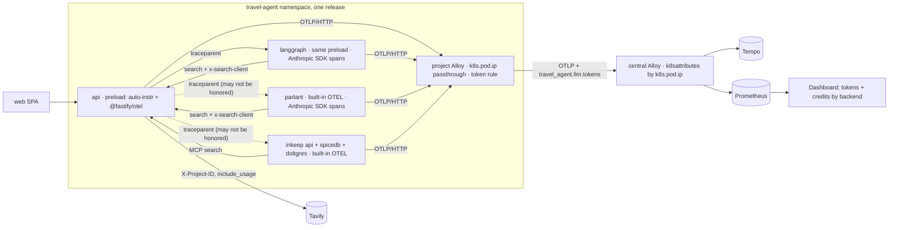

# Per-backend cost attribution (LLM tokens + Tavily) and OTEL auto-instrumentation

## Summary
The framework evaluation needs to say what each chat backend (Inkeep, Parlant, LangGraph) costs to run, and the numbers should be visible in the homelab Grafana. The same change turns on OpenTelemetry **auto-instrumentation (traces + metrics)** for every server-side service, and brings **Inkeep into this repo's chart**, so all three backends run the same way under Tilt and Helm (rev 14).

- **Telemetry path (rev 14):** every service exports OTLP to **this release's own Alloy collector** (in the chart, one per environment). It tags each span with its pod IP, derives the LLM token metric, and forwards everything to the central `monitoring/alloy`, which does the Kubernetes tagging and writes to Tempo, Prometheus and Loki as today.
- **LLM usage is measured in tokens, not dollars** (rev 11). The apps only emit standard OTEL `gen_ai` spans: the Anthropic SDKs trace themselves (TypeScript and Python), and Inkeep's built-in telemetry does the same. **One rule in the project Alloy** turns those spans into one token metric with one meaning for every backend. Moving to Bedrock later means adding one rule for the AWS SDK's spans; the dashboard stays.
- **Tavily:** it has no workspaces, but every Tavily call already goes through the Nest API. The API therefore:
  - tags each search with the calling backend (`X-Project-ID` at Tavily);
  - reads the credits used (`include_usage`);
  - counts both in two OTEL counters, because nothing automatic can see Tavily credits.
- **Inkeep in the chart (rev 14):** `inkeep.server.enabled` deploys Inkeep's API, SpiceDB and Doltgres (plus its databases on the release's CloudNativePG cluster) next to the app, the same way `parlant.enabled` and `langgraph.enabled` work. `tilt up -- --chat-backend=inkeep` runs a dev Inkeep of its own, so dev no longer shares the homelab Inkeep.
- A "Travel agent: cost by backend" dashboard shows tokens and credits side by side, with a per-backend "how cost is measured" table in `docs/agent-frameworks.md` for the team that picks this up.
- **Docker compose is out of scope entirely.** Support for it is being dropped, so this plan changes nothing in it.

## Goals
- **OTEL auto-instrumentation is on for every service, exporting OTLP/HTTP to the release's own Alloy (`<release>-alloy:4318`):**
  - **`travel-agent-api`** (Nest, Node): `@opentelemetry/auto-instrumentations-node` plus `@fastify/otel` for route-named server spans, started by a preload (`src/instrumentation.ts`). The preload is part of the start command and does nothing unless an OTLP endpoint is set.
  - **`travel-agent-langgraph`** (Node, Fastify): the same.
  - **`travel-agent-parlant`** (Python): Parlant's built-in OpenTelemetry tracer and meter, which turn on from env.
  - **`travel-agent-inkeep`** (the in-chart Inkeep API): its built-in OTEL, turned on by the same chart env.
- **Project collector:** a single-replica Alloy per release tags spans with `k8s.pod.ip` (passthrough), derives the token metric, and forwards OTLP to the central Alloy. The central Alloy resolves the real pod, namespace and deployment from that IP. ⛔ Spans in Tempo show the app's own `k8s.deployment.name`, never the collector's.
- **Trace linking:**
  - **api ↔ langgraph:** a chat turn on LangGraph is one connected trace, web → api → langgraph → api search → Tavily. Context goes across in W3C `traceparent`.
  - **api ↔ Parlant and api ↔ Inkeep:** these are expected **not** to join one trace. Parlant makes its own trace IDs (`fresh_trace`), and its outbound httpx calls aren't instrumented. This is recorded as a framework finding, not fixed.
- **One chart switch:** `otel.enabled` (with `otel.upstreamEndpoint` and `otel.environment`) turns it all on or off, including the project Alloy. When it's off, the preload returns at once and Parlant keeps its local tracer.
- **Backends are chart options:** `chat.backend` plus `inkeep.server.enabled` / `parlant.enabled` / `langgraph.enabled` pick what's deployed; `tilt up -- --chat-backend=<backend>` deploys only that one. `inkeep.apiUrl` (an external Inkeep) stays supported until the prod cutover.
- **Under Tilt, with OTEL on**, every pod boots and dev telemetry is distinguishable from prod (`service.namespace=travel-agent-dev`), for all three backends.
- **LLM token usage:** one metric, `travel_agent.llm.tokens` (a sum, labels `gen_ai.token.type` = `input`|`output`, provider and model), derived in the project Alloy from `gen_ai` spans. `input` includes cache reads and writes for every backend. Prompt and completion text is never captured.
- **Tavily project tags:** every Tavily search carries `X-Project-ID: travel-agent-<backend>`, where `<backend>` is `inkeep`, `parlant`, `langgraph` or `unknown`.
- **Search counters:** the API emits two counters:
  - `travel_agent.search.requests {client, outcome}`
  - `travel_agent.search.credits {client}`
- **Search logs:** `search ok` / `search cached` log lines also carry `client=<backend>` and `credits=<n>`.
- **Grafana dashboard** (`deploy/grafana/travel-agent-costs.json`), per backend over the selected time range:
  - LLM tokens (input, output) by backend and model;
  - Tavily credits, labelled as a lower bound;
  - searches by outcome and the cache hit ratio;
  - a combined table that always shows all three backends, including zero rows.
  - No USD figures (rev 11): tokens and credits are the units.
- **`docs/agent-frameworks.md`** gains a "Cost" section with a **per-backend "how cost is measured" table** (token source, Tavily source, dev/prod split, known gaps) and an "Observability" row in the comparison table.
- **Performance pass bars**, measured in step 3:
  - steady-state RSS under 70% of each pod's memory limit, after a scripted chat load;
  - cold start (process start → listening) no more than 1 s slower with OTEL on than off, against a warm database;
  - chat-stream p99 and time to first byte no more than 5% worse than with OTEL off.
- **Checks:** `npm run lint`, `npm run typecheck` and `npm test` pass, and so does `pytest` in `apps/parlant`.

## Non-goals
- **Scope is basic auto-instrumentation plus the cost metrics.**
  - No hand-written spans, and no metrics beyond the two search counters, in this change.
  - That's a focus limit, not a rule against custom instrumentation: cost-related metrics can come in later work (see Follow-ups).
- **No LLM instrumentation libraries in the apps** (rev 14). The Anthropic SDKs' own OTEL spans and Inkeep's built-in telemetry are the span sources; OpenLLMetry was tried in rev 13 and dropped (it doubled spans next to the SDKs' own, and its JS package needs a shim for the 1.x SDK). No app derives token metrics; the project Alloy does.
- **No USD for LLM spend,** and no Anthropic Admin API, Console workspaces or per-backend Anthropic keys (rev 11; keys confirmed dropped by the user in rev 12). Tokens keep the dashboard provider-agnostic for the move to Bedrock.
- **No OTEL log export.** Logs keep going to Loki through `alloy-logs` (stdout), and `OTEL_LOGS_EXPORTER=none` avoids duplicates. Parlant's console span dump is silenced by a local patch (decided rev 9).
- **No browser instrumentation of `apps/web`.** Its requests show up as root HTTP server spans in the API.
- **Nothing for `docker compose`.** Support for it is being dropped soon, so this plan touches no compose file, env or docs for it. All dev work targets Tilt and all deploys target Helm.
- **No in-app cost UI.** Grafana is the UI.
- **No per-guest/per-session labels on metrics, and no spend enforcement or per-backend limits.** The rate bucket and daily cap stay shared; the side effects are documented (see Performance).
- **No stripping of incoming trace headers at the edge** in this change (see Follow-ups).
- **No local report script** (dropped in rev 2).
- **The central Alloy, Grafana and network-policy configs live outside this repo.** This plan lists the changes they need in one place (see Homelab changes). Inkeep and the project collector move **into** the chart.
- **No tail sampling yet.** The collector layout leaves room for it (after the token rule), but sampling stays `parentbased_always_on`.
- **No migration of the homelab Inkeep's data** (rev 14, open question 2): agents are re-pushed from `apps/agents`; old conversations stay in the homelab Inkeep until it's retired.

## Context
### Search and Tavily
- **Tavily is called from exactly one place:** `apps/api/src/search/tavily.provider.ts` `TavilyProvider.search()`, which uses one `TAVILY_API_KEY` (`search.module.ts` `searchProvider()`).
- **`SearchService.search(input)`** (`search.service.ts`) sits in front of it with:
  - a cache (`CACHE_MAX_ENTRIES = 500`);
  - a single token bucket (`SEARCH_RATE_PER_MINUTE`, default 30);
  - a daily cap (`SEARCH_DAILY_LIMIT`, default 500, per process, reset on restart).
  - It has no idea who is calling.
- **Two entry points:**
  - **`POST /api/search/web`** (`search.controller.ts`):
    - Parlant calls it from `apps/parlant/travel_agent/search_client.py` `SearchClient`. Its default headers are only set when a token exists (line ~35).
    - LangGraph calls it from `apps/langgraph/src/apiClient.ts` `SearchClient.search`.
  - **`POST /api/mcp`** (`search.mcp.controller.ts`):
    - Only Inkeep calls it (`apps/agents/src/projects/travel-agent/tools/web-search.ts`), sending only `Authorization: Bearer`.
    - The controller builds a fresh `McpServer` in `server()` per request. `server()` takes no arguments today, and the tool callback calls `this.search.search(args)`. `handle()` hijacks the reply for the Streamable HTTP transport.
  - Both routes use `SearchTokenGuard`.
- **The cache key is `[query, maxResults, recencyDays]`,** with no caller in it.
- **Tests:** `apps/api/test/mcp.e2e-spec.ts` and `app.e2e-spec.ts` exist. `search.service.spec.ts` uses a fake `SearchProvider`.

### OTEL today
- **Node apps:** no OTEL in the repo's own code.
  - The images are `node:26-alpine`, and the apps are ESM.
  - API dev image: `WORKDIR /repo`, `CMD npx turbo run dev …`, which runs `nest start --watch`. Nest's `deleteOutDir: true` wipes `dist/` on each build.
  - LangGraph dev: `tsx watch --env-file-if-exists=../../.env src/main.ts`, with no `dist/`.
  - The Tiltfile builds every Node image with `target='dev'`.
  - Runtime images: `CMD ["node", "dist/main.js"]` from `/repo/apps/<app>`.
  - Both `tsconfig.build.json` files already `include: ["src"]`.
- **Postgres (since 699cc8a, CNPG):** the API (`apps/api/src/database/database.module.ts`, `pg.Pool` + Drizzle) and LangGraph (`apps/langgraph/src/checkpointer.ts`, `PostgresSaver` on a `pg.Pool`) use `pg`, so `auto-instrumentations-node` turns `instrumentation-pg` on by default. Parlant uses asyncpg (`travel_agent/postgres_db.py`), which nothing instruments.
  - Connection URLs carry role passwords (`_helpers.tpl` `postgresConnection`, `api.yaml` `DATABASE_URL` from the CNPG `-app` secret).
  - All queries are parameterized (Drizzle, `client.query(…, [$1])`), so `db.statement` is SQL text without values.
  - Boot is DB-first: the API's `openPool` waits up to 240 s and runs migrations before `listen`; LangGraph runs `waitForDatabase` and `saver.setup()` first. With no DB configured, the API falls back to memory and LangGraph to SQLite.
- **LLM clients:** the API calls no LLM. LangGraph uses `@langchain/anthropic`, which calls `@anthropic-ai/sdk` (1.14). Parlant uses `parlant[anthropic]`, which calls the Python `anthropic` SDK (2.8). Inkeep uses the Vercel AI SDK.
- **The Anthropic SDKs trace themselves (checked 2026-11-26):** TypeScript `internal/tracing.mjs` and Python `_tracing.py`. On by default (`ANTHROPIC_OPEN_TELEMETRY=false` turns them off), content mode `metadata_only` unless `ANTHROPIC_OPEN_TELEMETRY_TRACES_CONTENT_MODE=content`, using the global tracer provider. Spans (TS scope `com.anthropic.sdk.typescript`, name `anthropic.messages.create`) carry `gen_ai.usage.input_tokens` (in a mock test, 118 = 11 input + 100 cache read + 7 cache write, so it includes cache), `output_tokens`, `cache_read.input_tokens` and `cache_write.input_tokens`. They emit **no metrics**. `ANTHROPIC_OPEN_TELEMETRY_PROPAGATION` (default on) adds `traceparent` to calls to Anthropic.
- **AWS SDK instrumentation** (`@opentelemetry/instrumentation-aws-sdk`, on by default in auto-instrumentations) covers Bedrock Runtime `Converse`, `ConverseStream`, `InvokeModel` and `InvokeModelWithResponseStream` with `gen_ai` spans and its own token histogram: the span source after a Bedrock move.
- **Inkeep's telemetry:** `@inkeep/agents-core` 0.80.4 `constants/otel-attributes.js` names `gen_ai.usage.input_tokens`/`output_tokens`/`cache_read.input_tokens`/`cache_creation.input_tokens`, the AI SDK's `ai.usage.promptTokens`/`completionTokens`, `gen_ai.cost.estimated_usd`, and `tenant.id`/`project.id`/`agent.id`. Read from constants only; step 7 checks real spans.
- **Inkeep today:** one homelab install (`homelab/helm-values/inkeep.yaml`, bjw-s `app-template` 5.3.0, mirroring Inkeep's docker-compose) serves dev and prod (projects `travel-agent-dev` / `travel-agent`). Components: `agents-api` 0.80.4 (with an `agents-migrate` init container), `agents-manage-ui`, SpiceDB v1.49.2 (with a `migrate head` init), Doltgres 0.56.7 (the manage DB; a StatefulSet, not Postgres), and the run DB plus SpiceDB's datastore on CNPG (`homelab/apps/inkeep/postgres.yaml`). One `inkeep-secrets` Secret (`homelab/scripts/generate-inkeep-secret.sh`) holds AI keys, admin login, auth/JWT/bypass secrets, SpiceDB's preshared key and DB URLs. `OTEL_SDK_DISABLED=true`. The API reaches it through `inkeep.apiUrl`; Tilt reads its run-API bypass secret from the cluster; `scripts/push-agents.sh` pushes agents to it.
- **Parlant 4.x has built-in OTEL** (`parlant/bin/server.py` `_define_tracer`/`_define_meter`/`_define_logger`), turned on per signal by `OTEL_EXPORTER_OTLP_{TRACES,METRICS,LOGS}_ENDPOINT`.
  - It reads `OTEL_EXPORTER_OTLP_PROTOCOL` (default `grpc`), `OTEL_SERVICE_NAME` and `OTEL_RESOURCE_ATTRIBUTES`.
  - **Its tracer always adds a `ConsoleSpanExporter`** (`adapters/tracing/opentelemetry.py` ~line 115), so turning tracing on also prints every span as JSON to stdout, which `alloy-logs` ships to Loki.
  - Its meter defaults `OTEL_METRIC_EXPORT_INTERVAL` to 3000 ms.
  - It installs its own `TracerProvider`, so `OTEL_TRACES_SAMPLER` may be ignored.
  - The repo already patches Parlant (`travel_agent/anthropic_thinking.install()`), so there's a precedent for small local patches.

### Runtime and deploy
- **Chart:** each Deployment builds an `$env` dict in its template, rendered by `travel-agent.deployment` (`_helpers.tpl`). The probes there use each component's `healthPath`: api `/api/health` (global prefix `api`, `app.setup.ts:5`), and `/healthz` for parlant and langgraph.
  - LangGraph and Parlant use `strategy: Recreate` only when `persistence.enabled`, which defaults to false since the CNPG move (`values.yaml`).
  - Memory limits: api 512Mi, langgraph 512Mi, parlant 1Gi.
- **Shutdown:** LangGraph `main.ts` registers `process.once` for SIGTERM and SIGINT: `app.close()` → `checkpointer.close()` (the pool) → `process.exit(0)`. The API's `main.ts` calls `app.enableShutdownHooks()`, and `PoolShutdown.onApplicationShutdown` ends the pool. Nest removes its signal listener when shutdown starts and re-raises the signal after the hooks finish.
- **Homelab network policy:** the prod `travel-agent` namespace has a CiliumNetworkPolicy (homelab repo `apps/travel-agent/network-policy.yaml`). Its egress allows the namespace itself, kube-dns, `inkeep` api:3002 and `api.tavily.com:443`, so **not** `monitoring/alloy`. `travel-agent-dev` has no policy.
- **Homelab observability** (Grafana MCP 2026-11-22; `homelab/helm-values/alloy.yaml` read 2026-11-26):
  - Datasources: `prometheus`, `loki`, `tempo`, `alertmanager`. No dashboards for this app.
  - Central Alloy v1.21.3, one replica, default stability level. Pipeline: `otelcol.receiver.otlp` (4317/4318) → `otelcol.processor.k8sattributes` (namespace, pod, deployment, statefulset, node, container; **no explicit `pod_association`**) → `batch` → Tempo (OTLP gRPC), Prometheus (native OTLP receiver `/api/v1/otlp`) and Loki (OTLP). No label rules, routing, filtering or sampling.
  - `k8sattributes` matches by the sender's IP, so telemetry relayed through another collector gets the collector's pod. The documented fix: the relaying collector runs `k8sattributes` with `passthrough = true` (adds `k8s.pod.ip` only, no API access), and the central one matches on that resource attribute before the connection IP.
  - `otelcol.connector.signaltometrics` exists in v1.21 (experimental: needs `--stability.level=experimental`). It sums OTTL expressions over spans, with conditions and attribute grouping, and emits delta metrics (the docs pair it with `deltatocumulative` + `interval`).
- **Anthropic keys per process:** Inkeep `inkeep/inkeep-secrets` today, the in-chart Inkeep secret after rev 14; Parlant `travel-agent-parlant-dev` / `parlant.existingSecret`; LangGraph `travel-agent-langgraph-dev` / `langgraph.existingSecret`.
- **Chart patterns to reuse:** `<component>.enabled`, `existingSecret`, `travel-agent.deployment` (no init containers yet), `travel-agent.postgresConnection` (a role per backend on `<release>-db`, password from a basic-auth Secret Tilt makes from `.env`, TLS verified with the cluster CA), and `postgres.yaml`'s `$backends` list (one `DatabaseRole` + `Database` each).
- **Memory:** findings go in `docs/agent-frameworks.md` ([framework-evaluation-log]). Inkeep's data components force Haiku with tool_choice. The user evaluates Inkeep for other uses, so the homelab Inkeep may serve other projects.

### Tavily facts (docs.tavily.com, read 2026-11-22)
- **`include_usage: true`** adds `usage.credits` to the response.
- **Cost:** `basic` search = 1 credit. Pay-as-you-go is $0.008/credit, and the free plan includes 1,000 credits/month.
- **`X-Project-ID`** groups usage in Tavily's dashboard, `/usage` and `/logs`.
- **Per-key reports** are Enterprise only.
- These come from the docs, not from a call. Step 2's pre-check makes a real call.

## Assumptions
- **The preload works in the ESM runtime images on Node 26.** It calls the ESM hook registration that the installed `import-in-the-middle` documents, then `await import()`s the SDK, so the hook is in place before `node:http`, undici, Fastify and the app load.
  - On Node 26, `module.register` may be deprecated in favour of `module.registerHooks`. The step 3 pre-check records which form applies.
  - `NodeSDK` reads the standard env.
  - Checked in step 3.
- **`@fastify/otel` with `registerOnInitialization: true` attaches to the Fastify instance that Nest's `FastifyAdapter` creates.** Its export shape and its `ignorePaths` signature are confirmed against the installed version in step 3.
- **The HTTP/undici instrumentations don't capture bodies or headers by default.** Credentials travel only in headers, never in URLs (confirmed by the security review).
- **The central Alloy's OTLP pipelines exist** (read 2026-11-26). Only the `pod_association` addition is new.
- **Cilium keeps pod source IPs for in-cluster Service traffic,** so the project Alloy sees each app pod's own IP. ⛔ Checked in step 6.
- **OTLP → Prometheus translation puts only `service.name`/`service.namespace` (as `job`) and `service.instance.id` (as `instance`) on each series.** Other resource attributes go to `target_info`. So the dev/prod split uses `service.namespace` (see Design).
- **Inkeep's `agents-api` exports OTLP** when `OTEL_SDK_DISABLED` is unset and `OTEL_EXPORTER_OTLP_ENDPOINT` is set. ⛔ Checked in step 5.
- **Inkeep's spans carry token usage on exactly one span per model call** (the AI SDK's `doGenerate`/`doStream` level), with `project.id`. ⛔ Checked in step 7; the token rule for Inkeep is written from what step 7 records.
- **The Python Anthropic SDK's spans count input like the TypeScript ones** (cache included) and use the global provider Parlant sets. ⛔ Checked in step 7.
- **Each LLM call has exactly one usage-bearing span per backend** (no second instrumentation). ⛔ Checked in step 7.
- **Inkeep runs from its published images with the chart's own templates,** with the run DB and SpiceDB on the release's CNPG cluster over verified TLS. ⛔ Checked in step 5; the fallback is an in-namespace plain-text `pg_hba` rule for those two roles, as the homelab has today.

## Design



### Auto-instrumentation

**Chart values** (new top-level block):
```yaml
otel:
  enabled: false
  # The central collector the project Alloy forwards to (rev 14; was `endpoint`).
  upstreamEndpoint: ''    # e.g. http://alloy.monitoring.svc.cluster.local:4318
  environment: prod       # prod | dev; also picks service.namespace (below)
  tracesSampler: parentbased_always_on   # lever if Tempo/CPU is stressed: parentbased_traceidratio
  metricExportIntervalMs: 15000
  collector:              # this release's Alloy (see "Project collector")
    image: { repository: grafana/alloy, tag: v1.21.3 }   # same version as the central one
    resources: { requests: { cpu: 25m, memory: 128Mi }, limits: { memory: 512Mi } }
```
Apps always export to the project collector, `http://<release>-alloy:4318`; only the collector knows `upstreamEndpoint`.

**New `_helpers.tpl` template, `travel-agent.otelEnv`.** It takes `(dict "root" . "env" $env "service" "<name>" "runtime" "node|parlant")` and, when `otel.enabled`, sets into `$env`:

| Var | Value |
|---|---|
| `OTEL_SERVICE_NAME` | `travel-agent-api` / `-langgraph` / `-parlant` / `-inkeep` |
| `OTEL_RESOURCE_ATTRIBUTES` | `service.namespace=<ns>,deployment.environment.name=<otel.environment>`, where `<ns>` is `travel-agent` for prod and `travel-agent-dev` for dev. So Prometheus' `job` label (`<ns>/<service>`) separates dev from prod with no Alloy change |
| `OTEL_EXPORTER_OTLP_PROTOCOL` | `http/protobuf` |
| `OTEL_PROPAGATORS` | `tracecontext` (no baggage) |
| `OTEL_TRACES_SAMPLER` | `otel.tracesSampler` (Parlant may ignore it; recorded in step 3) |
| *node:* `OTEL_EXPORTER_OTLP_ENDPOINT` | `http://<release>-alloy:4318`. **This is the preload's on switch.** Inkeep gets it too |
| *node:* `OTEL_TRACES_EXPORTER` / `OTEL_METRICS_EXPORTER` / `OTEL_LOGS_EXPORTER` | `otlp` / `otlp` / `none` |
| *node:* `OTEL_NODE_DISABLED_INSTRUMENTATIONS` | `nestjs-core,fs,dns,net`, trimmed in step 3 to names that exist and are on by default in the installed bundle. `nestjs-core` is off because `@fastify/otel` already gives route names |
| *parlant:* `OTEL_EXPORTER_OTLP_TRACES_ENDPOINT` / `…_METRICS_ENDPOINT` | `http://<release>-alloy:4318/v1/traces` / `…/v1/metrics` |
| *langgraph, parlant:* `ANTHROPIC_OPEN_TELEMETRY_TRACES_CONTENT_MODE` | `metadata_only` (already the SDKs' default; set so the intent is visible and a stray `content` can't sneak in through `.env`) |
| `OTEL_METRIC_EXPORT_INTERVAL` | `15000` for every service (user, rev 11). Node's SDK default is 60 s and Parlant's is 3 s |

- **No `NODE_OPTIONS`.** It would be inherited by every child process (npx, turbo, nest, tsc) and break the Tilt dev pods. The preload is part of each start command instead (below).
- **When `otel.enabled` is false,** none of these vars are set: the Node preload returns at once without loading any SDK, and Parlant keeps its local tracer.
- **Overrides:** `api.env`/`langgraph.env`/`parlant.env` are merged after this, so they win.

**Node preload: `apps/api/src/instrumentation.ts` and `apps/langgraph/src/instrumentation.ts`** (identical, about 35 lines). This is SDK configuration, not custom spans. Its shape:
```ts
// Only node: builtins are imported statically. Everything else loads after the
// ESM hook is registered, so http/undici/fastify are patched (risk review R1).
if (process.env.OTEL_EXPORTER_OTLP_ENDPOINT && process.env.OTEL_SDK_DISABLED !== 'true') {
  const { register } = await import('node:module');
  register('@opentelemetry/instrumentation/hook.mjs', import.meta.url); // exact form per installed import-in-the-middle (step 3)
  const { NodeSDK } = await import('@opentelemetry/sdk-node');
  const { getNodeAutoInstrumentations } = await import('@opentelemetry/auto-instrumentations-node');
  const { default: FastifyOtelInstrumentation } = await import('@fastify/otel'); // export shape checked in step 3
  const HEALTH = new Set(['/api/health', '/healthz']);
  const path = (url?: string) => (url ?? '').split('?')[0];
  const sdk = new NodeSDK({
    instrumentations: [
      getNodeAutoInstrumentations({
        '@opentelemetry/instrumentation-http': {
          ignoreIncomingRequestHook: (req) => HEALTH.has(path(req.url)),
        },
        // Kept (decided rev 10): DB cost per turn is a comparison finding. No root spans
        // from boot retries/migrations; enhancedDatabaseReporting stays at its default
        // (off), so bound parameter values (guest intake, checkpoint blobs) aren't recorded.
        '@opentelemetry/instrumentation-pg': { requireParentSpan: true },
      }),
      new FastifyOtelInstrumentation({ registerOnInitialization: true, ignorePaths: (o) => HEALTH.has(path(o.url)) }),
    ],
  });
  sdk.start();
  // No signal listener here (A10): each app owns its shutdown and calls this last.
  (globalThis as Record<symbol, unknown>)[Symbol.for('travel-agent.otel.shutdown')] = () => sdk.shutdown();
}
export {};
```
- **`flushTelemetry(timeoutMs = 2000)`** (new, `apps/api/src/common/telemetry.ts` and `apps/langgraph/src/telemetry.ts`, ~10 lines each): looks up the global shutdown function and races it against the timeout. It resolves at once when OTEL is off. The apps never import `@opentelemetry/*`.
- **The preload registers no signal listener.** Rev 8's "exit if I'm the only listener" check was always true, because Node removes a `once` wrapper before calling it and Nest removes its own listener when shutdown starts. So it cut off `app.close()` and the pool close (architecture review A10).
- **LangGraph shutdown:** the existing handler becomes `app.close()` → `checkpointer.close()` → `flushTelemetry()` → `process.exit(0)`, so in-flight requests and pool writes finish before the last batch is sent.
- **API shutdown:** a `TelemetryShutdown` provider (`onApplicationShutdown` → `flushTelemetry()`), registered in `AppModule`. Nest awaits all shutdown hooks before re-raising the signal, so the flush runs alongside `PoolShutdown` and isn't lost.

**Start commands:**
- **Runtime images:** `CMD ["node", "--import", "./dist/instrumentation.js", "dist/main.js"]` in `apps/api/Dockerfile` and `apps/langgraph/Dockerfile`. The preload is always loaded, and it's a no-op without the endpoint.
- **Dev:** each app's own `dev` script loads the preload, so only the app process gets it:
  - LangGraph: `tsx watch --env-file-if-exists=../../.env --import ./src/instrumentation.ts src/main.ts` (keeps today's env flag).
  - API: `nest start --watch --exec "node --import ./dist/instrumentation.js"`, if `nest start --exec` passes flags through (checked in step 3). Otherwise a `start:dev` variant that runs `tsc --watch` and `node --watch --import …`.
  - `npm test` and vitest never load it.
- **Tilt:** `helm_set` adds `otel.enabled=true`, `otel.upstreamEndpoint=http://alloy.monitoring.svc.cluster.local:4318` and `otel.environment=dev`, behind a new `--otel` flag (default on). If the Nest `--exec` route doesn't work, the flag defaults to off and the step 3 end-to-end checks run against a release-image deploy instead.

**Health probes:** filtered in the preload for the Node services (`/api/health`, `/healthz`), as a hard gate in step 3. An Alloy `otelcol.processor.filter` on `url.path` stays documented as the fallback for any service the in-app filter misses, including Parlant.

**Packages:**
- `apps/api` and `apps/langgraph` `dependencies`:
  - from the OpenTelemetry project: `@opentelemetry/api`, `@opentelemetry/sdk-node`, `@opentelemetry/auto-instrumentations-node`, `@opentelemetry/instrumentation`;
  - from the **Fastify org**: `@fastify/otel`.
- **Versions:** caret ranges, as in the rest of the repo, installed from the reviewed lockfile with `npm ci`. The `@opentelemetry/*` packages stay on one release train, so each of api and langgraph resolves a single `@opentelemetry/api` (`npm ls @opentelemetry/api -w @travel-agent/api`, same for langgraph). A repo-wide `npm ls` can't show one version, because Inkeep's packages already pull in their own older OTel train (`auto-instrumentations-node@0.75`, api 1.9.0/1.9.1).
- `instrumentation-pg` pins `@types/pg`; the dependency commit checks `npm ls @types/pg` still shows the single version the CNPG change pinned, and that `npm run typecheck` passes for every workspace, including `apps/agents` (Inkeep's hoisting).
- The dependency additions go in their own commit, so the lockfile diff can be reviewed on its own.
- Parlant needs no new packages.

### Parlant console spans (decided rev 9: local patch)
Parlant's tracer always attaches a `ConsoleSpanExporter`. With OTEL on, every span is printed to stdout and shipped to Loki: a second copy of the same data, with its own retention.

**The patch:** `apps/parlant/travel_agent/otel_quiet.py`, an `install()` like `anthropic_thinking.install()`, called in `apps/parlant/main.py` (next to `anthropic_thinking.install()`) before the server starts.
- It replaces `ConsoleSpanExporter.export` with a no-op that returns `SpanExportResult.SUCCESS`, unless `PARLANT_CONSOLE_SPANS=1`. About 10 lines plus a test.
- It only silences the console copy. The OTLP exporter and Parlant's own logging are untouched.
- Re-check it on Parlant upgrades, as with the existing patch.

The rev 5 accepted risk covers Loki as well as Tempo. The user confirmed in rev 9 that guest data ending up in Loki is okay for now.

### Project collector (rev 14)
A single-replica Alloy per release (`templates/alloy.yaml`: Deployment with **`strategy: Recreate`**, Service on 4317/4318, ConfigMap, an `emptyDir` for `--storage.path=/var/lib/alloy`), rendered when `otel.enabled`. Args: `run --stability.level=experimental --storage.path=/var/lib/alloy --server.http.listen-addr=0.0.0.0:12345 /etc/alloy/config.alloy`. The experimental flag is needed only for `signaltometrics`, and it's scoped to this instance; the central Alloy stays at the default level.

```alloy
otelcol.receiver.otlp "apps" {
  http { endpoint = "0.0.0.0:4318" }
  grpc { endpoint = "0.0.0.0:4317" }
  output { traces = [otelcol.processor.k8sattributes.ip.input]  metrics = [otelcol.processor.k8sattributes.ip.input] }
}
// Only stamps k8s.pod.ip from the app's connection. No Kubernetes API access, no RBAC.
otelcol.processor.k8sattributes "ip" {
  passthrough = true
  output { traces = [otelcol.processor.batch.out.input]  metrics = [otelcol.processor.batch.out.input] }
}
otelcol.processor.batch "out" {
  output {
    // Tokens are derived here, before any future tail sampling, so they always see 100% of spans.
    traces  = [otelcol.connector.signaltometrics.tokens.input, otelcol.exporter.otlphttp.central.input]
    metrics = [otelcol.exporter.otlphttp.central.input]
  }
}
otelcol.connector.signaltometrics "tokens" {
  // One spans block per (source, token type); written from step 7's findings (step 8).
  output { metrics = [otelcol.processor.deltatocumulative.tokens.input] }
}
otelcol.processor.deltatocumulative "tokens" { output { metrics = [otelcol.processor.interval.tokens.input] } }
otelcol.processor.interval "tokens" { interval = "15s"  output { metrics = [otelcol.exporter.otlphttp.central.input] } }
otelcol.exporter.otlphttp "central" { client { endpoint = "<otel.upstreamEndpoint>" } }
```

- **One path per signal:** apps → project Alloy → central Alloy. Nothing exports to the central Alloy directly, and only the project Alloy runs the token rule.
- **One writer per token series, because of `Recreate`** (A24): the derived series carry no `service.instance.id`, so an old and a new collector pod overlapping in a rolling update would both write the same cumulative series and `increase()` would over-count on every deploy. During a restart, app exports retry, so a few seconds' gap costs nothing.
- The derived metric has no `k8s.pod.ip`, so the central Alloy tags it with the collector's own pod. That lands only in `target_info`; the token series keep their `job` from `service.namespace`/`service.name`.
- **Central tagging stays central.** The central Alloy gets explicit `pod_association` rules (homelab item 1): `k8s.pod.ip` resource attribute first, then the connection IP. Apps that send to it directly behave as today.
- **Resource attributes pass through untouched** (`service.name`, `service.namespace`, `deployment.environment.name`), so Prometheus' `job` and the dashboard queries don't change.
- **Health:** probes on `/-/ready` (port 12345). Alloy's own metrics are on the same port; a ServiceMonitor is optional (`otel.collector.serviceMonitor`, default off), like `postgres.podMonitor`.
- **Netpol:** apps reach it inside the namespace (already allowed); only the collector pod needs egress to `monitoring/alloy:4318` (homelab item 3).
- **Fallback if the experimental connector misbehaves:** the per-app span-to-metric processor from rev 13 (git history on this branch) for Node, and a record-only sampler; tokens for Inkeep would then be a gap.

### Inkeep in the chart (rev 14)
**Ships as its own PR, merged before the cost PR** (A25): it doesn't depend on the cost work, and its rollback (back to `inkeep.apiUrl`) shouldn't be tied to OTEL's. Only step 7's Inkeep run depends on it. It stays in this plan.

`inkeep.server.enabled` deploys Inkeep with the chart's own templates, the same way Parlant and LangGraph are deployed (open question 1 asks whether to use an umbrella chart instead). Images pinned to the repo's `@inkeep/*` version (0.80.4) and the homelab's SpiceDB v1.49.2 / Doltgres 0.56.7.

| Component | Template | Notes |
|---|---|---|
| `inkeep-api` | `templates/inkeep-api.yaml`, through `travel-agent.deployment` (extended to take `initContainers`) | `agents-api` on 3002, `strategy: Recreate`; init `agents-migrate`; env as in the homelab values (`SPICEDB_ENDPOINT=<release>-inkeep-spicedb:50051`, `INKEEP_AGENTS_API_URL`, `INKEEP_AGENTS_MANAGE_UI_URL`, `BLOB_STORAGE_LOCAL_PATH`) plus `travel-agent.otelEnv` (`travel-agent-inkeep`, node). No `OTEL_SDK_DISABLED` |
| `inkeep-ui` | `templates/inkeep-ui.yaml` | `agents-manage-ui` on 3000, optional (`inkeep.ui.enabled`, default true in dev). No ingress by default: Tilt port-forwards it; prod adds one in the homelab values if wanted |
| `inkeep-spicedb` | `templates/inkeep-spicedb.yaml` | `serve` with a `migrate head` init; gRPC 50051 |
| `inkeep-doltgres` | `templates/inkeep-doltgres.yaml` (StatefulSet + PVC) | The manage DB. Doltgres isn't Postgres, so it can't live on CNPG |
| Run DB + SpiceDB datastore | `postgres.yaml` `$backends` gains `inkeep` and `spicedb` when `inkeep.server.enabled` | Roles and databases on `<release>-db`, passwords from basic-auth Secrets, TLS verified with the cluster CA (`sslmode=verify-full&sslrootcert=/etc/postgres-ca/ca.crt` in both URLs; checked in step 5) |

- **Values layout** (A30): the in-chart stack lives under `inkeep.server.{enabled,secret,image,ui,spicedb,doltgres,blobStorage}`. The existing `inkeep.existingSecret` stays the **API's** env Secret (bypass secret when external, intake/search tokens, Tavily key, LangGraph token); its comment says so.
- **Secrets:** `inkeep.server.secret` names the Inkeep server's Secret: AI key, admin login, run/manage bypass secrets, JWT signing secret and keypair, `BETTER_AUTH_SECRET`, SpiceDB preshared key, Doltgres password, **and `SEARCH_API_TOKEN` and `INTAKE_API_TOKEN`**, which Inkeep sends back to the API (`apps/agents/.../web-search.ts:10-16`, the context fetcher). The chart builds the DB URLs itself from the role passwords.
  - **Dev:** Tilt makes it. Random values are generated **once** into the gitignored `.tilt/inkeep-dev.env` (rotating them every `tilt up` would sign everyone out and break JWTs); `ANTHROPIC_API_KEY`, `SEARCH_API_TOKEN` and `INTAKE_API_TOKEN` come from `.env`.
  - **Prod:** `scripts/generate-inkeep-secret.sh` (ported from the homelab repo, writing the new key set) and `kubectl apply`. It **copies** `SEARCH_API_TOKEN` and `INTAKE_API_TOKEN` from the API's prod Secret and never generates them (A26).
- **API wiring:** with `inkeep.server.enabled`, the API's `INKEEP_AGENTS_API_URL` is `http://<release>-inkeep-api:3002` and `INKEEP_AGENTS_RUN_API_BYPASS_SECRET` comes from the Inkeep Secret (`secretEnv`), so Tilt stops reading the homelab Inkeep's secret. `inkeep.apiUrl` (external) still works when `inkeep.server.enabled` is false. The API template fails if `chat.backend=inkeep` and neither is set.
- **Tilt:** `--chat-backend=inkeep` sets `inkeep.server.enabled=true` (and `false` otherwise), exactly like the other backends. Images are pulled, not built. A `local_resource` `inkeep-push` (after **both** `inkeep-api` and `travel-agent-api` are ready: push runs MCP tool discovery against the API) runs `scripts/push-agents.sh dev` against a port-forward to the dev Inkeep, so the agents exist after `tilt up` (A31).
  - The Inkeep PVC and DB objects get the same keep/idle handling the Tiltfile gives Parlant and LangGraph (`db_objects`, `idle_volumes`), so switching backends doesn't delete them.
  - `PUBLIC_INKEEP_AGENTS_API_URL` and `INKEEP_AGENTS_MANAGE_UI_URL` are the port-forward URLs in dev, or the manage UI and its auth don't work.
- **`scripts/push-agents.sh`** gains a target URL argument (dev: the port-forward; prod: the in-chart prod Inkeep after cutover, through a port-forward). It reads the manage bypass secret from the release's Inkeep Secret instead of `inkeep/inkeep-secrets`.
- **Telemetry for Inkeep** then flows like every other service: `service.namespace` separates dev from prod, and there are no other tenants in it.
- **Resources:** from the homelab values (api 384Mi/2Gi, ui 256Mi/1Gi, spicedb 128Mi/512Mi, doltgres 256Mi/2Gi). Step 5 checks the dev namespace has room.

### Homelab changes (all out of repo; one list)
1. **Central Alloy `pod_association`** (before rollout step 3): `pod_association { source { from = "resource_attribute", name = "k8s.pod.ip" } }` then `pod_association { source { from = "connection" } }`. Additive: direct senders still match by connection. The OTLP pipelines already exist. The processor's default (no rules) may already check `k8s.pod.ip` before the connection; the explicit rules make it certain, and step 6's gate shows whether they changed anything.
2. Central Alloy: health-probe span filter, only if step 3 shows the in-app filter misses something.
3. **Network policy** (prod `travel-agent` namespace): egress from the project Alloy pod (`app.kubernetes.io/component: alloy`) to `monitoring` / `app.kubernetes.io/name: alloy` on TCP 4318 only; egress from the in-chart Inkeep API to `api.anthropic.com:443` (check what the existing policy already grants agent pods); after cutover, remove the egress to the `inkeep` namespace.
4. *(Removed in rev 11.)*
5. Grafana: provision the dashboard from this repo's JSON.
6. **Inkeep cutover:** prod secrets (`scripts/generate-inkeep-secret.sh`, basic-auth Secrets for the `inkeep` and `spicedb` roles), then the values below, then push agents. The homelab Inkeep keeps running untouched until the soak ends (retiring it is a follow-up).
7. Helm homelab values: `otel.enabled=true`, `otel.upstreamEndpoint`, `otel.environment=prod`; at cutover `inkeep.server.enabled=true`, `inkeep.apiUrl: ''`, storage classes.
8. *(Merged into item 3.)*

### Caller identity (API)
- **New in `packages/shared/src/search.ts`:**
  - `SearchClients = ['inkeep','parlant','langgraph'] as const`
  - `type SearchClient = … | 'unknown'`
  - `SEARCH_CLIENT_HEADER = 'x-search-client'`
  - `parseSearchClient(value: unknown): SearchClient | undefined`, which is `undefined` when the value is missing or invalid.
  - `toSearchClient(value, fallback: SearchClient)`.
- **`SearchController.web()`:** `toSearchClient(header, 'unknown')`, reading the header with `@Headers(SEARCH_CLIENT_HEADER)`.
- **`SearchMcpController.handle()`:** reads `req.headers[SEARCH_CLIENT_HEADER]`, computes `toSearchClient(header, 'inkeep')`, and passes it into `server(client)`. The `registerTool` callback closes over it and calls `this.search.search(args, client)`.
- **The header is a self-reported label** behind the existing token guard, never used for auth.

### SearchService
- **Signature:** `search(input: unknown, client: SearchClient)`. `client` is **required**, so a caller that forgets it fails to compile.
- **Cache key** gains `client` (decided rev 4).
- **Project ID:** `ProviderRequest.projectId` is `` `${TAVILY_PROJECT_PREFIX ?? 'travel-agent'}-${client}` ``.
- **Provider result:** `SearchProvider.search()` returns `ProviderResult { results; credits?: number }`. The fake providers in specs are updated.
- **Outcomes:**

| Path | outcome | credits added |
|---|---|---|
| invalid request (`BadRequestException`) | none (deliberate: not a search, and it costs nothing) | — |
| provider off | `off` | — |
| cache hit | `cached` | — |
| rate/daily limit | `limited` | — |
| provider error or timeout | `error` | — (a timed-out call may still be billed, so the credit metric is a **lower bound**) |
| success | `ok` | `credits` if it's a finite number ≥ 0 |

- **Shared limits.** The one token bucket and the one daily cap stay shared across backends. So one chatty backend can use up the others' budget, and a `limited` outcome during a comparison run is a stack limit, not a framework failure. This is documented in the dashboard and the docs.
- **Cache pressure.** The 500-entry cache now holds up to three keys per query, so entries are evicted sooner. The cache hit ratio measures reuse within a backend only, so it isn't comparable with history from before this change.

### Search counters
- **`apps/api/src/search/search.metrics.ts`:** `@Injectable() SearchMetrics` with `request(client, outcome)` and `credits(client, n)`.
- **Instruments:** `metrics.getMeter('travel-agent-api').createCounter('travel_agent.search.requests' | 'travel_agent.search.credits')` from `@opentelemetry/api`. With no SDK, these are no-ops.
- **Tests:** specs stub `SearchMetrics`.

### TavilyProvider
- The body adds `include_usage: true`, and the headers add `'x-project-id': req.projectId`.
- It parses `json.usage?.credits` defensively.
- A real call in step 2's pre-check confirms Tavily accepts both.

### Callers
- **Parlant:** `SearchClient.__init__` always sets `x-search-client: parlant`, and adds `authorization` only when a token exists.
- **LangGraph:** `SearchClient.search` adds `[SEARCH_CLIENT_HEADER]: 'langgraph'`.
- **Inkeep:** identified by route.

### LLM token usage (rev 14: derived in the project Alloy)
**Units are tokens, labelled by service and model, with one definition for every backend.** The apps emit standard `gen_ai` spans; the project Alloy's `signaltometrics` connector sums them into `travel_agent.llm.tokens` (a sum, unit `{token}`).

**Span sources, one per backend:**

| Backend | Span source | Recognised by | `input` |
|---|---|---|---|
| LangGraph | `@anthropic-ai/sdk` built-in tracing (covers `beta.messages` too) | scope `com.anthropic.sdk.typescript[.<platform>]`, span `anthropic.messages.create` | `gen_ai.usage.input_tokens` (includes cache, checked by mock) |
| Parlant | Python `anthropic` built-in tracing | scope `com.anthropic.sdk.python` (`_tracing.py:41`) | `gen_ai.usage.input_tokens` (includes cache: `lib/_tracing/_response.py:56-59`; step 7 confirms) |
| Inkeep | its built-in (AI SDK) telemetry | the span name and scope step 7 finds carrying usage, once per model call | per step 7 (normalized to include cache) |
| *Later: Bedrock* | AWS SDK instrumentation | scope `@opentelemetry/instrumentation-aws-sdk`, `gen_ai.system=aws.bedrock` | per its attributes, normalized the same way |

**Rule shape** (two `spans` blocks per source; `gen_ai.token.type` is set with `default_value`, since the spans don't carry it):
```alloy
spans {
  name        = "travel_agent.llm.tokens"
  description = "LLM tokens per backend; input includes cache reads and writes"
  unit        = "{token}"
  // Matches TS (any platform suffix) and Python. count_tokens spans carry
  // anthropic.message.count_tokens.input_tokens, not gen_ai.usage.*, so they never match.
  conditions  = [`IsMatch(instrumentation_scope.name, "^com\\.anthropic\\.sdk\\.") and attributes["gen_ai.usage.input_tokens"] != nil`]
  attributes { key = "gen_ai.token.type"      default_value = "input" }
  attributes { key = "gen_ai.provider.name"   optional = true }
  attributes { key = "gen_ai.response.model"  optional = true }
  include_resource_attributes { key = "service.name" }
  include_resource_attributes { key = "service.namespace" }
  include_resource_attributes { key = "deployment.environment.name" }
  sum { value = `attributes["gen_ai.usage.input_tokens"]` }
}
// ...and the matching "output" block, then one pair per further source.
```
- **Content:** the Anthropic SDKs stay at `metadata_only` (chart sets it explicitly). Inkeep's content attributes (`ai.prompt.messages`, `ai.response.text`) are a known content path, covered by the rev 5 accepted risk and recorded in step 7; the token rule never copies span attributes other than the ones listed.
- **No app-side token code:** the rev 13 code (OpenLLMetry in both apps, `GenAiTokenMetrics`, Parlant's `telemetry.py`) is removed in step 8. Parlant's `otel_quiet` patch stays.
- **Sampling:** the rule sits before any future tail sampling, so it always sees every span. Apps stay `parentbased_always_on`.

### Grafana
- **LLM tokens (Prometheus):**
  - `sum by (job, gen_ai_token_type, gen_ai_response_model) (increase(travel_agent_llm_tokens{job=~"$ns/.*"}[$__range]))`. Exact metric and label names are recorded in step 8.
  - Per-backend rows map `job` to `langgraph` / `parlant` / `inkeep`.
- **Tavily (Prometheus):**
  - credits: `sum by (client) (increase(travel_agent_search_credits_total{job=~"$ns/.*"}[$__range]))`
  - outcomes: by `client, outcome`
  - cache hit ratio
  - Per-backend rows use `or` against a constant three-backend vector (`label_replace(vector(0), …)` per client), so a backend with no searches shows 0, not a missing row.
  - The credits panel description says "lower bound; cross-check with Tavily's dashboard filtered by project".
- `$ns` is a dashboard variable: `travel-agent` or `travel-agent-dev`.
- **Combined table:** tokens by type and Tavily credits, joined on `backend`, always three rows.
- **No USD panels** (rev 11).
- **Traces link:** Tempo Explore, `resource.service.namespace="$ns"`.
- **Dashboard as code:** `deploy/grafana/travel-agent-costs.json`, provisioned from the homelab repo (decided rev 4).

### Alternatives considered
| Option | Pros | Cons | Why not |
|---|---|---|---|
| `NODE_OPTIONS=--import …` as the switch (rev 6) | Fully env-driven | Inherited by npx/turbo/nest/tsc in Tilt dev pods, which crash-loop (A1) | The preload goes in the start command, gated by the endpoint |
| Zero-code `--import auto-instrumentations-node/register` (rev 3) | No code | Can't add `@fastify/otel` or filter probes | Replaced in rev 6 |
| Allow-list instrumentations (http, undici only) from the start | Least memory and startup cost | May miss something useful | The fallback if the step 3 pass bars fail |
| `opentelemetry-instrument` wrapper for Parlant | Covers httpx | Competes with Parlant's own `TracerProvider` | Follow-up |
| OpenLLMetry (rev 11–13) | One vendor-neutral package family | Doubles spans next to the SDKs' own; JS 0.27 needs a shim for SDK 1.x; its JS Bedrock package doesn't cover `Converse` | Dropped in rev 14 |
| Shared `packages/otel` for the preload | One copy | Package and build wiring for ~35 lines | Revisit with a third Node service |
| Anthropic Admin API `cost_report` via Grafana Infinity (revs 2–10) | Billed USD, exact | Anthropic-only (no Bedrock equivalent), daily lag, a full-admin key in Grafana | User: tokens, not USD, and minimal change for Bedrock (rev 11) |
| Per-backend Anthropic workspace keys (revs 1–10) | Console-side split and spend limits | Anthropic-only; tokens are already split by service | Dropped (user, rev 12): token metrics split by service already |
| Traceloop SDK (`@traceloop/node-server-sdk`, `traceloop-sdk`) | One-line setup | Installs its own providers and exporters, competing with `NodeSDK` and Parlant's | Use the bare instrumentations instead |
| `@traceloop/instrumentation-langchain` for LangGraph | Sees chains and tools | Double-counts with the Anthropic instrumentation; not needed for tokens | Provider-level instrumentation only |
| Tokens from Tempo TraceQL metrics | No collector rule | Depends on sampling and Tempo retention; query-time only | Dropped in rev 14 |
| Per-app span-to-metric processors (rev 13) | Stable SDK APIs | One copy per runtime, can't cover Inkeep, Bedrock means code changes | The fallback; dropped as primary in rev 14 (user: standardization) |
| Token rule in the central Alloy | No new pod | Experimental flag on the shared collector; logic outside this repo | Rev 14: project Alloy instead |
| Project Alloy writing straight to Tempo/Prometheus | One hop, no central dependency | Repeats the central tagging (and pod/replicaset RBAC) in this namespace | Central tagging kept; `k8s.pod.ip` passthrough is the only contract |
| Inkeep through an umbrella chart (bjw-s `app-template` as a dependency) | Reuses the homelab's proven values | Parent helpers (`otelEnv`, CNPG connection, CA, labels) don't reach the subchart; `helm dependency build` + `Chart.lock` in Tilt and deploy | Open question 1; drafter leans native templates |
| Per-client rate/daily limits | Fair comparisons | More config and a change in behavior | Follow-up. Side effects documented |
| `environment` as a metric attribute | Works with any OTLP→Prom setup | Custom attribute on every series | `service.namespace` per env does it for free |
| Per-backend search tokens / Tavily keys | Hard separation | Secret churn. Enterprise-only reports | User chose the header (rev 4) |
| Docker compose support | Local stack without a cluster | Being dropped | User: nothing for compose (rev 11) |

## Implementation steps

### 1. Shared caller type
- **Files:** `packages/shared/src/search.ts`, plus `packages/shared/src/index.ts` if needed.
- **Changes:** `SearchClients`, `SearchClient`, `SEARCH_CLIENT_HEADER`, `parseSearchClient`, `toSearchClient`.
- **Verify:** `npm run typecheck -w @travel-agent/shared`, plus unit tests (valid, invalid, array, undefined, fallback).

### 2. API: tag, cache, log and count by caller
- **Pre-check (before coding):** one real Tavily call with `include_usage: true` and `X-Project-ID: travel-agent-unknown`, using the dev key. It must return 200 with `usage.credits`. If Tavily rejects either, drop that field and record it.
- **Files:** `apps/api/src/search/search.provider.ts` (`ProviderRequest.projectId`, `ProviderResult`), `tavily.provider.ts`, `search.service.ts` (required `client`), `search.controller.ts`, `search.mcp.controller.ts` (`server(client)`), `search.metrics.ts` (new), `search.module.ts`, `apps/api/package.json` (`@opentelemetry/api`), specs and fakes.
- **Tests:**
  - project-ID header per client;
  - `include_usage`;
  - credits parsed or ignored;
  - per-client cache (same query from two clients → two provider calls);
  - `unknown` on REST for a missing or invalid header;
  - each outcome calls `SearchMetrics.request` exactly once, and no outcome for `BadRequest`;
  - credits recorded only on `ok`.
  - **e2e** (`apps/api/test/mcp.e2e-spec.ts`): the MCP route with no header, with an invalid header and with `x-search-client: parlant` gives `inkeep`, `inkeep` and `parlant` respectively, and `projectId` matches.
- **Verify:** `npm test -w @travel-agent/api` and `npm run test:e2e -w @travel-agent/api`.

### 3. Auto-instrumentation: preload, start commands, chart, Tilt
- **Pre-check:**
  - Record the image's Node version and its stance on `module.register` vs `module.registerHooks`, and the hook form the installed `import-in-the-middle` documents.
  - Record the `@fastify/otel` export and its `ignorePaths` signature.
  - List the instrumentations `auto-instrumentations-node` turns on by default, and set `OTEL_NODE_DISABLED_INSTRUMENTATIONS` to names that exist.
  - Check whether `nest start --watch --exec` passes `--import` through.
  - Record the resolved `instrumentation-pg` version, that it strips user and password from `db.connection_string`, and that `enhancedDatabaseReporting` defaults to off. The preload never sets it.
- **Files:**
  - `apps/api/src/instrumentation.ts`, `apps/langgraph/src/instrumentation.ts` (new);
  - `apps/api/src/common/telemetry.ts`, `apps/langgraph/src/telemetry.ts` (new: `flushTelemetry`), plus a spec each (resolves when no global is set; resolves at the timeout when the flush hangs);
  - `apps/api/src/app.module.ts` (`TelemetryShutdown` provider) and `apps/langgraph/src/main.ts` (flush in the existing signal handler);
  - `apps/api/Dockerfile`, `apps/langgraph/Dockerfile` (runtime `CMD`);
  - `apps/api/package.json`, `apps/langgraph/package.json` (deps and `dev` scripts);
  - `package-lock.json` (in its own commit);
  - `deploy/helm/travel-agent/values.yaml` (`otel` block and comments);
  - `templates/_helpers.tpl` (`travel-agent.otelEnv`);
  - `templates/api.yaml`, `templates/langgraph.yaml`, `templates/parlant.yaml`;
  - `Tiltfile`;
  - `turbo.json`: add `"OTEL_*"` and `"TAVILY_PROJECT_PREFIX"` to the `dev` task's `passThroughEnv`. The Tilt dev containers start the apps through `turbo run dev`, and Turbo's strict env mode drops undeclared vars, so without this the preload never sees the endpoint in dev.
  - No build-config changes: both `tsconfig.build.json` files already include `src`.
- **Verify, with hard gates marked ⛔:**
  - **Helm:** `helm template deploy/helm/travel-agent` shows no OTEL env by default. With `--set otel.enabled=true,otel.endpoint=http://x:4318,otel.environment=dev,parlant.enabled=true,langgraph.enabled=true`, it shows the table's env on all three Deployments, and no `NODE_OPTIONS`.
  - **Build:** `npm run build` for api and langgraph emits `dist/instrumentation.js`. `npm ls @opentelemetry/api -w @travel-agent/api` (and `-w @travel-agent/langgraph`) shows one version, `npm ls @types/pg` is unchanged, and `npm run typecheck` passes in every workspace.
  - **Runtime images**, with `-e OTEL_EXPORTER_OTLP_ENDPOINT=http://127.0.0.1:1 -e OTEL_TRACES_EXPORTER=console` (or a local collector), **and a database**: `DATABASE_URL` (api) and `LANGGRAPH_CHECKPOINTER=postgres` plus its URL (langgraph) pointed at a local `postgres` container or the dev cluster, so pg instrumentation and the pool shutdown are exercised:
    - ⛔ it boots;
    - ⛔ an outbound `fetch` produces a client span (for the api, a search with a stub key → `api.tavily.com` span);
    - ⛔ `POST /api/search/web` produces an HTTP server span plus `@fastify/otel` spans with `http.route`;
    - ⛔ `/api/health` (api) and `/healthz` (langgraph) produce **no** spans;
    - ⛔ boot (the `select 1` retries, migrations, `saver.setup()`) produces **no** root `pg` spans, and a LangGraph turn's `pg.query` spans are children of its request span. Record the pg span count per LangGraph turn (a framework finding: checkpointer DB work per turn);
    - with the endpoint unset, no `@opentelemetry` module is loaded (`node --trace-imports`, or a log line).
  - **Shutdown:** ⛔ `docker stop` exits in under 5 s for both images, with OTEL on and off, and with a DB attached:
    - ⛔ LangGraph closes the pool before exiting, and the API's `PoolShutdown` runs: Postgres logs no "unexpected EOF" / "connection reset" for either role.
    - ⛔ a search made just before the stop shows up in the console exporter's final metric output (the last batch is flushed).
  - **Tilt:** ⛔ `tilt up` with OTEL on boots every pod, and edits still hot-reload. The API and LangGraph dev processes see `OTEL_EXPORTER_OTLP_ENDPOINT` (check via the turbo passthrough) and export spans.
  - **The Tilt, Tempo, Prometheus and performance gates below run after step 6**, once apps export through the project Alloy.
  - **Tempo** (one Tilt run per backend: `tilt up -- --chat-backend=langgraph`, then `parlant`, then `inkeep`; A20): over the runs, shows `travel-agent-api`, `-langgraph`, `-parlant` and `-inkeep` under `service.namespace=travel-agent-dev`. One LangGraph turn with a search is one connected trace (api → langgraph → api `/api/search/web` → `api.tavily.com`), with route-named server spans. For Parlant and Inkeep, record whether traces join, and expect them not to.
  - **Prometheus:** shows `travel_agent_search_requests_total{job="travel-agent-dev/travel-agent-api"}`. Record the actual names, the `job` format, and whether Parlant honors the sampler.
  - **Performance** (record in Implementation notes):
    - cold start (process start → listening, then → first health 200), OTEL off vs on, against a warm DB;
    - ⛔ OTEL adds no more than 1 s, and the total stays within the probes' `initialDelaySeconds`/startup budget. DB wait time is excluded: it's measured but not a telemetry cost;
    - RSS after a scripted run of 20 chat turns with searches on each Node backend, OTEL off vs on;
    - ⛔ under 70% of the limit;
    - chat-stream p99 and TTFB over 20 turns, and an `autocannon` run against an authenticated cheap endpoint (not health), off vs on;
    - ⛔ p99 regression ≤ 5%;
    - the span payload size of one Parlant turn.
    - If a bar fails, first switch to an explicit instrumentation allow-list (http, undici, plus `@fastify/otel`). Then consider raising the limit (same values change), or the `traceidratio` sampler.
  - If nothing arrives: check the project Alloy's logs and `otelcol_exporter_send_failed_*` metrics, then Homelab changes item 1. In prod, check item 3 first (`hubble observe -n travel-agent --verdict DROPPED --to-namespace monitoring`).

### 4. Callers send their label
*(Was step 5; built.)*
- **Files:** `apps/parlant/travel_agent/search_client.py` (header always set), `apps/parlant/tests/test_search_client.py` (header present with and without a token), `apps/langgraph/src/apiClient.ts`, plus its spec.
- **Parlant console spans:** `apps/parlant/travel_agent/otel_quiet.py` and `apps/parlant/tests/test_otel_quiet.py` (export is a no-op by default, and passes through with `PARLANT_CONSOLE_SPANS=1`), plus the `install()` call in `apps/parlant/main.py`.
- **Verify:** `cd apps/parlant && uv run pytest` and `npm test -w apps/langgraph`. After step 6, Prometheus shows `client="parlant"` and `client="langgraph"` series.

### 5. Inkeep in the chart
- **Decide first:** open question 1 (native templates vs umbrella). The steps below assume native templates.
- **Pre-check:**
  - Inkeep 0.80.4's env for TLS to Postgres: does `INKEEP_AGENTS_RUN_DATABASE_URL` accept `sslmode=verify-full&sslrootcert=…` (its driver), and does SpiceDB's pgx URI? If not, record it and use the plain-text fallback for those two roles only.
  - The full secret key set `agents-api` 0.80.4 expects (compare the homelab generator, which lacks `INKEEP_AGENTS_MANAGE_API_BYPASS_SECRET` although `push-agents.sh` reads it).
  - Whether `agents-api` honors `OTEL_EXPORTER_OTLP_ENDPOINT` / `OTEL_SERVICE_NAME` / `OTEL_RESOURCE_ATTRIBUTES`. If it hardcodes `service.name`, the fallback is a `resource` rewrite in the project Alloy (`otelcol.processor.transform` on spans from the `inkeep-api` pod).
  - Which extensions the run-DB migrations create: the homelab database was made by a superuser `import`, and the chart's cluster has `enableSuperuserAccess: false`. Any needed extension goes into the cluster's `postInitApplicationSQL` or a `Database` `extensions` entry (A29).
  - Whether `agents-api` has an HTTP health path; otherwise use `tcpSocket` probes on 3002.
- **Files:**
  - `deploy/helm/travel-agent/values.yaml` (`inkeep.server.enabled`, `inkeep.image.tag`, `inkeep.secret`, `inkeep.ui`, `inkeep.spicedb`, `inkeep.doltgres` storage, `inkeep.blobStorage`, resources; the existing `apiUrl`/`tenantId`/`projectId`/`agentId`/`existingSecret` stay);
  - `templates/_helpers.tpl`: `travel-agent.deployment` takes `initContainers` and a probe override (`tcpSocket` or a custom `httpGet`); `travel-agent.postgresConnection` takes URL query parameters (for `sslmode=verify-full&sslrootcert=…`) (A29); SpiceDB's template orders secret env before `$(VAR)` uses, as the helper does;
  - `templates/inkeep-api.yaml`, `inkeep-ui.yaml`, `inkeep-spicedb.yaml`, `inkeep-doltgres.yaml` (new), `postgres.yaml` (`inkeep`, `spicedb` in `$backends`), `api.yaml` (URL, bypass secret, the `chat.backend=inkeep` guard);
  - `Tiltfile` (`inkeep.server.enabled` from `--chat-backend`, the dev Inkeep Secret from `.tilt/inkeep-dev.env` + `.env`, basic-auth Secrets for the two roles, port-forwards, the `inkeep-push` resource; drop `inkeep_bypass_secret()`);
  - `.gitignore` (`.tilt/`), `scripts/generate-inkeep-secret.sh` (new), `scripts/push-agents.sh` (target URL, secret source).
- **Verify:**
  - `helm template` with `inkeep.server.enabled=true` and `postgres.enabled=false` fails with a clear message, like the other backends' guard (A29). With `postgres.enabled=true` it renders the four components, the two DB roles, and the API pointing at `<release>-inkeep-api:3002`; `chat.backend=inkeep` with neither `inkeep.server.enabled` nor `inkeep.apiUrl` fails with a clear message; the default render is unchanged apart from the new values.
  - ⛔ `tilt up -- --chat-backend=inkeep` boots all Inkeep pods; migrations run; `inkeep-push` succeeds; a guest chat turn works end to end, including a web search over MCP.
  - ⛔ A second `tilt up` keeps the same Inkeep Secret values (sessions survive), and switching to another backend and back keeps the Inkeep PVC and databases.
  - ⛔ The manage UI loads and signs in through the port-forward.
  - ⛔ Inkeep's DB connections use TLS (`pg_stat_ssl` shows `ssl = t` for the `inkeep` and `spicedb` roles), or the recorded fallback applies.
  - `tilt up -- --chat-backend=parlant` and `langgraph` deploy no Inkeep pods.
  - The dev namespace's requests and limits fit the node pool (record the totals).

### 6. Project collector (Alloy) and central association
- **6a. Remove the rev 13 token code first** (A23), so every later gate measures what ships:
  - LangGraph preload back to the API's shape (no Traceloop, no shim, no explicit span processors); delete `apps/langgraph/src/genAiTokenMetrics.ts` + spec; drop `@traceloop/instrumentation-anthropic`, `@anthropic-ai/sdk` (direct), `@opentelemetry/exporter-trace-otlp-proto`, `@opentelemetry/sdk-trace`, `@opentelemetry/sdk-metrics` from `apps/langgraph`;
  - delete `apps/parlant/travel_agent/telemetry.py` + test and its `main.py` call; drop the `opentelemetry-instrumentation-anthropic` pin;
  - chart: drop `TRACELOOP_TRACE_CONTENT`; add `ANTHROPIC_OPEN_TELEMETRY_TRACES_CONTENT_MODE=metadata_only` for langgraph and parlant; `turbo.json` dev `passThroughEnv` gains `"ANTHROPIC_OPEN_TELEMETRY*"` (A27);
  - verify: tests, typecheck and lint pass; a mock-Anthropic run through the preload shows **one** usage span per call (scope `com.anthropic.sdk.typescript`).
- **Files:** `templates/alloy.yaml` (Deployment, Service, ConfigMap; config as in the Design, without the token rule yet), `values.yaml` (`otel.upstreamEndpoint`, `otel.collector.*`; `otel.endpoint` is renamed, and step 3's helm gate is re-run with the new key), `templates/_helpers.tpl` (`otelEnv` points apps at `<release>-alloy`), `Tiltfile` (`otel.upstreamEndpoint`).
- **Homelab:** item 1 (central `pod_association`), applied before this step's Tilt checks.
- **Verify** (Tilt, each backend in turn):
  - ⛔ Spans in Tempo carry `k8s.deployment.name` = `travel-agent-api` / `-langgraph` / `-parlant` / `-inkeep` and the app pod's `k8s.pod.name`, never the collector's.
  - ⛔ The project Alloy's `k8s.pod.ip` equals the app pod's IP (`kubectl get pod -o wide`), confirming Cilium keeps source IPs.
  - ⛔ Each span appears once in Tempo, and `travel_agent_search_requests_total` has one series per label set.
  - Apps that send to the central Alloy directly (any other homelab app) keep their tags after item 1.
  - Then run step 3's deferred Tilt, Tempo, Prometheus and performance gates.

### 7. Span sources and trace content (Tilt, before prod; blocking)
*(Replaces old steps 4 and 6's checks.)*
- **Test window, per backend run:** at least one search, one intake context fetch, one draft save, one multi-step turn that changes tool set (LangGraph intake → planner), one streamed reply (Parlant), one Inkeep MCP tool call, one forced error, one forced Anthropic error (an invalid model name), and one DB connection failure (start the backend before its database is ready).
- **Record, per backend** (in Implementation notes; step 8's rule is written from it):
  - which spans carry token usage: scope, span name, attribute names, and whether `input_tokens` includes cache;
  - that there's **exactly one** usage-bearing span per model call (LangGraph: no LangChain duplicate; Inkeep: outer vs `doGenerate`/`doStream`);
  - Inkeep: `project.id`/`tenant.id` presence and whether `gen_ai.cost.estimated_usd` appears.
- ⛔ **Credential search:** a Tempo/TraceQL search over every span in the window for each dev token value or distinctive prefix: `SEARCH_API_TOKEN`, `INTAKE_API_TOKEN`, `LANGGRAPH_API_TOKEN`, the Inkeep run and manage bypass secrets, `BETTER_AUTH_SECRET`, the JWT signing secret, the SpiceDB preshared key, `sk-ant-`, `tvly-`, the DB role passwords (API `-app`, `LANGGRAPH_DB_PASSWORD`, `PARLANT_DB_PASSWORD`, the `inkeep` and `spicedb` roles, Doltgres) and `postgresql://…:…@`. Include `exception.message`/`exception.stacktrace` and span events. Also search Parlant's Loki lines. Any hit keeps OTEL off for that service until fixed.
- ⛔ **Content off for the Anthropic SDKs:** no prompt or completion text on LangGraph's or Parlant's spans or span events.
- **Guest text (record-only):** for Inkeep (whose AI SDK telemetry records `ai.prompt.messages` and responses by default), whether content appears and whether it can be switched off. The rev 5 accepted risk applies; `db.statement` holds parameterized SQL only.
- **Grafana access (record-only):** whether anonymous access is off and who can sign in.

### 8. Token rule
- **Files:** `templates/alloy.yaml` (the `signaltometrics` blocks per source from step 7, plus `deltatocumulative` and `interval`); a fixture test `deploy/alloy/test/` (recorded span JSON per source, posted to a local `grafana/alloy:v1.21.3` container running the rendered config with a debug exporter; a script asserts the summed values). The rev 13 code is already gone (step 6a).
- **Verify:**
  - The fixture test passes: one Anthropic TS span (11 input, 100 cache read, 7 cache write, 5 output) gives `input=118, output=5`; a TS span with a platform-suffixed scope (`com.anthropic.sdk.typescript.bedrock`) is counted; the Python and Inkeep fixtures give their recorded totals; a `count_tokens` span, a span with no usage, and a non-LLM span give nothing (A28).
  - Under Tilt, per backend: `travel_agent_llm_tokens{gen_ai_token_type="input"}` for the turn equals the sum of the turn's usage-bearing spans in Tempo (cache included).
  - ⛔ No other token metric reaches Prometheus for these services (no app-side duplicate).

### 9. Grafana dashboard
- **Files:** `deploy/grafana/travel-agent-costs.json` (new), `deploy/grafana/README.md` (new: provisioning, queries, the `$ns` variable).
- **Verify:**
  - Token totals per backend match the step 8 turns.
  - Tavily credits match the step 7 searches.
  - The combined table shows all three backends, with zeros.

### 10. Docs
- **Files:** `docs/agent-frameworks.md`, `README.md` (Tilt backends, Inkeep in the chart).
- **Changes:**
  - **"Cost" section:**
    - **how cost is measured, per backend:** a table with token source (span source and Alloy rule), Tavily source (`x-search-client` / MCP route), dev/prod split (`service.namespace`), and known gaps;
    - the setup checklist and how to read the dashboard (units are tokens and credits, not USD);
    - caveats: Voyage embeddings aren't counted; Tavily credits are a lower bound; the cache is per backend; limits are shared; free-tier exhaustion (1,000 credits/month, at up to 3× credits per comparison prompt);
    - the Bedrock move: add a token rule for the AWS SDK's spans; the dashboard stays;
    - per-framework cost notes.
  - **"Observability" row:** each framework's built-in telemetry, trace-context behavior and LLM token visibility.
  - **"Findings while building":** Parlant's console exporter and `fresh_trace`, the Anthropic SDKs' built-in tracing, Inkeep's telemetry, and the step 3/5/6/7 results.
- **Verify:** read-through, by someone who didn't write it if possible.

## Test plan
- **Unit:**
  - shared `parseSearchClient`/`toSearchClient`;
  - API search specs (outcomes, cache, credits, headers);
  - Parlant and LangGraph header tests;
  - the `otel_quiet` patch test;
  - `flushTelemetry` (both apps).
- **Integration / e2e:** `mcp.e2e-spec.ts` header cases (step 2); the `helm template` checks (steps 3, 5, 6); the Alloy token-rule fixture test (step 8).
- **Manual:**
  1. Run the step 3 runtime and shutdown gates (done locally), then after step 6 the Tilt, Tempo, Prometheus and performance gates.
  2. Run the step 5 Inkeep gates and the step 6 attribution gates.
  3. Run the step 7 checks and credential search, one Tilt run per backend.
  4. For each backend, `tilt up -- --chat-backend=<backend>` and ask the Lisbon events question. Check:
     - the LangGraph turn is one connected trace;
     - Parlant and Inkeep traces exist, and whether they join is recorded;
     - Prometheus has 3 `client` series and 3 backends' `travel_agent_llm_tokens` under `travel-agent-dev`, over a range spanning the runs;
     - the dashboard's combined table shows all three.

## Rollout & rollback
- **Defaults are off:**
  - `otel.enabled: false`, so no collector, the preload is a no-op, and Parlant runs as today.
  - `inkeep.server.enabled: false`, so prod keeps using the homelab Inkeep through `inkeep.apiUrl`.
  - Old callers show as `unknown`.
- **Order:**
  1. Merge the Inkeep PR (step 5) first, after its gates pass; then this PR, after the step 3, 6, 7 and 8 gates pass under Tilt.
  2. Homelab item 1 (central `pod_association`) and item 3 (network policy).
  3. `npm run deploy` with `otel.enabled=true`, `otel.upstreamEndpoint` and `environment=prod`, Inkeep still external.
  4. Confirm traces, metrics and attribution, and repeat the step 3 health and shutdown gates on the release. Check `hubble observe -n travel-agent --verdict DROPPED` shows no drops.
  5. **Inkeep cutover** (item 6): prod Inkeep secrets, `inkeep.server.enabled=true`, `inkeep.apiUrl: ''`, deploy, `scripts/push-agents.sh prod`, a smoke chat on the Inkeep backend **that runs a web search and fetches the intake context** (A26), then the step 7 credential search over prod Inkeep spans.
  6. Grafana dashboard (item 5).
  7. After a soak: retire the homelab Inkeep (follow-up).
- **Rollback:**
  - `otel.enabled=false` and redeploy: no collector, the preload is inert and Parlant is back to its local tracer.
  - Token rule alone: remove the `signaltometrics` blocks; traces and other metrics are unaffected.
  - Inkeep: `inkeep.server.enabled=false` with `inkeep.apiUrl` back on the homelab Inkeep, which was left untouched. The in-chart Inkeep's data stays in its PVC and databases (`retain` reclaim policies).
  - Central `pod_association`: remove the two blocks; direct senders are unaffected either way.
  - Revert the commit for the rest.
  - **If a credential is found in telemetry:**
    1. Turn OTEL off for that service.
    2. **Rotate the credential.**
    3. Delete the affected Tempo blocks and Loki streams if the homelab setup allows. Otherwise record that they stay until retention ends.

## Security considerations
- **Traces (and Parlant's stdout → Loki) can carry guest data.**
  - Auto-instrumented HTTP spans record method, path, status and peer. Path IDs aren't capabilities, because every route also needs a header credential.
  - Framework built-ins may record prompts or completions.
  - **Accepted risk** (user, rev 5): this is accepted until a guardrail solution exists, because telemetry stays in-cluster. That explicitly covers Loki (Parlant's console spans) and Inkeep's AI SDK content attributes. With Inkeep in the chart, its telemetry holds only this app's conversations.
  - The "in-cluster" bound depends on who can sign in to Grafana (Tempo and Loki are readable through Explore). Step 7 records whether anonymous access is off.
- **No secrets in telemetry (blocking):**
  - Credentials travel in headers only. Header capture is off.
  - Step 7 runs a **search** for each token value or prefix across a test window, under Tilt, before prod, with every instrumentation in place; rollout step 5 repeats it for prod Inkeep.
  - A hit means turning OTEL off, rotating the credential, and purging or recording what's stored.
- **LLM content capture is off for the Anthropic SDKs** (`metadata_only`, set explicitly in the chart; ⛔ step 7). Inkeep's own telemetry may record content; that's recorded in step 7 and covered by the accepted risk. The token rule copies only token counts, provider and model into Prometheus.
- **No Anthropic admin key anywhere** (rev 11): dropping the Admin API removes the plan's highest-privilege secret.
- **Trace propagation:**
  - `OTEL_PROPAGATORS=tracecontext` (no baggage), so client-supplied baggage isn't propagated or turned into attributes.
  - Incoming `traceparent` from the internet is still honored. A client can opt its own requests out of sampling, or join forged trace IDs. Accepted for the homelab; stripping it at the edge is a follow-up.
  - Outbound `traceparent` to Tavily, Anthropic and Voyage leaks random trace IDs only. Accepted.
- **`x-search-client` is an allow-listed label** behind the token guard.
- **OTLP export is in-cluster and unauthenticated.** Apps talk only to the project Alloy inside their namespace; one narrow rule lets the collector pod reach `monitoring/alloy:4318` (homelab item 3).
- **`k8s.pod.ip` is client-supplied to the central Alloy.** Any in-cluster OTLP sender could set it and have its telemetry tagged as another pod's. That's no worse than today's unauthenticated OTLP endpoint (a sender can already set any resource attribute); accepted for the homelab.
- **Project Alloy:** no Kubernetes API access (passthrough mode needs none), runs as non-root with a read-only root filesystem, no ingress. The experimental flag is scoped to it.
- **Inkeep secrets move into this namespace** (rev 14): auth, JWT and bypass secrets, admin login and DB passwords sit in the release's Inkeep Secret. Dev values are generated once into the gitignored `.tilt/inkeep-dev.env` (never committed; `.gitignore` gains `.tilt/`). Prod's come from `scripts/generate-inkeep-secret.sh`, which writes a gitignored file to `kubectl apply`, as the homelab generator does. The manage UI has no ingress by default.
- **Inkeep's databases** get their own roles with access to only their own database (the chart's `rejectOthers` isolation), over verified TLS, or the recorded in-namespace plain-text fallback.
- **Postgres spans:** `instrumentation-pg` masks credentials in `db.connection_string` and, with `enhancedDatabaseReporting` off, records SQL text but not parameter values. Both are recorded in step 3 and backed by the step 7 search for the DB role passwords.
- **New deps:**
  - the official `@opentelemetry/*` packages, plus `@fastify/otel` from the Fastify org;
  - no LLM instrumentation packages (rev 14: the OpenLLMetry packages from rev 13 are removed in step 8);
  - images: `grafana/alloy:v1.21.3`, `inkeep/agents-api|agents-manage-ui|agents-migrate:0.80.4`, `authzed/spicedb:v1.49.2`, `dolthub/doltgresql:0.56.7`, all pinned (the same versions the homelab runs);
  - caret ranges, installed from a reviewed lockfile with `npm ci`, in their own commit;
  - one `@opentelemetry/api` copy.
- **Parlant patch:** it only silences a console exporter. It touches no data path.

## Performance considerations
- **Budget:** none existed in the repo. This plan sets pass bars (Goals), measured in step 3 under load rather than at idle:
  - RSS under 70% of the limit after 20 chat turns;
  - OTEL adds ≤ 1 s to cold start (warm DB), and the total stays within the probe budget;
  - chat-stream p99/TTFB regression ≤ 5%.
- **Auto-instrumentation cost:** the import-in-the-middle hook wraps every ESM module loaded after it, and Nest plus LangChain load many. So memory and startup could go well past a guess like "+30–60 MB". That's why there are measurements and a fallback.
  - The fallback order is: an explicit instrumentation allow-list (http, undici, `@fastify/otel`), then raising the limit (in the same values change as `otel.enabled`), then the `traceidratio` sampler.
  - `kubectl top` lags, so the peak is read from `container_memory_working_set_bytes` in Prometheus.
- **Spans per request:**
  - **Node:** an HTTP server span, plus the `@fastify/otel` route and hook/handler spans, plus client spans. Roughly 5–15 per request, more for chat turns. `nestjs-core` is off, so those spans don't overlap.
  - **Postgres:** a LangGraph turn adds a `pg.query` (and `pg-pool.connect`) span per checkpoint and pending write, likely dozens per turn; API intake routes add a few. `requireParentSpan: true` keeps boot queries out. Step 3 records the per-turn count; if it dominates, dropping `pg` is the first lever, ahead of the allow-list.
  - **Parlant:** the step 3 measurement records its turn payload size.
  - **Sampling:** `parentbased_always_on` for the homelab, with `parentbased_traceidratio` as the lever.
- **Export:** batched and off the request path. Every service pushes metrics every 15 s (rev 11): about 4× Node's default push rate, a fifth of Parlant's default.
- **Health probes:** filtered in the Node preload (gated in step 3). Parlant `/healthz` is recorded, and the Alloy filter is the fallback.
- **Parlant console spans:** the `otel_quiet` patch stops each span also being written to stdout and shipped to Loki. Step 3 confirms Parlant's log volume doesn't grow with OTEL on.
- **Search:**
  - one header and one small response field per search;
  - **cost:** up to 3× credits for repeated comparison prompts (decided rev 4);
  - **cache:** the 500-entry cache is shared by 3× the keys, so entries are evicted sooner;
  - **limits:** shared, so one backend can exhaust them for the others;
  - all documented.
- **Grafana:** Prometheus queries only; no external calls.
- **LLM spans:** one Anthropic SDK span per model call; small next to the pg spans.
- **Project collector:** one Alloy pod per environment (128Mi request, 512Mi limit), one extra in-cluster hop (batched). `signaltometrics` evaluates a few OTTL conditions per span; `interval` emits one data point per token series every 15 s.
- **Inkeep in the dev namespace:** about 1 GiB of requests and up to 5.5 GiB of limits across api, ui, SpiceDB and Doltgres, but only when `--chat-backend=inkeep`. Step 5 records whether it fits.

## Risks
| Risk | Likelihood | Impact | Mitigation |
|---|---|---|---|
| The ESM hook doesn't take effect, or the hook API differs on Node 26 | Medium | Missing http/undici/fastify spans | Dynamic imports after registration. Step 3 pre-check and the ⛔ client/route span gates (passed locally) |
| A dev command can't load the preload (Nest `--exec`) | Low (checked) | No dev telemetry | Fallback `start:dev` variant. ⛔ Tilt boot gate |
| Shutdown ordering cuts off the app or the flush | Medium | Unfinished pool close or chat streams, lost last batch | No listener in the preload. `flushTelemetry()` last in each app's shutdown. ⛔ gates passed locally |
| Prod network policy blocks OTLP or Inkeep's Anthropic calls | High (until item 3) | No prod data, or a broken Inkeep backend | Homelab item 3 before rollout. `hubble observe` in rollout step 4 |
| `k8sattributes` tags spans with the collector's pod | High without item 1 | Wrong deployment/pod labels | Passthrough + central `pod_association`. ⛔ step 6 gate |
| A NAT or proxy hides the app's source IP | Low | Wrong `k8s.pod.ip` | ⛔ step 6 IP check |
| `signaltometrics` (experimental) breaks on an Alloy upgrade | Medium | Token metric stops; traces unaffected | Pinned image; fixture test in CI-able form (step 8); per-app processor fallback |
| Token rule double-counts or misses (two spans per call, wrong attribute) | Medium | Wrong token totals | Step 7 records one usage span per call per backend; step 8 fixture and Tilt sum checks |
| Backends disagree on what `input` means | Medium | Skewed comparison | Rule normalizes per source to include cache; step 7 records each source's semantics |
| Inkeep exposes no token usage | Low (constants say it does) | Inkeep missing from the comparison | Step 7 records it; documented as a framework finding |
| Inkeep in the chart differs from the homelab install (secrets, env, TLS) | Medium | Inkeep backend broken in dev | Step 5 pre-checks and ⛔ boot/push/chat gates; homelab values as the reference |
| Dev Inkeep secrets rotate on every `tilt up` | High if missed | Sign-outs, broken JWTs | Generated once into `.tilt/inkeep-dev.env`; ⛔ step 5 gate |
| Prod Inkeep cutover loses history | Certain (by choice) | Old conversations not in the new Inkeep | Open question 2; homelab Inkeep kept until retired |
| pg spans inflate volume, or record values | Medium | Tempo/RSS cost; guest data in spans | `requireParentSpan`, `enhancedDatabaseReporting` off. Per-turn count recorded. Step 7 DB-password search |
| Memory or startup goes past the pod budget | Medium | OOM kills or failed probes | Step 3 load-based gates (cold start passed). Allow-list fallback |
| The health filter misses (path or signature) | Medium | Span noise | ⛔ Gate in step 3 (passed locally). Alloy filter fallback |
| A credential appears in spans or console logs | Low | Secrets in Tempo/Loki | Step 7 search under Tilt before prod, rollout step 5 for prod Inkeep. Rotate and purge on a hit |
| A framework records guest prompts | Medium | Guest text in in-cluster stores | Accepted (rev 5). Recorded in step 7. Guardrail follow-up |
| Tavily rejects `include_usage` or `X-Project-ID` | Low (checked) | All searches fail | Step 2 real-call pre-check passed |
| Credits undercounted (billed timeouts) | Medium | Tavily looks cheap | Labelled as a lower bound |
| Free tier runs out during comparisons | Medium | PAYGO or 432s | Documented. `SEARCH_DAILY_LIMIT`. Visible on the dashboard |
| Shared limits skew a comparison | Low | A `limited` outcome looks like a framework failure | Documented. Per-client limits follow-up |
| Context lost across Parlant and Inkeep | High | Disconnected traces | Expected and recorded as a finding |

## Open questions
None. Rev 15 (user): Q1 native chart templates for Inkeep; Q2 prod cutover without migrating the homelab Inkeep's data.

## Follow-ups
- Optional USD estimates from tokens (a price-per-model table as dashboard variables), if wanted after the Bedrock move.
- Remove the remaining compose files and docs when compose support is dropped (separate change).
- **Retire the homelab Inkeep** after the prod cutover soak (its namespace, CNPG cluster, Doltgres PVC, secrets and the `inkeep` egress rule).
- **Tail sampling** in the project Alloy, after the token rule (needs trace-ID routing if the collector ever has more than one replica).
- **A token rule for Bedrock** (AWS SDK spans) when the provider moves.
- `opentelemetry-instrument` or httpx instrumentation for Parlant, so its traces join the api's.
- Strip incoming `traceparent`/`tracestate`/`baggage` at the edge (ingress annotation, plus the web nginx `proxy_set_header`), so API server spans are always roots.
- Per-client search rate and daily limits, for fair comparisons.
- Browser tracing for `apps/web`.
- A Tavily plan-usage panel (`GET /usage`).
- Voyage usage on the dashboard.
- A credential-injecting proxy ([framework-evaluation-log]).
- A guardrail solution for guest data in telemetry (redaction in Alloy, or the frameworks' content switches). Revisit the rev 5 accepted risk when it lands.

## Decision log
- rev 1: Tavily attribution stays in the Nest API (no provider key in agents), using `X-Project-ID` rather than multiple keys. Drafter's call.
- rev 2: OTEL counters for search (user). Grafana instead of a report script (user: "I'd rather see this in grafana"; the drafter dropped the script). One Tavily key (drafter).
- rev 3: Auto-instrumentation with traces for all server-side services (user, artifact comment). Parlant uses its built-in OTEL, not `opentelemetry-instrument` (drafter). The web SPA and local compose are out of scope (drafter).
- rev 4: The user resolved open questions 1–4, all as recommended:
  1. a self-reported `x-search-client` header, with Inkeep identified by the MCP route;
  2. a per-backend search cache;
  3. the Infinity datasource for Anthropic cost, with restricted URLs, and the admin key revoked after the evaluation;
  4. the homelab repo provisions the Grafana, Alloy and Inkeep pieces, and the dashboard JSON's source of truth is here.
- rev 5: Guest prompt/completion content in traces is an **accepted risk** until guardrails, because telemetry stays in-cluster (user). The drafter keeps the credential-leak check as a blocker.
- rev 6: Add `@fastify/otel` now (user). That needs a preload, and health filtering moves into it (drafter).
- rev 7: Keep the two search counters. Scope is basic instrumentation plus cost metrics, with no hand-written spans (user).
- rev 8 (review triage, drafter):
  - The preload is in the start commands, gated by `OTEL_EXPORTER_OTLP_ENDPOINT`, instead of `NODE_OPTIONS` (A1).
  - Dynamic imports after hook registration (R1).
  - A capped flush on SIGTERM, then exit when it's the only listener (A2).
  - Infinity is narrowed to `cost_report` only, with a static workspace mapping, and gated on the Grafana access check (S1, P4, A5).
  - The dev/prod split is by `service.namespace` (A4).
  - `nestjs-core` is off (A6).
  - `OTEL_PROPAGATORS=tracecontext`; edge stripping deferred (S3).
  - The credential check is a search under Tilt before prod, with rotation on a hit (S2).
  - Inkeep gets its own `service.namespace` (S5).
  - `client` is required, plus the MCP `server(client)` wiring (R3, A8).
  - Measured pass bars (P1, P2, R5).
  - Shared limits and cache effects documented; per-client limits deferred (P3).
  - The rev 5 accepted risk is extended to Loki (A3).
  - The Parlant console-span mitigation is raised as open question 6.
- rev 9 (user):
  - Open question 6: the local `otel_quiet` patch.
  - Confirmed for now that guest data reaching Loki is okay; the rev 5 accepted risk covers Loki.
- rev 10 (review triage after the CNPG move, drafter):
  - The preload registers no signal listener; apps call a capped `flushTelemetry()` last in their own shutdown (A10).
  - Keep `instrumentation-pg`, with `requireParentSpan: true` and `enhancedDatabaseReporting` off (A12, S1).
  - Prod OTLP egress is opened by a narrow network-policy rule, not a broad allow (A11, S2).
  - The cold-start bar is an off-vs-on delta against a warm DB, not an absolute (A13).

- rev 11 (user, artifact comments):
  - Tokens, not USD, for LLM usage; keep observability provider-neutral for a later move to AWS Bedrock. The Admin API, Infinity and admin key are dropped.
  - OpenLLMetry auto-instrumentation is in scope. Drafter: bare instrumentations (not the Traceloop SDK), content capture off, a small Node span→metric processor because the JS package emits no metrics.
  - Nothing for docker compose; it's being dropped.
  - Per-backend keys: dropped pending open question 1 (drafter's recommendation).

- rev 12 (user): drop per-backend Anthropic keys and workspaces (open question 1). Add self-contained Inkeep under Tilt as a follow-up, with step 4's Inkeep check running under Tilt when it exists.

- rev 13 (review triage, drafter): all eight rev 12 findings accepted. LLM instrumentation is LangGraph-only in Node; `input` tokens include cache tokens everywhere; manual instrumentation is the main path; the credential search re-runs after step 6.

- rev 14 (user, chat):
  - Standardize token derivation in a collector (user: "what I want to make sure we have here is standardization"). A **project Alloy** per release, in this chart, runs the rule; central tagging stays central via `k8s.pod.ip` passthrough + `pod_association` (user preferred central tagging if it works; the drafter's "duplicate series" argument for routing through the central Alloy was wrong and withdrawn).
  - Long-term sampling will be in the collector, so the token rule sits before it (user).
  - **Inkeep moves into the chart now**, selectable like the other backends (user: "I want that now, not later").
  - Drafter: drop OpenLLMetry (doubles spans next to the Anthropic SDKs' own tracing; JS shim); the Anthropic SDKs' spans and Inkeep's telemetry are the sources.
  - Open: umbrella vs native templates (Q1), prod cutover without data migration (Q2).

- rev 15 (review triage, drafter): all ten rev 14 architecture findings accepted. The Inkeep work ships as its own PR first but stays in this plan (A25; the user asked for it now, which this keeps). The rev 13 removal moves to step 6a.
- rev 15 (user): native chart templates for Inkeep (Q1); prod Inkeep cutover without data migration (Q2). Plan re-approved; implementation resumes with step 5 (the Inkeep PR) on its own branch.

## Changelog
- rev 1: initial draft.
- rev 2: OTEL metrics export and a Grafana dashboard. Dropped `scripts/cost-report.mjs`.
- rev 3: zero-code auto-instrumentation via a chart-level `otel` block, the Inkeep env documented, a trace content check and open question 5.
- rev 4: recorded the answers to open questions 1–4.
- rev 5: guest text in traces is an accepted risk. The credential check is split out as blocking.
- rev 6: `@fastify/otel` and a Node preload, with health-probe filtering in the app.
- rev 7: resolved open question 5. Non-goal reworded as a focus limit.
- rev 8: applied the accepted findings from the rev 7 review (all four lenses):
  - the preload and start-command redesign;
  - shutdown handling;
  - the Parlant console-exporter context and open question 6;
  - the Infinity narrowing and gates;
  - the dev/prod label approach;
  - the credential search and rotation;
  - performance pass bars;
  - the e2e header cases and the required `client`;
  - the Tavily pre-check;
  - the rotation checklist;
  - a single homelab change list;
  - stale text fixed.
  - Status is now in-review.
- rev 9: open question 6 resolved (local patch), and the Loki extension of the accepted risk confirmed. Step 5 now always adds `otel_quiet`. The Alloy-logs drop stage is removed from the homelab list.
  - Also added the `turbo.json` `passThroughEnv` entries (`OTEL_*`, `TAVILY_PROJECT_PREFIX`) to step 3. This is a drafter catch from project memory: Turbo's strict env mode would drop them in the Tilt dev pods.
- rev 10: applied the rev 9 architecture + security re-review, prompted by the CNPG Postgres move (699cc8a):
  - shutdown redesign: no preload listener, `flushTelemetry()` called by each app (A10);
  - homelab item 8, the network-policy egress rule, plus `hubble` checks (A11, S2);
  - Postgres context, pg instrumentation config, pg span gates, DB passwords in the credential search, a checkpoint write and a DB failure in the test window (A12, S1);
  - DB-attached runtime gates and the cold-start delta bar (A13);
  - per-workspace `npm ls`, `@types/pg` and all-workspace typecheck (A14);
  - stale context fixed: Recreate, LangGraph's dev script and signal handling (A15).
- rev 11: applied the user's three artifact comments.
  - Tokens replace USD: OpenLLMetry Anthropic instrumentation for LangGraph (plus the `GenAiTokenMetrics` processor) and Parlant; new step 6; step 7 is a Prometheus-only dashboard. Removed the Admin API, Infinity, the admin key, its gates and risks, and homelab item 4.
  - Per-backend Anthropic keys removed (old step 6), raised as open question 1.
  - Docker compose: no changes anywhere; made explicit in Summary, Non-goals and Alternatives.
  - Tavily USD estimate dropped too, for one consistent rule (credits only).
  - Grafana sign-in check moved to step 4 as record-only, since no admin key depends on it now.
  - Metric export interval is 15 s for every service, set in the shared `otelEnv` block (user comment).
  - Status stays in-review; the token design hasn't been reviewed.
- rev 12: open question 1 resolved (per-backend keys dropped). Follow-up added for a self-contained Inkeep under Tilt; step 4's Inkeep credential search runs under Tilt when one exists, else against the homelab.
- rev 13: applied the rev 12 architecture + security review: explicit span processors (A16), lazy meter (A17), manual instrumentation and beta coverage (A18), one meaning of `input` (A19), one Tilt run per backend (A20), `travel_agent/telemetry.py` and the right `main.py` path (A21), LangGraph-only instrumentation (A22, S3), content-off default in code (S2), credential search after step 6 and in the merge gate (S1).
- rev 13: **approved** by the user (2026-11-26). No open questions or critical findings.

## Implementation notes
- **Step 1:** `packages/shared` has no test runner, so the `parseSearchClient`/`toSearchClient` tests live in `apps/api/src/search/search-client.spec.ts`.
- **Step 2 pre-check (2026-11-26):** one real Tavily call with `include_usage: true` and `X-Project-ID: travel-agent-unknown` returned 200 with `usage.credits = 1`. Both fields kept.
- **Step 3 pre-checks:**
  - Node in the image is 26.5. `module.register()` prints DEP0205 (deprecated), so the preload uses import-in-the-middle's synchronous `register()` from `import-in-the-middle/register-hooks.mjs` (`module.registerHooks`), resolved from `@opentelemetry/instrumentation`'s location so it's the copy the instrumentations use.
  - `@fastify/otel` 1.0.2 exports `FastifyOtelInstrumentation` (named); `ignorePaths(opts)` gets `opts.url`.
  - `auto-instrumentations-node` 0.83.1 turns on 39 instrumentations by default. `fs` is off by default, so `OTEL_NODE_DISABLED_INSTRUMENTATIONS` is `nestjs-core,dns,net`.
  - `nest start --exec "node --import ./dist/instrumentation.js"` works (Nest spawns through a shell).
  - `@opentelemetry/sdk-node` 0.301 no longer re-exports `tracing`; step 6 imports the span processor and console exporter from `@opentelemetry/sdk-trace-base`.
- **Deviation, `@opentelemetry/api` copies:** `@fastify/otel` 1.x needs `@opentelemetry/api` ≥ 1.10, while the root had 1.9.1 (Inkeep pins it). In the pruned runtime image the SDK hoisted to the root and registered through 1.9.1, so the 1.10 instrumentations saw a no-op tracer: **no spans at all** (metrics still flowed). Fixed by adding `@opentelemetry/api@^1.10.0` to the root `devDependencies`, which makes the root copy 1.10.0; Inkeep's packages keep their own nested 1.9.x. The runtime images now contain exactly one copy (1.10.0). This reshuffles a lot of `package-lock.json` (Inkeep's OTel tree moves to nested paths); `npm run typecheck` (all workspaces, including `apps/agents`) and both test suites pass, and `@types/pg` is still the single 8.15.6.
- **Step 3 results so far (local, Docker + throwaway Postgres 17):**
  - Helm: no OTEL env by default; the full table on all three Deployments with `otel.enabled=true`; no `NODE_OPTIONS`. Tiltfile evaluates with `--otel` defaulting to on.
  - Build: both apps emit `dist/instrumentation.js`.
  - API image: boots; `POST /api/search/web` gives a `POST /api/search/web` server span, `@fastify/otel` handler/hook spans with `http.route`, and a `POST` client span to `api.tavily.com`; `/api/health` gives no spans; boot gives no root `pg` spans; an intake request gives `pg-pool.connect` and `pg.query` child spans with parameterized `db.query.text` and no password.
  - Shutdown: `docker stop` 0.12 s (API) and 0.09 s (LangGraph) with a DB attached; Postgres logs no unexpected EOF or reset; a search made just before the stop appears in the final console metric batch (`travel_agent.search.requests {client: langgraph, outcome: error}`).
  - Dev commands: `npm run dev` for both apps loads the preload (route-named spans, no health spans).
  - Cold start (process start → listening, warm local DB, 7 runs, median): OTEL off 758 ms, on 1,342 ms: **+0.58 s, passes the ≤ 1 s bar**. An explicit allow-list (http, undici, pg, runtime-node, `@fastify/otel`) measured 1,162 ms (+0.40 s); not needed. Every mode, including OTEL off, had occasional ~1 s outliers, so they're environmental.
  - Still to run under Tilt: hot reload, Tempo/Prometheus checks, RSS and p99 bars.
- **Order (rev 13 note, superseded by rev 14's step 7):** the trace-content checks run once, after every instrumentation is in place, one Tilt session per backend.
- **Step 7, DB connection failure (2026-11-28):** terminating the `api` and `inkeep` roles' sessions every 0.3 s for 15 s (28 sessions) caused no request failures: the pools replaced idle connections, so nothing failed in flight. Briefly setting `CONNECTION LIMIT 0` on the dev `api` role (then back to -1) made 3 identity requests fail with 500 inside traced requests: the `pg.connect` and `pg-pool.connect` spans carry `too many connections for role "api"`, `db.namespace`, `server.address` and `server.port`, and the exception event says `PostgreSQL error … (code: 53300)`. ⛔ No password or connection string anywhere.
- **Step 8 (token rule):**
  - `templates/alloy.yaml`: the `signaltometrics` connector with one `spans` block per token type, each with two OR'd conditions (the Anthropic SDKs' scopes; Inkeep's `ai` scope with a `do(Stream|Generate)` span), labels `gen_ai.token.type` (set by `default_value`), `gen_ai.response.model` and `gen_ai.provider.name` (optional), and only `service.name`/`service.namespace`/`deployment.environment.name` kept from the resource; then `deltatocumulative` and a 15 s `interval`. Alloy runs with `--stability.level=experimental` (this collector only).
  - **Deviation:** the config moved into a named template, `travel-agent.alloyConfig`, so the pod's `checksum/config` hashes the rendered config. The earlier checksum hashed the `otel` values, so a config-only change wouldn't have rolled the collector.
  - `deploy/alloy/test/token-rule.sh` (+ `fixtures.py`, `receiver.alloy`, `check.py`): renders the chart's config, runs it in `grafana/alloy` at the chart's pinned version next to a stand-in receiver (debug exporter), posts the fixtures, and checks the sums. Passes: TS 118 + platform-suffixed 10 = 128 input / 7 output, Python 4013 / 88, Inkeep 10311 / 118; `count_tokens`, Inkeep's outer span and a non-LLM span produce nothing. Note: the receiver's debug exporter also needs the experimental flag.
  - Under Tilt, per backend (2 conversations each, one with a planner turn): `travel_agent_llm_tokens` equals the sum of the rule's spans in Tempo since the collector started, exactly: LangGraph 19,939 / 2,940, Parlant 59,534 / 3,328, Inkeep 63,302 / 1,485 (Inkeep split by model: Haiku for intake, Sonnet for planning). ⛔ No other token metric exists for these services.
  - **Finding:** the metric lands in Prometheus as `travel_agent_llm_tokens`, **without `_total`**: the connector's sums arrive non-monotonic, so Prometheus doesn't treat them as counters. `increase()` still computes correctly over them; the dashboard queries use the real name. The first-sample loss on a new series (noted in step 7) applies here too.
- **Step 3's deferred gates and step 7 (2026-11-26, Tilt dev images, one run per backend; the traffic driver and trace scanner are scratch scripts, not committed):**
  - **Performance, LangGraph, 20 conversations each (25 turns, 5 planner turns with searches):**

    | | OTEL off | OTEL on |
    |---|---|---|
    | TTFB p50 / p99 | 55 / 166 ms | 65 / 297 ms |
    | Total p50 / p99 | 2.14 / 13.86 s | 2.02 / 13.09 s |
    | Peak RSS api / langgraph | 771 / 380 MB | 804 / 447 MB |
    | project Alloy | — | 51 MB |

    Total-turn p99 is within the ≤ 5% bar. The TTFB p99 rose by 131 ms (from a 25-sample max, so noisy). **The RSS bar can't be judged on dev images:** with OTEL **off**, api is already at 75% of its 1 GiB dev limit and langgraph at 74% of 512 MiB, because dev images run turbo, `nest --watch`/`tsc --watch`/`tsx watch`. With OTEL on, langgraph is at 87%. **Open item:** measure RSS on the runtime images in rollout step 4 (LangGraph's prod limit is 512 MiB); raising it or the allow-list fallback are the levers. The API autocannon run wasn't done: the permission check blocked reading `INTAKE_API_TOKEN` from `.env` and running `npx -y autocannon`.
  - **Attribution and trace shape:** one LangGraph turn is one connected trace (api → langgraph → api `POST /api/search/web` → the Tavily client span). Prometheus has `client` series for langgraph, parlant and inkeep, each with `credits=1` per search in the API log.
  - **Token span sources (step 8's rule is written from these):**

    | Backend | Scope | Span | `gen_ai.usage.input_tokens` | Labels present |
    |---|---|---|---|---|
    | LangGraph | `com.anthropic.sdk.typescript` | `anthropic.messages.create` (30 for 30 calls) | includes cache | `gen_ai.provider.name`, request/response model |
    | Parlant | `com.anthropic.sdk.python` | `anthropic.messages.create` (32 for 32 calls; `count_tokens` spans carry no `gen_ai.usage.*`) | includes cache (`cache_write`/`cache_read` attrs) | same |
    | Inkeep | `ai` | `ai.streamText.doStream` only (8 for 8 calls; the outer span has no `gen_ai.usage.*`) | includes cache (10,311 = 226 + 10,085 + 0) | `gen_ai.system=anthropic.messages` (**no** `gen_ai.provider.name`), request/response model, `project.id` |

    One meaning of `input` everywhere, so the rule reads `gen_ai.usage.input_tokens` and `output_tokens` as they are; `gen_ai.response.model` is the model label; provider stays optional.
  - ⛔ **Credential search (prefix and pattern based):** across 331 traces (78 LangGraph window, 229 Parlant, 24 Inkeep), no `sk-ant-…`, `tvly-…`, `Bearer <value>` or `postgres://user:pass@` anywhere, including span events and exception messages, and no authorization, cookie, intake-token or conversation-key attributes. Each backend's forced Anthropic error (a fake `sk-ant-api03-…` key set in the pod's env) is traced as `authentication_error` / `invalid x-api-key` / `401`, and the fake key never appears. **Not done:** an exact-value search for each real secret, because reading the secret values was blocked by the permission check; the pattern search covers their formats.
  - ⛔ **Content off for the Anthropic SDKs:** no prompt or completion attributes or events on LangGraph's or Parlant's SDK spans.
  - **Guest text (record-only, rev 5 accepted risk):** Parlant's own tracer records agent replies (with the guest's name) as `loop.message` span events on `compass.loop.step`; Inkeep's AI SDK telemetry records `ai.prompt`, `ai.prompt.messages`, `ai.prompt.tools` and `ai.response.text`. Parlant's console spans don't reach its logs (`otel_quiet` works: 0 span lines).
  - **Parlant forced error:** Parlant validates the key at startup, so a bad key crash-loops the new pod (the old one keeps serving); its startup 401 is traced without the key. A runtime auth error isn't reachable without a code change.
  - **Not run:** the DB connection-failure case (it means stopping the shared dev database).
  - **Found and fixed: first-sample undercount.** Prometheus' `increase()` uses a new series' first sample as its baseline, so the 3 Inkeep searches made before the series' first export counted as 0. `SearchMetrics` now creates every `client × outcome` series (and credits per client) at 0 at startup (`search.metrics.spec.ts`). **The token metric has the same exposure** (each new model/type/service series loses its first data point, and again after a collector restart); step 8 options: accept it (small, long-lived series), or Prometheus' created-timestamp zero injection for OTLP (a central change, not made).
  - Tilt also prunes the collector when `--otel=off` now.
- **Rebase:** PR #6 merged as `3f72f29`; the cost work was committed (lockfiles, plan, steps 1–4) and rebased onto it. One conflict, `templates/api.yaml` (secretEnv vs `otelEnv`), resolved by keeping both. Typecheck in all workspaces and API, LangGraph and Parlant tests pass after the rebase.
- **Step 6a:** done. A mock-Anthropic run through LangGraph's preload gives exactly one usage span per call, all from scope `com.anthropic.sdk.typescript` (input 118 = 11 + 100 + 7, the beta path included), and no prompt or completion text.
- **Step 6:**
  - `templates/alloy.yaml` (ConfigMap, Deployment with `Recreate`, Service, optional ServiceMonitor), `otel.upstreamEndpoint` (was `otel.endpoint`) and `otel.collector.*`; every app's OTEL endpoint is now `<release>-alloy:4318`, Inkeep included (`travel-agent-inkeep`). The stability flag is left off until step 8 needs it. The config passes `alloy fmt` and runs clean in a local v1.21.3 container. Non-root (uid 473), read-only root filesystem, `emptyDir` for storage and `/tmp`.
  - Under `tilt ci -- --chat-backend=inkeep`: ⛔ spans in Tempo carry `k8s.deployment.name` `travel-agent-api` and `travel-agent-inkeep-api`, never `travel-agent-alloy`; ⛔ their `k8s.pod.ip` values (10.0.4.98, 10.0.4.88) are the app pods', not the collector's (10.0.4.24), so Cilium keeps source IPs. Inkeep's `OTEL_SERVICE_NAME` overrides its hardcoded `inkeep-agents-api`, so no resource rewrite is needed. Metrics arrive as `job=travel-agent-dev/travel-agent-api` and `…/travel-agent-inkeep`.
  - **Finding: homelab item 1 isn't needed for correctness.** The central `k8sattributes`, with no `pod_association` rules, already prefers the `k8s.pod.ip` resource attribute (as the rev 14 review suspected). The explicit rules remain a recommended homelab change, so the behavior doesn't depend on a default.
  - Still to run: step 3's deferred Tilt/performance gates and the per-backend runs (LangGraph, Parlant), which come with step 7.
- **Step 5 (Inkeep in the chart), branch `feat/inkeep-in-chart` from `main`, worktree `.claude/worktrees/inkeep-in-chart`:**
  - Pre-checks (images 0.80.4): `agents-api` serves `GET /health` (HTTP probes kept); it turns OTEL on when `OTEL_EXPORTER_OTLP_ENDPOINT` is set, exports traces only, hardcodes `service.name=inkeep-agents-api` in its resource (whether `OTEL_SERVICE_NAME` wins is checked in step 7; the Alloy rewrite is the fallback), and adds a `BaggageSpanProcessor` that copies all baggage into span attributes. The DB driver is `pg` 8.2x, so `sslmode=verify-full&sslrootcert=…` in the URL works; no migration creates an extension.
  - Secret keys beyond the homelab generator: `INKEEP_ANON_JWT_SECRET` (required in production), `INKEEP_AGENTS_MANAGE_API_BYPASS_SECRET`, and `INKEEP_AGENTS_JWT_SIGNING_SECRET` (read in `agents-core`; found at the first chat turn, which failed with "Failed to generate service token" until it was added).
  - Built: `templates/inkeep.yaml` (one file: api with `wait-db` + `migrate` inits, ui, SpiceDB with `wait-db` + `migrate head`, Doltgres StatefulSet), `inkeep.server.*` values with `keepDatabases`, the helper's `initContainers`/`probe` override and `postgresConnection` `urlName`/`query`, the `postgres.enabled` and `inkeep.server.secret` guards, API wiring, `scripts/inkeep-secrets.sh` (`generate` for Tilt, `prod` writes Secrets from stdin only), Tilt resources and `inkeep-push`, `push-agents.sh` targets.
  - **Deviation:** the API template does **not** fail when `chat.backend=inkeep` and neither `inkeep.server.enabled` nor `inkeep.apiUrl` is set: that's the chart's default values, and the existing behavior (chat returns 503) is kept so default renders stay valid.
  - **Deviation (added):** `wait-db` init containers (the cluster's postgresql image, `psql` loop), because CNPG creates roles asynchronously and SpiceDB's migration failed on the first run; and a `travel-agent-inkeep-config` Tilt resource that deploys the Secret and DB objects before any Inkeep pod.
  - **Added (user, mid-implementation):** the Tiltfile prunes the Deployments, StatefulSets and Services of backends that aren't selected; their PVCs, Secrets and databases stay.
  - Verified: default and existing-option renders are identical to `main`; `tilt ci -- --chat-backend=inkeep` healthy; `inkeep-push` succeeds (tool discovery over MCP); `inkeep` and `spicedb` roles connect over TLSv1.3; a guest conversation runs intake then planner, with two `web_search` calls (`search ok`, 6 results each); manage UI redirects to login and admin sign-in returns 200 through the port-forward; switching to Parlant prunes Inkeep and LangGraph, and switching back reattaches the same Doltgres PVC with the run DB's conversations intact; Parlant and LangGraph runs deploy no Inkeep pods.
  - Not yet run: the dev namespace's resource totals (recorded at the next Tilt session) and prod (`scripts/inkeep-secrets.sh prod`, cutover in rollout step 5).
- **Step 6 under rev 13 (OpenLLMetry), then superseded:**
  - Built and unit-tested: `@traceloop/instrumentation-anthropic` in LangGraph's preload, applied through a shim (0.27 expects the 0.x SDK's `Anthropic.Completions`, which 1.x removed; it does wrap `messages.create` and `beta.messages.create`, streaming included); `GenAiTokenMetrics` with a lazy meter; explicit span processors; Parlant's `travel_agent/telemetry.py` (OpenLLMetry Python 0.63.1, which counts `input` as input + cache read + cache write and wraps `AsyncMessages.create`/`.stream` but not `count_tokens`).
  - A mock-Anthropic run through the real preload found the Anthropic SDK 1.14's own spans next to OpenLLMetry's: 3 calls, 6 usage spans, 1,008 counted input tokens instead of 354. That led to rev 14. The rev 13 code stays on the branch until new step 8 removes it.
  - Also found: `@opentelemetry/sdk-node` 0.301 uses `@opentelemetry/sdk-trace` 3.x (the old `sdk-trace-base` is gone), and the `spanProcessors`-replaces-env behavior (A16) still holds.
- rev 14: **design change after implementation started** (steps 1–3 and the old step 5 are built):
  - LLM tokens are derived in a new project Alloy (`signaltometrics`) from standard `gen_ai` spans; OpenLLMetry and the in-app token processor are dropped (removed in new step 8).
  - Central `k8sattributes` keeps doing the tagging, matching on `k8s.pod.ip` stamped by the project Alloy (passthrough).
  - Inkeep is deployed by this chart (`inkeep.server.enabled`, Tilt `--chat-backend=inkeep`), with its run DB and SpiceDB datastore on the release's CNPG cluster and a Tilt-generated, stable dev secret.
  - Steps renumbered: 4 callers (built), 5 Inkeep in the chart, 6 project collector, 7 span sources and trace content (blocking), 8 token rule, 9 dashboard, 10 docs (with a per-backend "how cost is measured" table).
  - Homelab list rewritten (central `pod_association`, network policy, Inkeep cutover).
  - Status back to in-review; base commit unchanged.
- rev 15: applied the rev 14 architecture review: rev 13 removal moved to step 6a before any gate (A23); project Alloy `Recreate` + storage `emptyDir` (A24); Inkeep as its own PR, merged first (A25); prod Inkeep secret copies `SEARCH_API_TOKEN`/`INTAKE_API_TOKEN` and the smoke turn searches (A26); `ANTHROPIC_OPEN_TELEMETRY*` passthrough (A27); Parlant's scope and `input` filled in, wider fixture (A28); helper probe override, URL params, `postgres.enabled` guard, extension pre-check, service-name fallback (A29); `inkeep.server.*` values (A30); Tilt push deps, keep/idle handling, port-forward URLs (A31); stale text (A32).
- rev 15: **approved** by the user (2026-11-26), with Q1 and Q2 answered as recommended. Status back to implementing; base unchanged. The Inkeep PR (step 5) is built on its own branch, `feat/inkeep-in-chart`, from `main`.

## Review log

### Revision 7

#### Security review (rev 7) — verdict: APPROVE WITH CHANGES

**S1 [high] Infinity allow-list of `/workspaces` lets any Grafana user call the admin key on endpoints that write**
- Where: Design > Grafana > "Anthropic cost (Infinity)" (allowed URLs `.../cost_report` and `/workspaces`), Security considerations > "The Anthropic admin key", Decision log rev 4 item 3.
- Issue: Infinity's allowed-hosts check matches on URL prefix. It also lets queries use POST unless that is locked down separately. A `/v1/organizations/workspaces` prefix therefore also covers:
  - `POST /v1/organizations/workspaces` (create a workspace);
  - `POST /workspaces/{id}` (update one);
  - `POST /workspaces/{id}/archive`. Archiving a backend's workspace disables that workspace's API keys, so the backend goes down.
  - `POST /workspaces/{id}/members` (grant a role).

  Grafana OSS has no per-datasource query permissions, so any signed-in Viewer can send those requests with the full-org admin key by POSTing to `/api/ds/query`. They don't need Explore or Editor rights. The plan's mitigation says "Grafana editors could use it", which understates who can.
- Recommendation:
  - Remove `/workspaces` from the allowed URLs and allow only the exact `https://api.anthropic.com/v1/organizations/cost_report` URL.
  - Map workspace IDs to backend names with a static value mapping in the dashboard JSON. Workspace IDs are not secret, and there are only three.
  - In step 7, check how the installed Infinity version matches allowed URLs and whether it allows POST, and record the result. Confirm that the homelab Grafana has anonymous access off and no Viewer accounts the user doesn't control. If either is untrue, go back to the exporter CronJob alternative.
  - Make sure the datasource provisioning file in the homelab repo takes the key from a secret or env reference, never a literal value.

**S2 [medium] The credential-leak check is a one-trace spot check, runs after prod is enabled, and has no rotation step**
- Where: Implementation step 4 ("Inspect one Inkeep, one Parlant and one LangGraph trace"), Rollout & rollback order (step 1 enables prod OTEL, step 2 runs the check), Security considerations "No secrets in telemetry (blocking)".
- Issue: The credential paths that matter are these:
  - Inkeep's credential stuffer sends `Authorization: Bearer <SEARCH_API_TOKEN>` to `/api/mcp` and `x-intake-token` to `/api/intake/:id/context` (`apps/api/src/search/search-token.guard.ts:13-17`, `apps/api/src/intake/intake.controller.ts:86-98`).
  - The API sends the Inkeep bypass secret and `LANGGRAPH_API_TOKEN` as bearer headers.

  Framework built-ins, especially Inkeep's, may record a context-fetcher or MCP tool config, or the request options, as span attributes. They may only do that on some spans: a context fetch, a tool call, or an error or retry path. One trace picked by eye can easily miss them. The rollout also turns OTEL on in prod before the check runs. If a leak is found, the tokens are already in Tempo for the whole retention period, and the plan only says "keep OTEL off".
- Recommendation:
  - Make the check a search, not an inspection. Use TraceQL or a Tempo search for the known dev token values, or a distinctive prefix of each (`SEARCH_API_TOKEN`, `INTAKE_API_TOKEN`, `LANGGRAPH_API_TOKEN`, the bypass secret, the `sk-ant-` / `tvly-` prefixes), across every span from a test window. The window must include a search, an intake context fetch, a draft save and a forced error.
  - For the Node services and Parlant, run it under Tilt (dev tokens) before setting `otel.enabled=true` in prod.
  - Add to Rollback: if a credential is found, rotate it, and expire or delete the affected Tempo blocks, or record that they stay until retention ends.

**S3 [low] Trace context and baggage from the internet are trusted and propagated, and trace IDs go out to third parties**
- Where: Design > Auto-instrumentation (NodeSDK defaults: W3C tracecontext plus baggage propagators; `OTEL_TRACES_SAMPLER=parentbased_always_on`), Goals ("W3C traceparent propagation ... web → api"). The ingress routes `/api` straight to the API (`deploy/helm/travel-agent/templates/ingress.yaml:28`), and `apps/web/nginx.conf.template:8` proxies `/api/`.
- Issue:
  - Any internet client can send `traceparent` with sampled=0, which stops its own requests from being traced: a cheap way to dodge the new telemetry.
  - It can also send forged trace IDs that join or pollute other traces.
  - It can send `baggage` entries, which propagate to Inkeep, Parlant and LangGraph, and which some frameworks turn into span attributes.
  - The undici instrumentation also injects `traceparent` into requests to `api.tavily.com`, `api.anthropic.com` and Voyage.
- Recommendation:
  - Set `OTEL_PROPAGATORS=tracecontext` in `travel-agent.otelEnv` (no baggage).
  - Strip incoming `traceparent`, `tracestate` and `baggage` at the edge (nginx `proxy_set_header traceparent "";` etc., or an ingress annotation), so that the API's server span is always a root.
  - Optionally, filter third-party hosts out of propagation. Otherwise, record the leak to third parties as accepted.

**S4 [low] The dependency statement doesn't match the package list, and "pinned" isn't defined**
- Where: Security considerations ("New deps are the official `@opentelemetry/*` packages only, pinned versions"), Design > Packages.
- Issue: `@fastify/otel` is maintained by the Fastify org, not the OpenTelemetry project. Also, `npm install` writes caret ranges, and the repo uses caret ranges (`apps/langgraph/package.json`). So "pinned" holds only in the lockfile.
- Recommendation:
  - Fix the statement so it lists `@fastify/otel` and its maintainer.
  - Decide between exact versions (`--save-exact`) and caret ranges plus `npm ci` from the reviewed lockfile, and say which.
  - Keep `@opentelemetry/sdk-node`, `auto-instrumentations-node` and `instrumentation` on the same release train, so the lockfile doesn't pull in duplicate copies of the API.

**S5 [low] Inkeep's OTEL may export other tenants' or projects' data under a travel-agent label**
- Where: Design > "Inkeep (homelab, out of repo)", which sets the same `OTEL_RESOURCE_ATTRIBUTES` (`service.namespace=travel-agent`) on the shared homelab `agents-api`.
- Issue: Memory notes the user evaluates Inkeep for other uses. If the homelab `agents-api` serves other projects, turning on its built-in OTEL sends their prompts and tool data to Tempo too. Their traces would be labelled as travel-agent, which widens the accepted guest-data risk beyond this app.
- Recommendation: In step 4, record whether the homelab Inkeep serves other projects. If it does, give it its own `service.namespace` (for example `inkeep`), and note in `docs/agent-frameworks.md` that the accepted risk covers all of its tenants.

Notes:
- Claims I confirmed in the code:
  - Tavily is called only from `apps/api/src/search/tavily.provider.ts`.
  - Both search routes use `SearchTokenGuard`.
  - The cache key has no caller in it.
  - Conversation keys and intake, search and LangGraph tokens all travel in headers, never in URLs or query strings. So default HTTP span attributes (`url.path`, `url.query`) won't hold credentials. Path IDs (conversation and thread IDs) aren't capabilities on their own, because every route also needs a header credential.
  - The `x-search-client` allow-list design is sound, and the per-client cache also stops results crossing backends.
  - `.env` is gitignored.
  - Tilt's `dev_secret(..., extra)` writes the per-backend keys straight into Secret `stringData`, without printing them.
- I did not re-raise the guest-text-in-traces risk the user accepted in rev 5. One observation for the user: the "stays in-cluster" reasoning really depends on who can sign in to Grafana, since Tempo is readable through Explore. The same Grafana access check in S1 bounds that exposure too.
- I couldn't verify these, which the plan already defers to steps 3, 4 and 7:
  - Infinity's exact allowed-URL matching and HTTP method rules in the installed version;
  - the homelab Grafana's auth and anonymous-access settings;
  - what Inkeep's and Parlant's tracers actually record.
- The Review log was empty, so there were no earlier findings to reconcile.
- Plan file: /home/nronnei/projects/ts/travel-agent/docs/plans/2026-11-22-per-backend-cost-attribution.md

#### Architecture review (rev 7) — verdict: BLOCK

The search-attribution half (shared caller type, the `SearchService`/provider changes, the `SearchMetrics` seam, the Tavily headers) fits the code and can be tested as planned. It is blocked by one design problem in how OTEL is wired into the Node pods under Tilt (A1). Two more issues are not visible in the plan: the LangGraph shutdown hang (A2) and Parlant's console span exporter (A3).

**A1 [critical] `NODE_OPTIONS=--import ./dist/instrumentation.js` breaks every Tilt dev pod, and Tilt turns it on by default**
- Where: Design › Auto-instrumentation table (`NODE_OPTIONS` row), "Tilt: … `--otel` flag (default on)", step 3 verify bullets that rely on `tilt up`; `Tiltfile:166-202` (all Node images use `target='dev'`); `apps/api/Dockerfile:27-30` and `apps/langgraph/Dockerfile:27-30` (dev stage: `WORKDIR /repo`, `CMD npx turbo run dev …`); `apps/api/nest-cli.json` (`deleteOutDir: true`); `apps/langgraph/package.json` (`dev` = `tsx watch src/main.ts`, no `dist`).
- Issue: The chart's env reaches the Tilt pods too. Under Tilt the container runs `npx` → `turbo` → `npm` → `nest start --watch` / `tsc --watch` (shared) / `tsx watch`. Every one of those node processes inherits `NODE_OPTIONS` and resolves `./dist/instrumentation.js` against its own working directory:
  - `npx` runs in `/repo`, where the file does not exist, so the container crash-loops before anything starts.
  - Even inside the app directory it fails: nest wipes `dist/` at the start of every watch build, and LangGraph's dev image never builds `dist` at all.
  - The plan's claim that "`npm run dev` and tests never load it" is false under Tilt. Step 3's Tempo and Prometheus checks, and the whole manual test plan, go through Tilt.
- Recommendation: Stop using `NODE_OPTIONS` as the switch.
  - Make the preload part of the start command: runtime `CMD ["node", "--import", "./dist/instrumentation.js", "dist/main.js"]`.
  - Have `instrumentation.ts` return before loading the SDK unless the chart sets something like `OTEL_EXPORTER_OTLP_ENDPOINT`. Use a dynamic `await import('@opentelemetry/sdk-node')` so nothing loads when it's off.
  - For dev, either add the preload to the app's own run command (`tsx watch --import ./src/instrumentation.ts …`; for Nest, `nest start --watch --exec "node --import ./dist/instrumentation.js"` or similar, to be checked), or make Tilt's `--otel` default off and run step 3's end-to-end checks against the release deployment.
  - Whichever you pick, add a step 3 check that `tilt up` with `otel.enabled=true` boots every pod.

**A2 [high] The preload's SIGTERM listener stops LangGraph from exiting**
- Where: Design › Node bootstrap, `process.once('SIGTERM', () => void sdk.shutdown())`; `apps/langgraph/src/main.ts` (no signal handling, plain `app.listen`); `apps/api/src/main.ts:15` (`enableShutdownHooks()`).
- Issue: Adding any `SIGTERM` listener turns off Node's default exit-on-signal.
  - **LangGraph** has no handler of its own. After `sdk.shutdown()` it keeps listening until the kubelet sends SIGKILL after the grace period, which is 30 s by default. With `strategy: Recreate` (`langgraph.yaml`, PVC) that adds about 30 s of downtime to every rollout and every Tilt restart.
  - **API**: Nest's hook re-raises the signal after `app.close()`, so the process does exit. But that races the async SDK flush, so the last batch can be lost.
- Recommendation: Spell out the shutdown order per app. For LangGraph, add a small `SIGTERM` handler in `main.ts` that runs `await app.close()`, then the SDK shutdown, then `process.exit(0)`; or have the preload call `process.exit` after `shutdown()` only when nothing else is listening. For the API, accept the possible loss and document it. Add a `docker stop` timing check to step 3 (it should exit in well under 5 s).

**A3 [high] Parlant's built-in tracer also prints every span to stdout, and alloy-logs ships that to Loki**
- Where: Context › "Parlant 4.x has built-in OTEL"; Non-goals ("No OTEL log export"); Security ("Traces can carry guest data"); `apps/parlant/.venv/lib/python3.12/site-packages/parlant/adapters/tracing/opentelemetry.py:115-121`. `OpenTelemetryTracer.__aenter__` always adds a `ConsoleSpanExporter` before the OTLP one.
- Issue: Turning on `OTEL_EXPORTER_OTLP_TRACES_ENDPOINT` also dumps every span as JSON to stdout.
  - It multiplies Parlant's log volume in Loki and duplicates what Tempo already has, which contradicts the plan's "no duplicates" reason for `OTEL_LOGS_EXPORTER=none`.
  - If Parlant's spans carry prompt or completion text, guest data lands in a second store with its own retention. The rev 5 accepted risk was argued for Tempo only.
- Recommendation: Add this to Context, Security and Risks.
  - In step 4, check the stdout volume and content alongside the span check.
  - Decide on a mitigation: an alloy-logs drop stage for Parlant's span-JSON lines (homelab), or a small local patch next to the existing Parlant patch. Get the user's sign-off, since a patch touches framework code.
  - At minimum, extend the rev 5 accepted-risk note to cover Loki.

**A4 [medium] `deployment_environment_name` won't be a label on the metric series by default**
- Where: Grafana › Tavily, "all filtered by `$env` on `deployment_environment_name`"; Design table (`OTEL_RESOURCE_ATTRIBUTES`).
- Issue: In OTLP → Prometheus translation, resource attributes other than `service.name`, `service.namespace` and `service.instance.id` go to `target_info`, not onto each series. That holds for `otelcol.exporter.prometheus` and for Prometheus' own OTLP receiver unless `promote_resource_attributes` is set. Dev (`travel-agent-dev`) and prod would then mix in every panel, or the `$env` filter returns nothing.
- Recommendation: Pick one approach:
  - Promote `deployment.environment.name` in Alloy (a homelab change; list it with the other homelab items).
  - Add `environment` as a metric attribute on the two counters, read from config.
  - Filter on `job`/`service_namespace`, plus a join to `target_info`.

  Step 3's "record the actual label names" should explicitly cover this label.

**A5 [medium] The Anthropic `cost_report` panel will silently truncate and mis-scale**
- Where: Grafana › Anthropic cost (Infinity); step 7.
- Issue: The cost report is paginated. Daily buckets come back about 7 at a time by default, with `has_more`/`next_page`, so any dashboard range longer than that drops days. As far as I know, `amount` is a decimal string in the lowest currency unit (cents), so "sums `amount`" without parsing and dividing by 100 shows cents as dollars. I could not check this against the live docs.
- Recommendation: In step 7's pre-check, confirm the pagination, the `limit` maximum and the unit of `amount`. In the Design, specify `limit` set to the maximum, a note that ranges past one page need the exporter fallback, and the parse-and-divide step in the JSONata. Workspace ID `null` is the default workspace, so map it to a "default" row.

**A6 [medium] Pick the Node setup and the env together**
- Where: Design › Node bootstrap, `register('@opentelemetry/instrumentation/hook.mjs', import.meta.url)`; Assumptions (image Node version). Images are `node:26-alpine` (`apps/api/Dockerfile:3`).
- Issue: On Node 26, `module.register` may be deprecated in favour of `module.registerHooks`, and current `import-in-the-middle` recommends `createAddHookMessageChannel` so it doesn't wrap every module. The env list also has two loose ends:
  - `fastify` and `fs` may already be removed from or off by default in current `auto-instrumentations-node`.
  - `@opentelemetry/instrumentation-nestjs-core` is in the bundle and will add Nest controller/handler spans on top of the `@fastify/otel` hook spans. That overlap was never discussed.
- Recommendation: In step 3, record the Node version's stance on `module.register` and use the hook form the installed `import-in-the-middle` documents. Trim `OTEL_NODE_DISABLED_INSTRUMENTATIONS` to names that actually exist. Make an explicit decision to keep or disable `nestjs-core`; disabling it is probably right, since `@fastify/otel` gives route names.

**A7 [low] Build config changes aren't needed**
- Where: step 3 Files ("build config so each app emits `dist/instrumentation.js` (`nest-cli.json`/`tsconfig.build.json`; LangGraph's build script)").
- Issue: Both `apps/api/tsconfig.build.json` and `apps/langgraph/tsconfig.build.json` already `include: ["src"]`, so `src/instrumentation.ts` is emitted with no change.
- Recommendation: Drop those files from the step. Keep the "emits `dist/instrumentation.js`" check.

**A8 [low] Outcome and caller details to pin down**
- Where: Design › SearchService, outcome table; Caller identity; Callers.
- Issue:
  - **MCP fallback:** `toSearchClient` maps a missing header to `'unknown'`, but the MCP controller wants `'inkeep'` as the fallback, so it needs a separate "header present and valid" check. The header also has to be read in `handle()` (`search.mcp.controller.ts:43`) and closed over into the `registerTool` callback.
  - **Validation failures:** a `BadRequestException` from the service's `safeParse` gets no outcome. Say whether that's deliberate.
  - **Parlant header:** Parlant's `SearchClient` only sets default headers when a token exists (`search_client.py:35`). Set `x-search-client` unconditionally.
- Recommendation: Add these three to step 2 and step 5.

**A9 [low] Stale text from before rev 6**
- Where:
  - Risks row 1 still describes `--import …/register` and offers "a minimal `otel.ts` bootstrap" as a fallback, which is now the design.
  - Performance › Volume says health spans stay "until filtered in Alloy", though Node now filters them in the preload.
  - Performance › Export says "one metrics push per 60 s per service", but Parlant's meter defaults to 3 s (`OTEL_METRIC_EXPORT_INTERVAL`, `adapters/meter/opentelemetry.py`).
- Recommendation: Update these lines, and set `OTEL_METRIC_EXPORT_INTERVAL=60000` for Parlant in `travel-agent.otelEnv`.

Notes:
- **Checked against the code and correct:** Parlant reads `OTEL_EXPORTER_OTLP_PROTOCOL` (default `grpc`, so the helper's `http/protobuf` matters), `OTEL_SERVICE_NAME`, and `OTEL_RESOURCE_ATTRIBUTES` (through `Resource.create`). The chart's `merge` order gives `api.env` and the others precedence, as the plan says. The API, LangGraph and the Anthropic SDK all use global `fetch` for outbound calls, so undici instrumentation will carry `traceparent`.
- **Expect these traces not to link:** Parlant's outbound search uses httpx, which isn't instrumented, and its `fresh_trace` generates its own trace IDs. So Parlant traces will very likely not join the api trace. That is already covered as a finding and follow-up, but the step 3/4 and test-plan expectation of "one connected trace per turn per backend" should allow for it.
- **Couldn't check here:** the `@fastify/otel` export shape and `ignorePaths` signature, Inkeep's OTEL env names, Alloy's pipelines, and the current Anthropic Admin API response shape.
- **Files:** /home/nronnei/projects/ts/travel-agent/docs/plans/2026-11-22-per-backend-cost-attribution.md, /home/nronnei/projects/ts/travel-agent/Tiltfile, /home/nronnei/projects/ts/travel-agent/apps/api/Dockerfile, /home/nronnei/projects/ts/travel-agent/apps/langgraph/Dockerfile, /home/nronnei/projects/ts/travel-agent/apps/langgraph/src/main.ts, /home/nronnei/projects/ts/travel-agent/apps/parlant/.venv/lib/python3.12/site-packages/parlant/adapters/tracing/opentelemetry.py

#### Risk review (rev 7) — verdict: APPROVE WITH CHANGES

The plan's defaults-off rollout and the `otel.enabled` rollback are sound. I found no one-way doors. The main risks are in how the Node ESM preload loads, and a few gaps between the plan and the code.

**R1 [high] The preload's static imports run before `register()`, so the ESM hook may not take effect**
- Where: Design, "Node bootstrap" (`instrumentation.ts` sketch). The Dockerfile uses Node 26 and `"type": "module"`.
- Issue: ES imports are hoisted. `@opentelemetry/sdk-node`, `auto-instrumentations-node` and `@fastify/otel` all evaluate before `register(...)` runs. The `hook.mjs` loader only affects modules imported after it is registered. The app's own imports come later, so most things are probably fine. But `node:http`, undici and Fastify are only patched if the hook is in place first, and the plan gives no evidence for that. The Risks table still describes the old `--import …/register` approach, so it points at the wrong mitigation.
- Mitigation:
  - Split the bootstrap into two files.
    - `register-hook.ts` calls only `register()`.
    - `instrumentation.ts` holds the SDK setup and is loaded with a dynamic `await import()` after registration.
    - Alternatively, use `NODE_OPTIONS='--import ./dist/register-hook.js --import ./dist/instrumentation.js'`.
  - Make the step 3 check explicit about what must show up: an outbound `fetch` span to `api.tavily.com`, and `http.route` on the server spans. A boot with no errors is not enough.
  - Update the Risks row to describe this failure.

**R2 [high] The health-probe filter is probably dead code, and the per-pod `/healthz` is not covered**
- Where: Design, `HEALTH = new Set(['/api/health','/healthz'])`. Probes come from `_helpers.tpl:117-130` and `values.yaml:16,115,169`.
- Issue: `ignoreIncomingRequestHook` compares the raw `req.url`, and the `@fastify/otel` `ignorePaths` option has a signature the plan itself says is unverified. The API path is `/api/health` (set by `app.setGlobalPrefix('api')` in `app.setup.ts:5`), which is covered. If the filter fails, the startup, readiness and liveness probes together produce roughly 0.3 or more spans per second per pod. The plan also drops the Alloy filter, which was the safety net.
- Mitigation:
  - Keep the step 3 check that `/api/health` and `/healthz` print no span, and make it a hard gate.
  - Keep the Alloy filter as a documented fallback for the Node services too, not only for Parlant.
  - Fix the Performance section. It still says probes are filtered "in Alloy", which contradicts rev 6.

**R3 [medium] The cache key change interacts with the MCP controller, and `search()` has other callers**
- Where: Design, "SearchService" and "Caller identity".
- Issue: `search.mcp.controller.ts` calls `this.search.search(args)` inside a tool callback created by `server()`, which takes no arguments. To read the header, `req` has to be passed into `server()`. The plan does not say so. The Streamable HTTP transport also hijacks the reply, so it is worth confirming that `@fastify/otel` and the guard handle that cleanly. `search.service.spec.ts` and the e2e specs call `search(input)`. The default `'unknown'` keeps them compiling, but it can hide a caller that forgets to pass the client.
- Mitigation:
  - State in step 2 that `server(client)` is the change in the MCP controller.
  - Add an e2e test with an invalid or missing header on the MCP route, expecting `inkeep`.
  - Make `client` a required parameter, so a missing caller fails at compile time.

**R4 [medium] Per-client cache keys can cost up to 3x the credits, with only an in-process cap**
- Where: Performance, "Search"; Design, "SearchService".
- Issue: This was decided in rev 4, so I am not reopening the decision. The mitigation relies on `SEARCH_DAILY_LIMIT`, which is 500 per day and per process (`search.service.ts`, `takeToken`). It resets on restart. At 500 searches a day the maximum is about $4/day at $0.008 a credit, which is acceptable. The free plan includes 1,000 credits a month, so the free tier would run out within days of an evaluation. Credits are also recorded only when the Tavily call returns. A timeout at 8 seconds can still be billed with no credit recorded.
- Mitigation: Note the free-tier exhaustion risk in the docs. Document that the credits panel is a lower bound, and cross-check it against Tavily's `/usage`.

**R5 [medium] Memory and startup on 512Mi pods, with no pass or fail criterion**
- Where: Performance considerations; `helm values` limits (api 512Mi, langgraph 512Mi).
- Issue: The "+30-60 MB" figure is a guess. `auto-instrumentations-node` plus the ESM hook can cost more than that. An OOM kill would look like an app outage rather than a telemetry problem, and that is the main blast-radius risk of the change.
- Mitigation: Make step 3 record RSS before and after, and set a go/no-go threshold in the plan. Roll out `otel.enabled` first with the api and langgraph limits raised in the same values change. Mention that `kubectl top` readings lag.

**R6 [medium] Rollout order and the Inkeep key swap can break running guest sessions**
- Where: Rollout & rollback, steps 3 and 4.
- Issue: Swapping the key in `inkeep/inkeep-secrets` by hand means a pod restart, and an in-flight chat turn is lost. A wrong workspace key means 401s from Anthropic that only appear when a guest chats. Parlant and LangGraph have the same problem on key rotation.
- Mitigation: Add a smoke chat per backend after each rotation, as a rollout checklist item. Rotate one backend at a time. Keep the old key valid until the check passes.

**R7 [medium] The Tavily request and response changes lack tests for the failure paths**
- Where: Design, "TavilyProvider"; step 2 tests.
- Issue: The `include_usage` and `x-project-id` fields come from docs read on the same day, not from a call. If Tavily rejects an unknown body field or header with a 400, every search fails, and the model answers from general knowledge. `search.provider.ts:12` has the `search()` return type, which has to change to `ProviderResult`, and the fake providers in specs will break.
- Mitigation: Do a single manual call with the real key before merge, as a spike in step 2. Update the fake provider in the specs. Consider gating `include_usage` behind a config flag for rollback without a redeploy of code.

**R8 [low] Parlant tracer behavior is unknown in several places**
- Where: Context, "OTEL today"; Risks, "Context lost across a framework".
- Issue: Whether Parlant accepts incoming `traceparent`, traces `/healthz`, or samples at all are all guesses. The plan accepts this and records them as findings, which is fine. `OTEL_TRACES_SAMPLER` is set for Parlant as well, but Parlant installs its own provider, so the sampler may be ignored.
- Mitigation: Note this in step 3 rather than assuming `tracesSampler` applies.

**R9 [low] Smaller items**
- `NODE_OPTIONS` is inherited by every Node child process in the container, including any `npm`/`npx` invocations. This is harmless in the runtime image, but it makes the Tilt dev images (`CMD npx turbo run dev`) load the preload, if the env reaches them. Confirm that Tilt's `helm_set` applies only to the runtime image, or that dev builds do not have `dist/instrumentation.js`.
- `nest build` uses `deleteOutDir: true`, so `dist/instrumentation.js` is emitted by the existing `tsconfig.build.json` (`include: ["src"]`). No special build config is needed, and step 3's "build config" line can be dropped for api.
- The e2e spec is named `mcp.e2e-spec.ts` in the plan, but I did not confirm that file exists. Check the name.
- The lockfile diff will be large. Keep it reviewable by putting the dependency additions in their own commit.

Notes:
- I read the plan and checked these against the code: `search.service.ts`, `search.mcp.controller.ts`, `apps/api/Dockerfile`, `apps/api/package.json`, `nest-cli.json`, the tsconfig files, `_helpers.tpl` probes, and `values.yaml` health paths.
- I could not verify the `@fastify/otel` API, the Alloy pipelines, Tavily's behavior with `include_usage`, or the Anthropic Admin API shapes. The plan already schedules these as checks in steps 3 and 7. The Inkeep MCP server was unreachable during this review, so Inkeep's OTEL behavior is unchecked.
- I did not look at `apps/langgraph` beyond its build script and the `/healthz` route.

#### Performance review (rev 7) — verdict: APPROVE WITH CHANGES

**P1 [medium] Memory and startup overhead are estimated, not budgeted, and the check can't catch the real peak**
- Where: plan "Performance considerations" and step 3. Limits are api 512Mi and langgraph 512Mi (values.yaml:41 and :209).
- Issue: the plan loads the full `auto-instrumentations-node` bundle and the `import-in-the-middle` ESM hook. That hook wraps every ESM module loaded after it, and both apps are ESM. Heap and startup cost scale with the module graph, which is large with Nest and LangChain. The "+30–60 MB, under 1 s" figure is a guess. It is probably low for LangGraph and for the hook plus `@fastify/otel`. The api also proxies chat streams, so memory under load matters more than idle memory. Step 3 only says to compare `kubectl top pod` before and after, and an idle pod hides the peak. Slower boot can also trip liveness or readiness probes. I did not check the chart's probe `initialDelaySeconds`.
- Recommendation:
  - In step 3, record cold-start time (process start to first `/api/health` 200) and RSS with `OTEL` off and on.
  - Take the RSS after a scripted run, for example 20 chat turns with searches, not at idle.
  - Set an explicit pass bar, for example RSS under 70% of the limit and startup under 5 s.
  - Check that the probe timing tolerates the new boot time.
  - If the numbers are bad, list the instrumentations you actually need (http, undici, plus `@fastify/otel`) and disable the rest. `OTEL_NODE_DISABLED_INSTRUMENTATIONS` removes only 4 of the many instrumentations, so the rest still load their hooks. Use `getNodeAutoInstrumentations` with an explicit allowlist, or pass instrumentations individually.

**P2 [medium] Request-path latency impact is never measured, and 100% sampling plus `@fastify/otel` multiplies spans**
- Where: values `tracesSampler: parentbased_always_on`, `@fastify/otel` (hook and handler child spans), step 3 verify.
- Issue: every request creates an http span, a route span and a child span per Fastify hook and handler. That is likely 5–15 spans per request, and more for chat turns that cross services. Overhead on the chat and SSE proxy path, and on the streaming throttle that commit 20acc5f added, is asserted ("a few %") without data. Parlant's built-in tracer may also attach prompt-sized attributes to spans. That inflates OTLP payloads and Tempo storage, and can hit Alloy batch or size limits.
- Recommendation:
  - Add a before/after check with OTEL off and on: p50/p99 and time-to-first-byte of one chat stream, plus a simple `autocannon` run against a cheap authenticated endpoint. Do not use `/api/health`, because it is filtered.
  - Record the pass bar, for example under 5% p99 regression.
  - Keep `parentbased_always_on` for the homelab, but note `parentbased_traceidratio` as the lever if Tempo or CPU is stressed.
  - In step 4, also record the span payload size of one Parlant turn.

**P3 [medium] The per-backend cache is a deliberate cost increase, and the daily cap is shared across backends**
- Where: Design "SearchService" (`client` in the cache key); `search.service.ts` `CACHE_MAX_ENTRIES = 500`, `SEARCH_DAILY_LIMIT = 500`, and the rate limiter (30/min, one shared token bucket).
- Issue: a comparison prompt run on all 3 backends now costs 3 credits (about $0.024) where it used to cost 1. That is acceptable and was decided in rev 4. Two side effects are not stated. First, the 500-entry cache is now shared by 3x the keys, so eviction is earlier. Second, the one rate bucket and one daily cap mean one chatty backend can starve the others and skew the comparison. The "cache hit ratio" panel also now measures only within-backend reuse, so it is not comparable with history.
- Recommendation: state both side effects in the Performance section and in the docs "Cost" caveats. Optionally move the cap and bucket to per-client. That is a small change, and without it a limit hit by one backend can look like a framework reliability difference. Otherwise, accept it as-is.

**P4 [medium] Dashboard queries hit the Anthropic Admin API on every refresh, and `cost_report` is paginated**
- Where: Grafana "Anthropic cost (Infinity)" and step 7.
- Issue:
  - Each panel load and auto-refresh makes a live external call with an org-admin key, and nothing caches it. The combined table likely makes a second call for `/workspaces`.
  - `cost_report` returns daily buckets in pages, so a long `$__range` (30 days or more) may be silently truncated if the panel doesn't follow `next_page`.
  - A wrong Anthropic total would be a correctness bug, not just a slowness bug.
- Recommendation:
  - Set the Infinity query's cache or minimum refresh (for example 5–15 minutes, Grafana's datasource cache or `refresh: ''` on the dashboard).
  - Verify pagination behavior in step 7 with a range over one page.
  - Cache the `/workspaces` lookup, or hardcode the 3 workspace IDs in a dashboard variable.

**P5 [low] The Prometheus counters need an initial zero and survive-restart handling**
- Where: "Search counters" and the dashboard `increase(...[$__range])` queries.
- Issue: OTLP counters appear only after the first `add()`. A backend that has never searched shows nothing, not 0. Pod restarts also reset the cumulative value. `increase()` handles resets, but the sparse series make the combined table join drop a backend.
- Recommendation: use `or vector(0)` or a left join per backend in the queries, and note it in the README. No need to pre-emit zeros from the app. Cardinality is bounded (3 clients × 5 outcomes), so there is no concern there.

**P6 [low] Health-probe filtering depends on exact path strings**
- Where: `instrumentation.ts` `HEALTH = {'/api/health','/healthz'}`.
- Issue: the health controller is `@Controller('health')` (`apps/api/src/health/health.controller.ts:4`). The `/api` prefix must come from a global prefix, and I did not confirm that in this review. LangGraph's probe path is also unconfirmed. If the strings are wrong, every probe (about 6 per minute per pod) emits spans. That is minor but unnecessary noise and Tempo volume.
- Recommendation: step 3 already checks that `/api/health` prints no span. Add the same check for the LangGraph probe path and for whichever path each chart `livenessProbe` and `readinessProbe` actually uses.

Notes:
- No performance budget exists in the plan, CLAUDE.md or CI that I found. I judged against reasonable expectations for a homelab app: small per-request overhead, memory under the pod limits, and no added latency on chat streaming.
- The design is otherwise sound. Metrics and trace export are batched and off the request path. OTEL is off by default, and rollback removes `NODE_OPTIONS`. The Tavily changes add one header and one response field per search. The counters are low-cardinality.
- Not verified:
  - the `@fastify/otel` span counts per request
  - Alloy and Tempo limits
  - Parlant tracer span sizes
  - the chart's probe timings
  The plan already defers most of these to step 3, so the main change requested is to add numeric pass bars and a load-based measurement (P1, P2).

#### Dispositions

| ID | Severity | Disposition | Note |
|---|---|---|---|
| S1 | high | [accepted] | Allow-list is exactly `cost_report`, GET only. Static workspace mapping. ⛔ Grafana anonymous-access and Infinity matching checks in step 7, with exporter fallback. Key via secret reference |
| S2 | medium | [accepted] | Token-value search across a test window under Tilt before prod (step 4). Rotation and purge in Rollback |
| S3 | low | [accepted] / [deferred] | `OTEL_PROPAGATORS=tracecontext` accepted. Edge stripping deferred to Follow-ups. Outbound trace IDs to third parties accepted |
| S4 | low | [accepted] | Statement fixed (Fastify org). Caret ranges plus reviewed lockfile with `npm ci`. Single `@opentelemetry/api` check |
| S5 | low | [accepted] | Inkeep gets `service.namespace=inkeep`. Tenancy recorded in step 4, and the accepted risk is extended if it's shared |
| A1 | critical | [accepted] | No `NODE_OPTIONS`. The preload is in the runtime `CMD` and the dev scripts, gated by the endpoint, with dynamic imports. ⛔ Tilt boot gate. Fallback: Tilt `--otel` default off |
| A2 | high | [accepted] | Capped flush on SIGTERM, then exit if it's the only listener. API last-batch loss accepted and documented. ⛔ `docker stop` < 5 s |
| A3 | high | [accepted] | Added to Context, Security, Performance and Risks. Accepted risk extended to Loki (user confirmed, rev 9). Mitigation: local `otel_quiet` patch (user, rev 9) |
| A4 | medium | [accepted] | Dev/prod split via `service.namespace` (`travel-agent` / `travel-agent-dev`), which lands in `job`. Recorded in step 3 |
| A5 | medium | [accepted] | Max `limit`, range cap, `amount`/100, `null` → default. Checked in step 7 against more than one page |
| A6 | medium | [accepted] | Hook form per installed version (step 3 pre-check). Disabled list trimmed to real names. `nestjs-core` disabled |
| A7 | low | [accepted] | Build-config files dropped from step 3 |
| A8 | low | [accepted] | `toSearchClient(value, fallback)`, `server(client)`, BadRequest deliberately has no outcome, Parlant header unconditional |
| A9 | low | [accepted] | Stale lines fixed. Parlant `OTEL_METRIC_EXPORT_INTERVAL=60000` |
| R1 | high | [accepted] | Only `node:` builtins are imported statically. Hook registered, then `await import()` of the SDK. ⛔ client and route span gates |
| R2 | high | [accepted] | Health no-span check is a ⛔ gate for both paths. Alloy filter kept as the fallback for all services. Performance text fixed |
| R3 | medium | [accepted] | `client` required. `server(client)` wiring. MCP e2e header cases |
| R4 | medium | [accepted] | Lower-bound label and free-tier note in the docs and dashboard |
| R5 | medium | [accepted] | Load-based pass bars (merged with P1). Limits raised in the same values change if needed |
| R6 | medium | [accepted] | Rotation checklist with a smoke turn. The old key stays valid until it passes |
| R7 | medium | [accepted] | Real-call pre-check in step 2. Fakes updated. The config flag for `include_usage` was **rejected**: the pre-check plus a revert covers it |
| R8 | low | [accepted] | Step 3 records whether Parlant honors the sampler |
| R9 | low | [accepted] | `NODE_OPTIONS` removed (see A1). Build config dropped. e2e file confirmed to exist. Deps in their own commit |
| P1 | medium | [accepted] | Cold start, RSS after 20 turns, ⛔ bars. Allow-list fallback |
| P2 | medium | [accepted] | Off/on p99 and TTFB plus `autocannon`, ⛔ ≤ 5%. `traceidratio` lever noted. Parlant payload size recorded |
| P3 | medium | [accepted] / [deferred] | Side effects documented. Per-client limits deferred to Follow-ups |
| P4 | medium | [accepted] | No auto-refresh, query caching or a 15-minute minimum. Pagination check. Static workspace mapping |
| P5 | low | [accepted] | Constant three-backend vector so zero rows show |
| P6 | low | [accepted] | Paths confirmed (`/api/health` via global prefix, `/healthz`). ⛔ gate covers both |

### Revision 9

Re-review of architecture and security after the CloudNativePG Postgres move (699cc8a).

#### Architecture review (rev 9) — verdict: APPROVE WITH CHANGES

The search-attribution half still fits the code as written: `search.service.ts:82` `search(input)`, `search.mcp.controller.ts` `server()` taking no arguments, `search.provider.ts:12`, and both e2e specs exist. All the rev 7 fixes I checked made it into the plan text: A1, A3 through A9, R1, R2 and P1 through P6. Commit 699cc8a (CNPG Postgres) has since made several of the plan's claims wrong and added new things that auto-instrumentation will pick up. The two high findings are A10 and A11. Neither needs a redesign.

**A10 [high] The preload's "exit if I'm the only SIGTERM listener" check is always true, and LangGraph now has its own shutdown handler**
- Where: Design › Node preload (`process.once('SIGTERM', …)`, `if (process.listenerCount('SIGTERM') === 0) process.exit(0)`), Context line 105 ("LangGraph `main.ts` has no signal handling"), and "LangGraph shutdown". Code: `apps/langgraph/src/main.ts:44-51` (new in 699cc8a: `process.once` for SIGTERM and SIGINT runs `app.close()`, then `checkpointer.close()` (the pg pool), then `process.exit(0)`). Also `apps/api/src/database/database.module.ts` `PoolShutdown.onApplicationShutdown` (`pool.end()`).
- Issue:
  - Node removes a `once` wrapper before calling it, and Nest's shutdown hook removes its own listener synchronously when it starts. So by the time the preload's `.finally` runs, `listenerCount('SIGTERM')` is 0 in **both** apps.
  - The preload then calls `process.exit(0)` as soon as the flush finishes (or at 2 s). That cuts off LangGraph's `app.close()` and `pool.end()`, and Nest's `app.close()`, which includes in-flight chat streams and the new Postgres pool shutdown.
  - In the other direction, LangGraph's own `process.exit(0)` can win the race and drop the last batch. The rationale in A2 (LangGraph has no handler) no longer holds.
  - The ⛔ gate "`docker stop` < 5 s" passes even with this bug, so nothing catches it.
- Recommendation:
  - Remove `process.exit` and the listener-count logic from the preload.
  - Have the preload expose a flush function, for example `globalThis[Symbol.for('travel-agent.otel.shutdown')]`, or keep a capped flush-only listener.
  - LangGraph: call the flush in the existing handler chain, `app.close()` → `checkpointer.close()` → flush (capped) → `exit`.
  - API: call it from a Nest `onApplicationShutdown` hook, or accept the loss as now.
  - Update Context line 105 and the Risks row.
  - Add a gate: on `docker stop` with a DB attached, LangGraph logs a clean pool close and Postgres logs no "terminating connection".

**A11 [high] The homelab `travel-agent` namespace's CiliumNetworkPolicy blocks OTLP egress to `monitoring/alloy`**
- Where: Homelab changes list (items 1–7) and Rollout step 3–4. Out of repo: `/home/nronnei/projects/homelab/apps/travel-agent/network-policy.yaml`. Its egress allows only the same namespace, kube-dns, `inkeep` api:3002 and `api.tavily.com:443`.
- Issue:
  - Prod pods can't reach `alloy.monitoring.svc:4318`. Export fails silently and is retried by the batch processor.
  - Tilt runs in `travel-agent-dev`, which has no policy, so every step 3/4 gate passes. Then prod shows no data at rollout step 4.
  - The CNPG change showed this namespace needs explicit policy entries (memory: `postgres-network-policy.yaml`).
- Recommendation:
  - Add a Homelab item: an egress rule to `monitoring` / `app.kubernetes.io/name: alloy` on TCP 4318.
  - Check whether Alloy has an ingress policy, and whether the `inkeep` namespace restricts egress too (for item 6).
  - Put it ahead of rollout step 3.
  - Add `hubble observe -n travel-agent --verdict DROPPED` to the rollout step 4 check.

**A12 [medium] `instrumentation-pg` is now active in both Node apps and isn't accounted for**
- Where: Design › env table (`OTEL_NODE_DISABLED_INSTRUMENTATIONS`), Performance › Spans per request ("5–15 per request"), step 4 credential search list. Code: `apps/api` and `apps/langgraph` now depend on `pg` (`database.module.ts`, `checkpointer.ts`), and `auto-instrumentations-node` turns `instrumentation-pg` on by default.
- Issue:
  - LangGraph's `PostgresSaver` writes checkpoints and pending writes for every graph step, so one chat turn adds dozens of `pg.query` spans plus `pg-pool.connect` spans. The span and RSS estimates are now low.
  - `requireParentSpan` defaults to false. The startup `select 1` retry loop, `runMigrations`/advisory-lock queries and `saver.setup()` will each emit root spans.
  - The credential search omits the new DB credentials: `LANGGRAPH_DB_PASSWORD`, `PARLANT_DB_PASSWORD`, and the API's `<cluster>-app` password (the URL carries it, `_helpers.tpl` `postgresConnection`).
  - The pg spans are also a useful finding for the framework comparison (the checkpointer's DB cost per turn).
- Recommendation:
  - Make an explicit keep or drop decision for `pg` (keeping it is reasonable).
  - If kept, configure it in the preload with `requireParentSpan: true`, and leave `enhancedDatabaseReporting` at its default (off).
  - Add the three DB passwords to the step 4 search, and record pg span counts per LangGraph turn in step 3.
  - Parlant uses asyncpg, which isn't instrumented. Note that.

**A13 [medium] The cold-start bar and the runtime-image gates don't account for the DB-first boot**
- Where: Goals "cold start under 5 s"; step 3 Runtime images (`-e OTEL_EXPORTER_OTLP_ENDPOINT=…` with no DB) and Performance. Code: `openPool` waits up to 240 s and migrates before `listen` (`database.module.ts`, `migrate.ts`); LangGraph runs `waitForDatabase` + `saver.setup()` before `listen`.
- Issue:
  - Boot time now depends on the database. Measured against a cold or remote CNPG, the 5 s bar can fail with OTEL off, which says nothing about telemetry.
  - Without a DB, the API falls back to memory and LangGraph to SQLite. The docker gates then never exercise pg instrumentation, the hook on `pg`, or the shutdown path in A10.
- Recommendation:
  - Define cold start as an off-vs-on delta (≤ 1 s, say) against a warm DB, or as process start → listen.
  - Run the runtime-image gates with `DATABASE_URL`/`LANGGRAPH_CHECKPOINTER=postgres` pointed at a local Postgres or the dev cluster.

**A14 [medium] The repo already hoists Inkeep's OTel tree, so "one `@opentelemetry/api`" and lockfile hygiene need scoping**
- Where: Design › Packages ("a single copy of `@opentelemetry/api` (`npm ls @opentelemetry/api` in step 3)"); step 3 Build verify.
- Issue:
  - `npm ls` shows `@inkeep/agents-core` and `agents-manage-ui` already pulling in `auto-instrumentations-node@0.75.0` and the `instrumentation@0.217` train. Under them sit `@opentelemetry/api` 1.9.0 and 1.9.1, with aliased copies.
  - Current releases are 0.83.x / core 3.x. A repo-wide `npm ls` will never show one version, so the gate as written can't pass.
  - Adding the new train to api/langgraph can also reshuffle hoisting around Inkeep's `overridden` entries. This is the same class of problem as the `@types/pg`/pglite pins from CNPG. `instrumentation-pg` pins `@types/pg` 8.15.6, which matches today.
- Recommendation:
  - Scope the check per workspace (`npm ls @opentelemetry/api -w @travel-agent/api`, and the same for langgraph), or check inside the `turbo prune` output or the runtime image.
  - Add `npm ls @types/pg` (single 8.15.6) and a `npm run typecheck` of `apps/agents` to the dependency commit's verify.

**A15 [low] Stale context and commands after 699cc8a**
- Where:
  - Context line 104: "LangGraph and Parlant use `strategy: Recreate` (PVC)". That now applies only when `persistence.enabled`, and both default to false (`values.yaml:172,234`).
  - Start commands: the LangGraph dev script is now `tsx watch --env-file-if-exists=../../.env src/main.ts`, so the planned command drops the env flag.
  - turbo: `passThroughEnv` now includes `DATABASE_*`. The planned `OTEL_*` and `TAVILY_PROJECT_PREFIX` additions are still needed and correct.
- Recommendation:
  - Update the Recreate line.
  - Write the LangGraph dev script as `tsx watch --env-file-if-exists=../../.env --import ./src/instrumentation.ts src/main.ts`.

Notes:
- I verified against the code: the search files and signatures, the MCP `server()` shape, `search_client.py` (headers only when a token exists), and `_helpers.tpl`. On the helpers, `$env` is still a dict merged with `values.env`, and secretEnv entries come first, so `otelEnv` writing into `$env` still works. Also the API health check doesn't touch the DB, so the probe filter isn't undermined by pg spans, and memory limits are unchanged (512Mi / 512Mi / 1Gi). `turbo.json`'s strict `passThroughEnv` confirms the rev 9 drafter catch.
- I read the homelab repo (`/home/nronnei/projects/homelab/apps/travel-agent/network-policy.yaml`) to check A11. I did not check whether `monitoring` or `inkeep` have their own policies.
- Not verified (the plan already defers these): the `@fastify/otel` API, Node 26 hook registration, `nest start --exec` pass-through, Alloy pipelines, and the Anthropic `cost_report` shape.

#### Security review (rev 9) — verdict: APPROVE WITH CHANGES

All five rev 7 security fixes (S1 to S5) made it into rev 9:
- **S1:** the Infinity allow-list is the exact `cost_report` URL, GET only, with ⛔ gates in step 7, the exporter fallback, and the key taken from a secret reference.
- **S2:** the credential check is now a search under Tilt before prod, and Rollback has rotate-and-purge steps.
- **S3:** `OTEL_PROPAGATORS=tracecontext` is set, and edge stripping is deferred.
- **S4:** the dependency statement and lockfile policy are fixed.
- **S5:** Inkeep gets `service.namespace=inkeep`.

The rev 9 decisions add no new security risk:
- The `otel_quiet` patch only silences the console exporter.
- The Loki extension of the accepted risk was confirmed by the user, so I have not re-raised it.

The two findings below both come from commit 699cc8a. The plan's Context was written before Postgres arrived, and now that the API and LangGraph use `pg`, `auto-instrumentations-node` turns Postgres instrumentation on by default.

**S1 [low] Postgres instrumentation is now in scope, but the plan doesn't mention it and the credential search leaves out the DB credentials**
- Where:
  - Context > "OTEL today" and Security considerations, which have no mention of Postgres;
  - Step 4 "⛔ Credential search" token list;
  - Step 3 `OTEL_NODE_DISABLED_INSTRUMENTATIONS`.
  - Code: `apps/api/src/database/database.module.ts:37-41` and `apps/langgraph/src/checkpointer.ts:57-62` build `pg.Pool({ connectionString })`.
  - The URLs carry role passwords: `deploy/helm/travel-agent/templates/_helpers.tpl:195` builds `postgresql://<role>:$(<PREFIX>DB_PASSWORD)@...`, and `api.yaml:31` sets `DATABASE_URL` from the CNPG `-app` secret's `uri`.
- Issue:
  - Every intake read or write, LangGraph checkpoint write and startup `select 1` retry will now produce `pg` spans.
  - The `@opentelemetry/instrumentation-pg` I found installed (0.69.0, `node_modules/@opentelemetry/instrumentation-pg/build/src/utils.js:59-77`) strips the user and password from `db.connection_string` before recording it. So by default there's no leak.
  - But two things rely on defaults the plan doesn't state or test:
    - the version the new lockfile resolves still does that masking;
    - `enhancedDatabaseReporting` stays off. If it were on, bound parameter values would be recorded, meaning guest intake answers and LangGraph checkpoint blobs.
  - The step 4 search wouldn't catch a regression:
    - its list leaves out `LANGGRAPH_DB_PASSWORD`, `PARLANT_DB_PASSWORD` and the API's CNPG app password;
    - its test window has no step that's sure to exercise a checkpoint write or connection-error path.
- Recommendation:
  - Add Postgres to Context (OTEL today), noting that `pg` is auto-instrumented in api and langgraph.
  - In the step 3 pre-check, record that the installed `instrumentation-pg` masks connection-string credentials and that `enhancedDatabaseReporting` is off, and don't set it in the preload.
  - In step 4, add the three DB role passwords to the token search, and add one LangGraph turn (a checkpoint write) and one DB connection failure (for example, start the API before the cluster is ready) to the test window.
  - Optionally, cover the guest-data side explicitly under the rev 5 accepted risk: `db.statement` is parameterized SQL text only.

**S2 [low] The homelab `travel-agent` namespace has a CiliumNetworkPolicy, and Homelab changes doesn't include OTLP egress**
- Where:
  - Design > "Homelab changes (all out of repo; one list)", items 1 to 7;
  - step 3 "If nothing arrives, work through Homelab changes items 1–2".
  - Project memory (CNPG) records a CiliumNetworkPolicy on the homelab `travel-agent` namespace, which needed explicit rules for the CNPG pods.
- Issue:
  - If that policy limits egress, the api, langgraph and parlant pods can't reach `monitoring/alloy:4318`. The exporters fail quietly and drop the data.
  - The fix will likely be found under time pressure during rollout, and the easy fix is a broad egress allow.
  - The plan's troubleshooting path (items 1 and 2) points only at Alloy pipelines and filters.
- Recommendation: add an item to Homelab changes: a CiliumNetworkPolicy egress rule from the travel-agent app pods to `monitoring/alloy` on TCP 4318 only, plus a matching ingress allow on Alloy if the monitoring namespace has a policy. Point the step 3 "nothing arrives" fallback at it.

Notes:
- Claims I re-checked against the code after 699cc8a:
  - Parlant `search_client.py:31-36` still sets headers only when a token exists, so the plan's always-set change still applies.
  - Both Dockerfiles' runtime `CMD` is still `node dist/main.js` (`apps/api/Dockerfile:45`, `apps/langgraph/Dockerfile:44`), and the dev stage still runs `npx turbo run dev`.
  - The `turbo.json` dev `passThroughEnv` exists and now includes `DATABASE_*`, so adding `OTEL_*` there is correct.
  - DB queries in api and langgraph are all parameterized (Drizzle, `client.query(..., [$1])`). I found no interpolated SQL that would put values into `db.statement`.
  - Parlant's own `travel_agent/postgres_db.py` emits no spans.
- Stale Context (architecture, not security): plan line 105 says LangGraph `main.ts` has no signal handling. Since 699cc8a, `apps/langgraph/src/main.ts:44-50` registers `process.once` handlers for SIGTERM and SIGINT that close the server, then the pool, then `exit(0)`.
  - The preload's `listenerCount('SIGTERM') === 0` check runs after both `once` listeners have already been removed. So the preload's `exit(0)` can race the app's `app.close()` and `checkpointer.close()`.
  - This doesn't create a security issue, but the shutdown design and the ⛔ `docker stop` gate should be updated.
- Not verified, and already deferred by the plan:
  - the `instrumentation-pg` version the new lockfile will resolve;
  - the homelab CiliumNetworkPolicy egress rules (out of repo);
  - Infinity URL matching;
  - the Grafana auth settings.

#### Dispositions

| ID | Severity | Disposition | Note |
|---|---|---|---|
| A10 | high | [accepted] | Preload registers no listener and exposes the SDK shutdown on a global symbol. `flushTelemetry()` runs last in LangGraph's handler and in an API `TelemetryShutdown` hook. ⛔ gates: clean pool close, last batch arrives |
| A11 | high | [accepted] | Homelab item 8 (narrow egress to Alloy:4318), before rollout step 3. `hubble` check in step 3 fallback and rollout step 4 |
| A12 | medium | [accepted] | Keep `pg` with `requireParentSpan: true`, `enhancedDatabaseReporting` off. ⛔ no boot root spans. Per-turn count recorded. DB passwords in the credential search. Parlant asyncpg noted |
| A13 | medium | [accepted] | Cold start is an off-vs-on delta ≤ 1 s against a warm DB. Runtime gates run with a DB attached |
| A14 | medium | [accepted] | Per-workspace `npm ls`, `npm ls @types/pg`, typecheck in every workspace |
| A15 | low | [accepted] | Recreate line, LangGraph dev script and shutdown context fixed |
| S1 | low | [accepted] | Merged with A12: Postgres context, pre-check of masking and defaults, DB passwords and a `postgresql://` credential pattern in the search, checkpoint write and DB failure in the test window, `db.statement` check |
| S2 | low | [accepted] | Merged with A11 |

### Revision 12

Re-review of architecture and security after the token design (revs 11–12).

#### Architecture review (rev 12) — verdict: APPROVE WITH CHANGES

All rev 9 fixes are in the plan text: A10 (no preload listener, `flushTelemetry()` at the end of each app's shutdown), A11 (homelab item 8 plus `hubble` checks), A12 (`pg` kept with `requireParentSpan`), A13 (cold start measured as an off-vs-on difference with a DB attached), A14 (per-workspace `npm ls` and `@types/pg`) and A15. The search-attribution half still matches the code. The new token design from revs 11–12 is the right size and has the right boundaries: bare OpenLLMetry instrumentations, GenAI semantic conventions, and units of tokens rather than USD. I found one wiring bug that would stop all Node traces from exporting, and a few places where the plan's assumptions don't match the installed code.

**A16 [high] Adding `GenAiTokenMetrics` as a span processor silently removes the OTLP trace exporter**
- Where: Design › LLM token usage › Node ("the preload adds a small `SpanProcessor`"); the preload sketch (no `spanProcessors` today); step 3's `OTEL_TRACES_EXPORTER=console` gate. Code: `node_modules/@opentelemetry/sdk-node/build/src/sdk.js:226-228`: `const spanProcessors = this._tracerProviderConfig ? this._tracerProviderConfig.spanProcessors : getSpanProcessorsFromEnv();`
- Issue: `NodeSDK` builds its span processors from env (`OTEL_TRACES_EXPORTER=otlp` → batch processor plus OTLP exporter) only when no `spanProcessors` are passed. As soon as the preload passes `spanProcessors: [new GenAiTokenMetrics()]`, the env-built OTLP processor is dropped. LangGraph and the API would then export no traces, while metrics would still flow. Step 3's gates run before step 6 adds the processor, so they would pass, and the break would land in step 6. The `OTEL_TRACES_EXPORTER=console` gate also stops working, because that env var is no longer read.
- Recommendation: In the Design, pass the full list explicitly: `spanProcessors: [new tracing.BatchSpanProcessor(new OTLPTraceExporter()), new GenAiTokenMetrics()]`. Add `@opentelemetry/exporter-trace-otlp-proto` to the dependency list. Use `tracing` from `@opentelemetry/sdk-node` (it is re-exported there). Either pick the exporter yourself from `OTEL_TRACES_EXPORTER` (`console` for the docker gates) or switch those gates to a local collector. Add a step 6 ⛔ gate that LangGraph's HTTP and `pg` spans still reach Tempo once the processor is in place.

**A17 [medium] In JS, a meter fetched before `sdk.start()` stays a no-op for good**
- Where: Design › Node › `GenAiTokenMetrics`; step 6 `genAiTokenMetrics.spec.ts`. Code: `node_modules/@opentelemetry/api/build/src/api/metrics.js:46-47` (`getGlobal('metrics') || NOOP_METER_PROVIDER`). Unlike the tracer API and Python, the JS metrics API has no proxy provider.
- Issue: The processor is built while the `NodeSDK` config is assembled, before `start()` registers the global meter provider. If its constructor calls `metrics.getMeter(...)` or creates the histogram, every record goes to a no-op and nothing fails. `SearchMetrics` is safe, because Nest builds it after the preload has run.
- Recommendation: Have the processor fetch the meter and create the histogram lazily on the first `onEnd`, or accept a `() => Meter` or `MeterProvider` in its constructor. That constructor argument is also the test seam: the spec passes a `MeterProvider` with an in-memory reader. Note this in the Design.

**A18 [medium] Patching `@anthropic-ai/sdk` through ESM hooks is fragile, and LangChain sometimes calls `beta.messages.create`**
- Where: Assumptions ("`@traceloop/instrumentation-anthropic` patches the ESM `@anthropic-ai/sdk`…"); Context ("depends on `@opentelemetry/instrumentation@^0.203`"); step 6 pre-check. Code: `node_modules/@langchain/anthropic/dist/chat_models.js:1017-1027,1049-1057` (`beta.messages.create` whenever `betas` is non-empty) and `:104-110`. LangChain adds `mid-conversation-tool-changes-2026-07-01` or `inline-tools-2026-09-15` on its own when the message history shows a change of tool set. That can happen when LangGraph moves from intake to the planner, which use different tools.
- Issue:
  - The Traceloop package brings its own older `@opentelemetry/instrumentation`, and so its own `import-in-the-middle`. Its ESM hook may never fire under the loader hook that the newer copy registers. So "may miss" is the likely outcome, not an edge case.
  - Separately, if the instrumentation wraps only `Messages.create`, every call LangChain routes through `beta.messages` is silently left out of the token counts.
  - The step 6 gate ("per-turn tokens match the response's `usage`") can pass on a turn that never takes the beta path.
- Recommendation:
  - Make `manuallyInstrument()` the main path, not the fallback. There is exactly one hoisted copy (`node_modules/@anthropic-ai/sdk`, 1.12.0, from `@langchain/anthropic`). Add `@anthropic-ai/sdk` as a direct `apps/langgraph` dependency at the same range, so the preload's `await import('@anthropic-ai/sdk')` resolves to that copy.
  - In the step 6 pre-check, record whether the instrumentation covers `beta.messages.create`. If it doesn't, record the gap or patch it.
  - Make the token-match gate a multi-step turn that changes tool set, so it goes through the beta path.

**A19 [medium] Node and Python token series may not mean the same thing, and the cache-token panels may have no Python source**
- Where: Goals ("LLM tokens (input, output, cache read, cache write)"); Design › Node processor ("cache read and cache write … whatever type values the Python instrumentor uses"); step 6 pre-check. Code: Parlant calls `messages.create` and `messages.stream` (as a context manager, the main reply path) plus `messages.count_tokens` (`.venv/.../parlant/adapters/nlp/anthropic_service.py:131,306,339,1081,1161`).
- Issue:
  - As far as I know, `opentelemetry-instrumentation-anthropic` records `gen_ai.client.token.usage` with only `input` and `output` types. Its `input` is the total including cache read and cache creation; cache counts go only on span attributes. I couldn't check this in the venv because the package isn't installed yet.
  - If that holds, the Prometheus cache-read and cache-write columns have no Parlant data.
  - Unless the Node processor folds cache tokens into `input` the same way, "input" means different things per backend, which skews exactly the comparison this dashboard exists for.
  - Coverage of the streaming context manager (`messages.stream`) is also unverified. `count_tokens` must not count as usage.
- Recommendation:
  - Fix the canonical meaning in the Design now: `input` = total input including cache, matching the Python instrumentor. Set cache read and cache write as extra types only if Python emits them; otherwise treat them as Tempo-only, or as a recorded gap.
  - Change the Goals bullet to match.
  - Add to the step 6 pre-check: Parlant's `messages.stream` path produces a span with usage, and `count_tokens` produces no token metric.

**A20 [medium] Tilt runs one chat backend at a time, but the step 3 gates and the test plan assume all three are up**
- Where: step 3 Tempo gate ("shows `travel-agent-api`, `-langgraph` and `-parlant`"); step 5 verify (both `client` series); Test plan › Manual 3–4 ("Tilt up with all backends … ask … on each backend", "3 `client` series"). Code: `Tiltfile:28-32` (`--chat-backend`, default `inkeep`; `PARLANT`/`LANGGRAPH` decide which backend is deployed) and `apps/api/src/app.module.ts` (`ConditionalModule` per `CHAT_BACKEND`).
- Issue: A single `tilt up` deploys one backend and wires the API to that backend only. The default run (`inkeep`) brings up neither Parlant nor LangGraph. As written, these gates can't pass in one run.
- Recommendation: Write the gates as one Tilt run per backend (`tilt up -- --chat-backend=langgraph`, then `parlant`, then `inkeep`), with the checks per run. Note that the "3 `client` series" check is cumulative over a time range spanning the runs, which `increase()` handles across restarts. The step 3 helm-template gate already sets `parlant.enabled`/`langgraph.enabled` and is fine as is.

**A21 [low] Wrong Parlant entrypoint path, and the instrumentor call is hard to test where it's planned**
- Where: step 6 Files (`apps/parlant/travel_agent/main.py`, `tests/test_main_otel.py`); step 5 (`install()` call in `main.py`); Design › Python. Code: the entrypoint is `apps/parlant/main.py`, which runs `anthropic_thinking.install()` at import and imports `parlant.sdk`.
- Issue: The file doesn't exist at the path the plan gives. A test that imports `main.py` loads all of the Parlant SDK and its module-level side effects.
- Recommendation: Put the conditional call in a `travel_agent` module, such as `travel_agent/otel_quiet.py` or a new `travel_agent/telemetry.py` with an `install_llm_instrumentation()` function. Call it from `apps/parlant/main.py` and test that function. Have it run `os.environ.setdefault("TRACELOOP_TRACE_CONTENT", "false")` before `instrument()`, so content capture stays off even when the endpoint is set without going through `otel.enabled`, for example via `parlant.env`.

**A22 [low] Keep the Anthropic instrumentation out of the API, and say where the processor lives**
- Where: Design › Node ("The API … shares the same preload file; the instrumentation is inert there"); step 6 Files (adds `@traceloop/instrumentation-anthropic` to `apps/api/package.json`); Design says the processor is "in `instrumentation.ts`", while step 6 puts it in its own module with a spec only in `apps/langgraph`.
- Issue: The API never loads `@anthropic-ai/sdk`. The extra dependency pulls the second `@opentelemetry/instrumentation` train into the API workspace for nothing, and it widens the step 6 `npm ls` check. "Identical files" has no value of its own: the Alternatives table already rejects a shared package.
- Recommendation: Add the instrumentation, the processor module (`apps/langgraph/src/genAiTokenMetrics.ts`) and the dependency to LangGraph only. Let the two preloads differ by those lines, and fix the Design text so it says the processor has its own module.

Notes:
- Checked against the code: the LangGraph `main.ts` signal handler, `AppModule` (no `TelemetryShutdown` yet, as expected), `turbo.json` dev `passThroughEnv` (still needs `OTEL_*` and `TAVILY_PROJECT_PREFIX`), the API and LangGraph `package.json` scripts, Parlant's `pyproject.toml` (exact `parlant==4.0.5` pin, so the exact-pin convention holds), the Parlant Dockerfile (runs `python main.py` directly, so no turbo passthrough is needed for `TRACELOOP_*`), Parlant calling `trace.set_tracer_provider` and `metrics.set_meter_provider` (`adapters/tracing/opentelemetry.py:150`, `adapters/meter/opentelemetry.py:107`), and Python OTEL 1.45.2 in `uv.lock`. Python's API has proxy tracer and meter providers, so calling `instrument()` at import time, before Parlant sets its providers, should work. Step 6 already checks this.
- A16 and A17 are confirmed against the sdk-node and API copies installed under Inkeep's older train. I'm assuming current releases behave the same way; the `spanProcessors`-overrides-env behavior has been stable.
- Not verified: the Traceloop JS package's wrapped methods (beta coverage), Python `opentelemetry-instrumentation-anthropic` token-type values and stream wrapping (not installed), and whether Tempo TraceQL metrics need the metrics-generator `local-blocks` processor. If they do, add that to the step 7 pre-check alongside `sum_over_time` support.

#### Security review (rev 12) — verdict: APPROVE WITH CHANGES

**S1 [medium] The blocking credential search runs before the OpenLLMetry instrumentation exists, and the merge gate leaves step 6 out**
- Where: Implementation step 4 ("⛔ Credential search", which runs before prod), step 6 (adds `@traceloop/instrumentation-anthropic` and `opentelemetry-instrumentation-anthropic`), Rollout order item 1 ("Merge, after steps 3–4 pass under Tilt"), Security considerations ("No secrets in telemetry (blocking)").
- Issue:
  - Step 6 adds third-party code that patches the Anthropic clients in LangGraph and Parlant. Those clients hold `ANTHROPIC_API_KEY` and see every prompt.
  - Steps run in order, so the step 4 search (`sk-ant-`, the bearer tokens, the DB passwords) and the guest-text record finish before these instrumentations exist. The plan's only blocking control against secrets in Tempo therefore never sees the new spans.
  - The rollout merge gate names steps 3–4, not step 6. Step 6's own ⛔ gate checks only content attribute names (`gen_ai.prompt.*` and the others). It doesn't search values for credentials, and it doesn't check span events or exception events. The Python instrumentor can emit content as events when it isn't in legacy-attribute mode, and it records exceptions on error paths.
- Recommendation:
  - After step 6, re-run the step 4 credential search, including `sk-ant-`, over a window that has LangGraph and Parlant turns with token instrumentation on. The window should also include one forced Anthropic error, such as a bad model name or an invalid key under Tilt, so the exception path is covered.
  - Extend step 6's ⛔ content gate to span events and to `exception.message`/`exception.stacktrace`, not only to attribute names.
  - Change Rollout item 1 to "after steps 3, 4 and 6 gates pass under Tilt", or move step 6 ahead of step 4.

**S2 [low] Parlant's content-capture setting fails open outside the chart**
- Where: Design > LLM token usage > Python ("The chart sets `TRACELOOP_TRACE_CONTENT=false` for Parlant (its default is `true`)"); step 6 Files (`_helpers.tpl`); `main.py` instrumentor call, gated only on `OTEL_EXPORTER_OTLP_TRACES_ENDPOINT`.
- Issue:
  - The instrumentor turns on whenever the traces endpoint is set. Content stays off only if the chart's `otelEnv` Parlant branch also ran.
  - Two paths turn capture on without that branch: setting the endpoint through `parlant.env` (which the plan says wins over `otelEnv`), or running Parlant locally with a `.env`.
  - On either path, full guest prompts and completions go to Tempo. That falls under the rev 5 accepted risk, but it contradicts the plan's statement that "LLM content capture is off" and needs "a deliberate change" to turn on.
- Recommendation:
  - In `main.py`, call `os.environ.setdefault("TRACELOOP_TRACE_CONTENT", "false")` before `AnthropicInstrumentor().instrument()`, so turning it on takes an explicit `true`.
  - Assert that in `test_main_otel.py`.
  - Keep the chart value as well.

**S3 [low] The API takes on a third-party LLM instrumentation package it never uses**
- Where: Step 6 Files (`apps/api/package.json` gets `@traceloop/instrumentation-anthropic`); Design ("The API calls no LLM, but it shares the same preload file; the instrumentation is inert there"); Security considerations > New deps.
- Issue: The API handles the search token, the intake tokens and the CNPG app credentials, and it calls no LLM. Adding the package there only keeps the two preload files identical. In exchange, the API's runtime image gains a dependency tree that does nothing useful there. That tree also brings an older `@opentelemetry/instrumentation@^0.203` train with its own `import-in-the-middle` copy.
- Recommendation: Add `@traceloop/instrumentation-anthropic` (and `GenAiTokenMetrics`) to LangGraph only. Let the two preloads differ by that one entry, or have the preload add the instrumentation behind a dynamic import guarded by a flag that only the LangGraph start command sets. Update Security > New deps to match.

Notes:
- **Prior findings checked, and the fixes are in the plan:**
  - rev 7 S2–S5: the credential search is a search, rotate-and-purge is in Rollback, `OTEL_PROPAGATORS=tracecontext` is set, the dependency policy is stated, and Inkeep has `service.namespace=inkeep`.
  - rev 9 S1/A12: pg is in Context, `requireParentSpan: true` is set, `enhancedDatabaseReporting` stays off, the step 3 pre-check records the masking, and the DB passwords plus the `postgresql://…:…@` pattern are in the step 4 search.
  - rev 9 S2/A11: homelab item 8 adds narrow egress to Alloy on TCP 4318, with `hubble` checks.
  - rev 7 S1 (Infinity / admin key) no longer applies, because rev 11 removed the Admin API and the admin key entirely. That removes the plan's highest-privilege secret.
  - Moving the Grafana sign-in check to record-only is reasonable now that no admin key depends on it. It still sets the bound on the rev 5 accepted risk.
- **Not re-raised:** guest text in Tempo and Loki, including all Inkeep tenants (accepted in rev 5 and rev 9). Inkeep's Vercel AI SDK telemetry records inputs and outputs by default when it is on, so that accepted risk does apply there.
- **Plan accuracy (not security):** step 6 and the Design name `apps/parlant/travel_agent/main.py`, but the entrypoint is `apps/parlant/main.py`; `anthropic_thinking.install()` is called there at line 39.
- **Verified in the code:** the Parlant venv has OpenTelemetry SDK 1.45.2 / 0.66b2 and no OpenLLMetry package yet; Parlant's OTEL logger turns on only with `OTEL_EXPORTER_OTLP_LOGS_ENDPOINT` (`parlant/bin/server.py:506-508`), which the chart doesn't set; no `@traceloop/*` package is installed in `node_modules` yet.
- **Could not verify, because the packages aren't installed:** that `@traceloop/instrumentation-anthropic@0.27.0` fully honors `traceContent: false`, and whether the Python instrumentor 0.63.1 in its default mode emits content events. The S1 gate extension is how to confirm both.

#### Dispositions

| ID | Severity | Disposition | Note |
|---|---|---|---|
| A16 | high | [accepted] | Explicit `spanProcessors` (batch + OTLP proto exporter, console for docker gates) plus `GenAiTokenMetrics`. ⛔ step 6 gate: HTTP and `pg` spans still reach Tempo |
| A17 | medium | [accepted] | Lazy meter via `() => Meter`; spec uses an in-memory `MeterProvider` and constructs before the provider exists |
| A18 | medium | [accepted] | `manuallyInstrument()` is the main path; direct `@anthropic-ai/sdk` dep; beta coverage recorded; tool-set-change turn in the gate |
| A19 | medium | [accepted] | `input` includes cache tokens everywhere; separate cache types only if both runtimes emit them; Goals updated; stream and `count_tokens` checks |
| A20 | medium | [accepted] | One Tilt run per backend in step 3, step 6 and the test plan; cumulative `client` series check |
| A21 | low | [accepted] | `travel_agent/telemetry.py` `install_llm_instrumentation()`, called from `apps/parlant/main.py`; path fixed for `otel_quiet` too |
| A22 | low | [accepted] | Merged with S3: LangGraph only |
| S1 | medium | [accepted] | Credential search re-runs after step 6 with a forced Anthropic error, including exception attributes; content gate covers span events; merge gate is steps 3, 4 and 6 |
| S2 | low | [accepted] | `setdefault("TRACELOOP_TRACE_CONTENT", "false")` in code, tested; chart value kept |
| S3 | low | [accepted] | No LLM instrumentation in the API; Security › New deps updated |

### Revision 14

Architecture re-review after the Alloy token rule and Inkeep-in-the-chart redesign.

#### Architecture review (rev 14) — verdict: APPROVE WITH CHANGES

The rev 14 direction fits this repo and is the right size: apps emit standard `gen_ai` spans, one collector rule turns them into the token metric, and central tagging stays central. I checked the main claims against the installed SDKs and they hold:
- The TypeScript and Python Anthropic SDKs trace themselves. TS uses scope `com.anthropic.sdk.typescript[.<platform>]` (`node_modules/@anthropic-ai/sdk/internal/tracing.mjs:28,100`). Python uses `com.anthropic.sdk.python` (`apps/parlant/.venv/.../anthropic/_tracing.py:41`).
- Python's `gen_ai.usage.input_tokens` includes cache reads and writes (`anthropic/lib/_tracing/_response.py:56-59`).
- `count_tokens` spans carry `anthropic.message.count_tokens.input_tokens`, not `gen_ai.usage.*` (`tracing.mjs:227-229`, `_tracing.py:133-138`). So the rule's condition already leaves them out.
- `beta.messages` goes through the same span helper (`resources/beta/messages/messages.mjs:51`). Rev 12's A18 is therefore settled by the SDK's own tracing.

The problems are about step order, one way the collector can double-write a series, and gaps in the new "Inkeep in the chart" work.

**A23 [high] The rev 13 code is removed after the steps that measure and gate on the final setup**
- Where: Implementation steps 6, 7 and 8. The deferred step 3 performance gates run "after step 6". Step 7 records "exactly one usage-bearing span per model call" and runs the blocking credential search. Step 8 removes OpenLLMetry, `GenAiTokenMetrics` and `travel_agent/telemetry.py`. On the branch today, `apps/langgraph/src/instrumentation.ts` still loads `@traceloop/instrumentation-anthropic`, the shim, explicit span processors and `GenAiTokenMetrics`, and `apps/parlant/main.py` calls `telemetry.install_llm_instrumentation()`.
- Issue: Implementation notes already record that this setup produces two usage spans per call (6 spans for 3 calls). Several things are run against code that step 8 then changes:
  - Step 7's single-span check, which step 8's rule is written from, can't pass in that state.
  - The RSS, cold-start and p99 gates measure the wrong preload.
  - The blocking credential and content checks run on a span set that isn't the one that ships.

  The likely result is redoing the per-backend Tilt runs for steps 6 and 7.
- Recommendation: move the removal into its own step right after step 4 (or to the start of step 6). That covers the preload back to the API's shape, the deps, `telemetry.py`, the `opentelemetry-instrumentation-anthropic` pin, `TRACELOOP_TRACE_CONTENT` in `_helpers.tpl`, and `ANTHROPIC_OPEN_TELEMETRY_TRACES_CONTENT_MODE` added in the same change. Step 8 then only adds the `signaltometrics` blocks and the fixture test. Re-check the rollout merge gate against the new numbering.

**A24 [medium] A rolling update of the project Alloy puts two writers on the token series**
- Where: Design › Project collector ("One path per signal … so no series has two writers"), `templates/alloy.yaml` (no strategy given), and the rule's `include_resource_attributes` (only `service.name`, `service.namespace`, `deployment.environment.name`).
- Issue: the derived series carry no `service.instance.id`, so Prometheus sees them with `job` only and an empty `instance`. That is correct with one collector. During a default RollingUpdate, the old and new pods both export the same series. The old one is a large cumulative value and the new one starts at 0. The interleaved samples look like counter resets, and `increase()` over-counts tokens on every deploy and Tilt restart. The app series are fine, because sdk-node 0.301's default `all` detectors include `serviceinstance` (`apps/api/node_modules/@opentelemetry/sdk-node/dist/utils.mjs`).
- Recommendation: give the Alloy Deployment `strategy: Recreate`. Export gaps while it restarts are fine, since the SDKs retry. Reword the "no two writers" claim to say it holds because of Recreate. Two related fixes:
  - Alloy needs a writable `--storage.path`, so add an emptyDir to go with the read-only root filesystem the Security section promises.
  - Note that the derived metric drops `k8s.pod.ip`, so the central Alloy tags it with the collector's pod. This only affects `target_info`.

**A25 [medium] Inkeep in the chart is a separate change and should ship as its own PR**
- Where: Summary, Design › Inkeep in the chart, step 5, and rollout step 5.
- Issue: the work is four new templates (including a StatefulSet and a PVC), a secret generator, new Tilt resources, two CNPG roles, homelab netpol changes and a prod cutover of the only prod backend. It doesn't depend on the cost work; only step 7's Inkeep span checks depend on it. The branch is already large (a lockfile diff of about 15k lines). Bundling the two ties their rollbacks together and makes review harder. The user asked for this "now", which doesn't require the same PR.
- Recommendation: split step 5 into its own plan and PR, merged first (or alongside), with this plan's step 7 Inkeep run gated on it. Keep native templates (open question 1); see A29 for what the shared helper still lacks.

**A26 [medium] The prod Inkeep secret is missing the two tokens Inkeep sends back to the API**
- Where: Design › Inkeep in the chart › Secrets (the prod key list), and `scripts/generate-inkeep-secret.sh` (to be ported).
- Issue: `apps/agents/src/projects/travel-agent/tools/web-search.ts:10-16` reads `SEARCH_API_TOKEN` from the Inkeep server's own env, and the context fetcher needs `INTAKE_API_TOKEN`. The homelab generator (`homelab/scripts/generate-inkeep-secret.sh`) writes neither. The plan lists them for dev only. If the prod secret is generated as described, MCP search and the intake context fetch return 401 at cutover. The smoke chat may not catch it if the turn doesn't search.
- Recommendation: have the ported generator copy `SEARCH_API_TOKEN` and `INTAKE_API_TOKEN` from the API's prod Secret (`inkeep.existingSecret`), and never generate them. Add a search-plus-intake turn to the rollout step 5 smoke check.

**A27 [low] The chart's Anthropic content-mode env never reaches the LangGraph dev process**
- Where: Design env table (`ANTHROPIC_OPEN_TELEMETRY_TRACES_CONTENT_MODE`), step 7's content gate, and `turbo.json` dev `passThroughEnv`, which has `ANTHROPIC_API_KEY` only.
- Issue: Tilt's LangGraph container starts through `npx turbo run dev`, and Turbo's strict env mode drops undeclared vars, the same problem rev 9 fixed for `OTEL_*`. Step 7 under Tilt would test the SDK default rather than the chart's setting, and `ANTHROPIC_OPEN_TELEMETRY=false` couldn't be used as a dev lever either.
- Recommendation: add `"ANTHROPIC_OPEN_TELEMETRY*"` to the dev `passThroughEnv`, in the same change that sets the env in the chart.

**A28 [low] Fill in the Parlant row now, and widen the fixture**
- Where: Design › LLM token usage, the span-source table; step 8's fixture.
- Recommendation:
  - Parlant: scope `com.anthropic.sdk.python`, `input` = `gen_ai.usage.input_tokens` (cache included, per the file above). Step 7 then confirms this instead of discovering it.
  - Fixture: add a TS span whose scope has a platform suffix, and a `count_tokens` span that should produce nothing.

**A29 [low] The Inkeep templates need more than `initContainers` from the chart's helpers**
- Where: step 5 Files, `_helpers.tpl` `travel-agent.deployment` and `travel-agent.postgresConnection`, and `postgres.yaml`.
- Issue:
  - Probes in the deployment helper are always `httpGet` on `healthPath`. The homelab runs `agents-api` with `tcpSocket` probes on 3002.
  - `postgresConnection` emits `<PREFIX>DATABASE_URL` with no `sslmode` plus a `_SSL_ROOT_CERT` var that Inkeep doesn't read.
  - SpiceDB isn't rendered through the helper, so it has to repeat the "secret env first" ordering itself for `$(VAR)` expansion to work.
  - Nothing fails when `inkeep.enabled` is set without `postgres.enabled`, although `postgres.yaml` has exactly that guard for the other backends.
  - The homelab `inkeep_agents` database was created by a superuser `import`. Fresh Inkeep migrations running as a non-superuser owner (`enableSuperuserAccess: false`) have never been tried, so any `CREATE EXTENSION` will fail.
- Recommendation:
  - Add a probe override (or verify an HTTP health path) to the helper.
  - Add a URL-query parameter to `postgresConnection`.
  - Add the `postgres.enabled` guard.
  - Add a step 5 pre-check: which extensions do the run-DB migrations create?
- Also: if step 5 finds `agents-api` hardcodes `service.name`, the fallback is a resource rewrite in the project Alloy. Name that in the plan now.

**A30 [low] Two different Secrets under `inkeep.*` will get confused**
- Where: `values.yaml` `inkeep.existingSecret`, which is really the API's env Secret (Tavily key, LangGraph token and so on), next to the planned `inkeep.secret` for the Inkeep server.
- Recommendation: put the in-chart stack under one sub-key, for example `inkeep.server.{enabled,secret,image,ui,spicedb,doltgres,blobStorage}`, and comment what `inkeep.existingSecret` actually holds.

**A31 [low] Tilt wiring for the dev Inkeep**
- Where: step 5's Tiltfile changes.
- Recommendation:
  - Make `inkeep-push` depend on `travel-agent-api` as well as `inkeep-api`. Tool discovery on push needs the API to be up (see the comment in `web-search.ts`).
  - Give the Inkeep PVCs and DB objects the same keep and idle handling the Tiltfile already uses for Parlant and LangGraph (`db_objects`, `idle_volumes`), so switching backends doesn't drop them.
  - Set `PUBLIC_INKEEP_AGENTS_API_URL` and `INKEEP_AGENTS_MANAGE_UI_URL` to the port-forward URLs, or the manage UI and auth won't work.

**A32 [low] Stale text**
- Where:
  - The step 3 helm gate still passes `otel.endpoint`, which is renamed in step 6.
  - The front matter still says `reviewed: rev 12`.
  - Homelab item 1 may already be what the central Alloy does by default: k8sattributes with no `pod_association` checks the `k8s.pod.ip` resource attribute before the connection IP. Keep the explicit rules, but let the step 6 gate show whether they changed anything.

**Prior findings**
- Rev 12 A16, A17, A21, A22, S2 and S3 no longer apply once the rev 13 code is removed (see A23 for when).
- A18 is settled by the SDK's built-in beta tracing.
- A19 holds: `input` includes cache in both SDKs.
- A20 and S1 landed: per-backend Tilt runs, and the credential search runs after all instrumentation, with step 7 in the merge gate.

Notes:
- Not verified: Alloy v1.21's `signaltometrics` and `interval` component syntax, and `k8sattributes` `passthrough`. I relied on the plan's reading of the docs. Also not verified: `agents-api` 0.80.4's OTEL env handling and service name (the package isn't in `node_modules`), whether the `monitoring` namespace has ingress policies, and Inkeep's AI SDK usage semantics.

#### Dispositions

| ID | Severity | Disposition | Note |
|---|---|---|---|
| A23 | high | [accepted] | Removal is step 6a, before any collector or content gate; step 8 only adds the rule and fixture |
| A24 | medium | [accepted] | `strategy: Recreate`, storage `emptyDir`, reworded; `target_info` note |
| A25 | medium | [accepted] | Inkeep ships as its own PR, merged first; stays in this plan (the user asked for it now) |
| A26 | medium | [accepted] | Generator copies the two tokens from the API's Secret; smoke turn searches and fetches intake |
| A27 | low | [accepted] | `ANTHROPIC_OPEN_TELEMETRY*` passthrough in step 6a |
| A28 | low | [accepted] | Parlant row filled in; fixture adds a platform-suffixed scope and `count_tokens` |
| A29 | low | [accepted] | Probe override, URL params, `postgres.enabled` guard, extension pre-check, service-name fallback |
| A30 | low | [accepted] | `inkeep.server.*` |
| A31 | low | [accepted] | Push deps, keep/idle handling, port-forward URLs |
| A32 | low | [accepted] | Fixed |
